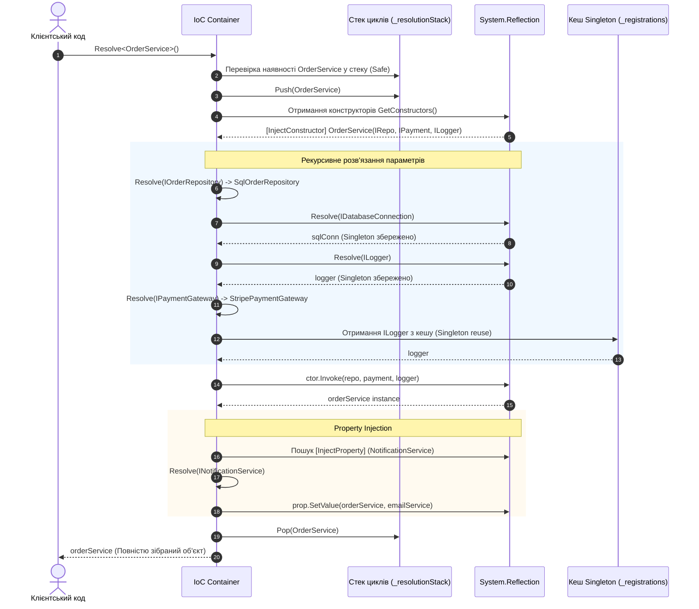

# 06. Фінальний проєкт: Власний IoC/DI Контейнер (IoC Container Deep Dive)

Цей проєкт є вершиною навчального модуля. Він об'єднує всі вивчені аспекти рефлексії: дослідження типів, аналіз конструкторів і параметрів, роботу з атрибутами, пізнє зв'язування та захист від небезпечних станів рантайму.

---

## 🎯 Архітектурні вимоги до власного IoC-контейнера

1. **Керування життєвими циклами (Lifetimes)**:
   - **`Transient`**: Створення нового екземпляра при кожному запиті розв'язання.
   - **`Singleton`**: Створення єдиного екземпляра при першому запиті та подальше повернення з потокобезпечного кешу.
2. **Інтелектуальне розв'язання конструкторів (Constructor Resolution)**:
   - Підтримка класів з кількома конструкторами.
   - Пріоритетний вибір конструктора, поміченого атрибутом `[InjectConstructor]`.
   - Жадібний алгоритм (Greedy selection): вибір конструктора з найбільшою кількістю параметрів, які контейнер може розв'язати.
   - Підтримка опціональних параметрів (`param.HasDefaultValue`).
3. **Ін'єкція залежностей у властивості (Property Injection)**:
   - Автоматичне заповнення публічних властивостей, помічених атрибутом `[InjectProperty]`.
4. **Захист від циклічних залежностей (Circular Dependency Detection)**:
   - Відстеження поточного стека розв'язання (`Stack<Type>`).
   - Якщо клас $A$ вимагає $B$, а $B$ вимагає $A$, контейнер негайно викидає інформативний `CircularDependencyException` із ланцюжком залежностей, запобігаючи фатальному переповненню стека (`StackOverflowException`).
5. **Наочна діагностика графу (Visual Tree Logging)**:
   - Друк ієрархічного дерева створення об'єктів у консолі в реальному часі.

---

## 🏛️ Схема послідовності створення графу залежностей



---

## 📋 Таблиця компонентів контейнера та посилання на код

| Компонент / Метод | Опис і відповідальність | Посилання на код |
| :--- | :--- | :---: |
| `ServiceLifetime` | Перерахування життєвих циклів: `Transient` та `Singleton` | [](../DependencyInjection/Container.cs#L8-L23) |
| `[InjectConstructor]` | Атрибут для явного вибору цільового конструктора серед кількох перевантажень | [](../DependencyInjection/Container.cs#L25-L30) |
| `[InjectProperty]` | Атрибут для автоматичного заповнення властивостей залежностями | [](../DependencyInjection/Container.cs#L32-L37) |
| `CircularDependencyException` | Кастомний виняток із детальним ланцюжком циклу | [](../DependencyInjection/Container.cs#L39-L46) |
| `RegisterSingleton<T, TImpl>()` | Реєстрація сервісу з єдиним екземпляром на додаток | [](../DependencyInjection/Container.cs#L95-L105) |
| `RegisterTransient<T, TImpl>()` | Реєстрація сервісу, що інстанціюється щоразу заново | [](../DependencyInjection/Container.cs#L85-L94) |
| `Resolve(Type serviceType)` | Головна точка входу для вирішення графу залежностей | [](../DependencyInjection/Container.cs#L145-L215) |
| `CreateInstanceViaReflection` | Вибір конструктора, аналіз параметрів, створення через `Invoke` | [](../DependencyInjection/Container.cs#L220-L260) |
| `InjectAnnotatedProperties` | Сканування властивостей об'єкта та заповнення залежностями | [](../DependencyInjection/Container.cs#L262-L274) |

---

## 🛡️ Механізм виявлення циклічних залежностей

У реальних проєктах помилка конфігурації залежностей може призвести до нескінченної взаємної рекурсії:
$$\text{ServiceA} \longrightarrow \text{ServiceB} \longrightarrow \text{ServiceC} \longrightarrow \text{ServiceA}$$

У нашому контейнері ця проблема вирішується стеком поточного шляху `Stack<Type> _resolutionStack`:

```csharp
// Перевірка на циклічну залежність перед поглибленням у дерево
if (_resolutionStack.Contains(serviceType))
{
    var cycleList = _resolutionStack.Reverse().Concat(new[] { serviceType }).Select(t => t.Name);
    string chain = string.Join(" ──> ", cycleList);
    throw new CircularDependencyException($"Виявлено циклічну залежність! Ланцюжок: {chain}");
}
```

🔗 Переглянути демонстрацію перехоплення циклу можна в [DependencyInjection/Program.cs](../DependencyInjection/Program.cs#L52-L71).

---

## 🚀 Як запустити проєкт IoC-контейнера

```powershell
dotnet run --project "06-Advanced-DotNet/02-Reflection-And-Metadata/DependencyInjection/RealTime-DependencyInjection.csproj" -c Release
```
