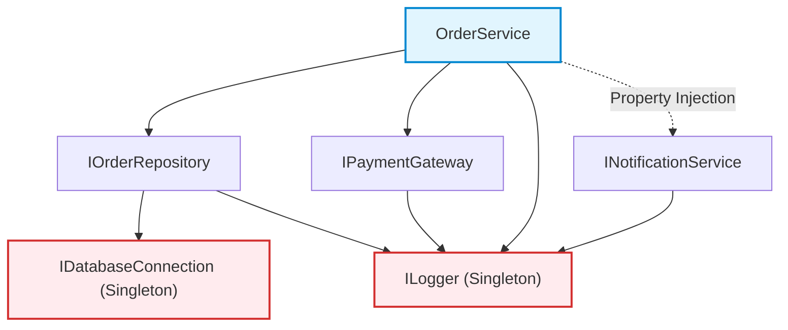
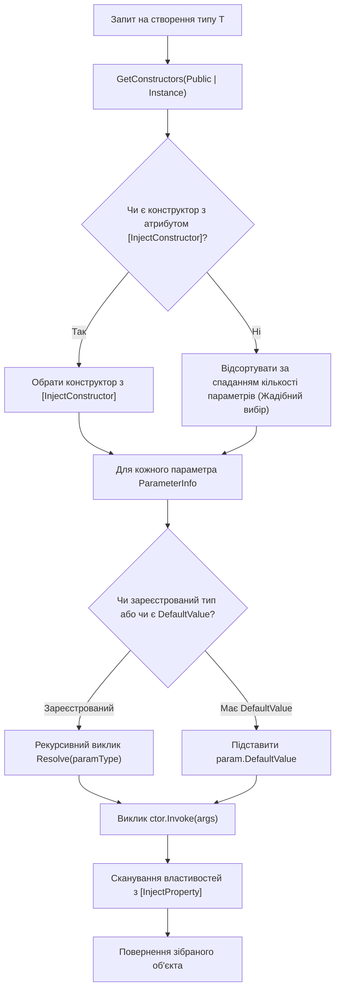

# 06. Фінальний проєкт: Власний IoC/DI Контейнер (IoC Container Deep Dive & Architecture)

Цей проєкт є вершиною навчального модуля. Він демонструє, як на базі рефлексії створюються індустріальні фреймворки на кшталт **`Microsoft.Extensions.DependencyInjection`**, **Autofac** або **Castle Windsor**.

---

## 🏛️ 1. Теоретичний фундамент: IoC, DIP та Hollywood Principle

1. **Принцип інверсії залежностей (Dependency Inversion Principle - DIP із SOLID)**:
   - Модулі верхніх рівнів не повинні залежати від модулів нижніх рівнів. Обидва типи мають залежати від абстракцій (інтерфейсів).
   - Абстракції не повинні залежати від деталей. Деталі мають залежати від абстракцій.
2. **Інверсія керування (Inversion of Control - IoC)**:
   - Архітектурний патерн, за якого потік виконання програми передається зовнішньому каркасу (фреймворку).
   - **Hollywood Principle**: *"Не дзвоніть нам, ми самі вам зателефонуємо"*. Замість того, щоб клас сам створював свої залежності (`new SqlDatabaseConnection()`), контейнер самостійно створює їх і передає класу ззовні.
3. **Впровадження залежностей (Dependency Injection - DI)**:
   - Конкретний механізм передачі залежностей у залежний об'єкт (через конструктор, властивості або методи).

---

## 📐 2. Математична модель: Орієнтований ациклічний граф (DAG)

Процес розв'язання залежностей у DI-контейнері — це побудова та топологічний обхід **орієнтованого ациклічного графу (Directed Acyclic Graph - DAG)**:
- **Вершини графу ($V$)**: зареєстровані типи сервісів (`OrderService`, `IOrderRepository`, `ILogger`).
- **Орієнтовані ребра ($E$)**: конструкторні та властивісні залежності між ними ($A \to B$ означає, що $A$ вимагає $B$).



---

## 🛡️ 3. Захист від циклічних залежностей (Circular Dependency Detection)

Якщо розробник помилився і створив замкнене коло:
$$\text{ServiceA} \longrightarrow \text{ServiceB} \longrightarrow \text{ServiceC} \longrightarrow \text{ServiceA}$$

Класичний наївний рекурсивний алгоритм увійде в нескінченну рекурсію, яка завершиться аварійним падінням процесу з фатальним **`StackOverflowException`** (який неможливо перехопити через звичайний `catch`!).

### 3.1. Алгоритм відстеження через стек викликів
Наш контейнер використовує структуру даних `Stack<Type> _resolutionStack`:
1. Перед початком створення типу перевіряється: `_resolutionStack.Contains(serviceType)`.
2. Якщо тип уже присутній у стеку — це означає наявність зворотного ребра в графі (цикл!).
3. Викидається спеціалізований `CircularDependencyException` із відтвореним ланцюжком циклу:

```csharp
if (_resolutionStack.Contains(serviceType))
{
    var cycleList = _resolutionStack.Reverse().Concat(new[] { serviceType }).Select(t => t.Name);
    string chain = string.Join(" ──> ", cycleList);
    throw new CircularDependencyException($"Виявлено циклічну залежність! Ланцюжок: {chain}");
}
```

🔗 Переглянути обробку циклів можна в [16-DependencyInjection/Container.cs](../16-DependencyInjection/Container.cs#L145-L165).

---

## ⚙️ 4. Алгоритм розв'язання конструкторів (Constructor Resolution Engine)

Як контейнер обирає, який саме конструктор викликати, якщо їх у класі декілька:



🔗 Переглянути код рефлексивного рушія створення можна в [16-DependencyInjection/Container.cs](../16-DependencyInjection/Container.cs#L220-L270).

---

## ⏳ 5. Керування життєвими циклами (Lifetimes)

| Життєвий цикл | Поведінка в пам'яті | Збереження посилання | Коли використовувати |
| :--- | :--- | :--- | :--- |
| **`Transient`** | Новий об'єкт створюється при **кожному** виклику `Resolve<T>()`. | Контейнер не утримує посилання. Об'єкт видаляється збирачем сміття (GC) одразу після виходу з області видимості. | Легкі сервіси без стану (Stateless services), репозиторії, платіжні операції. |
| **`Singleton`** | Єдиний екземпляр створюється під час **першого** звернення, кешується в `ServiceDescriptor` і повертається для всіх наступних запитів. | Об'єкт живе протягом усього часу роботи контейнера (Rooted reference). | Логери, пули з'єднань з БД, конфігурації, кеші. |

🔗 Переглянути верифікацію рівності посилань (`ReferenceEquals`) можна в [16-DependencyInjection/Program.cs](../16-DependencyInjection/Program.cs#L36-L47).

---

## 📋 6. Повний довідник компонентів DI-контейнера

| Клас / Метод | Призначення | Посилання на код |
| :--- | :--- | :---: |
| `Container` | Головний клас IoC-контейнера, який керує реєстраціями та графом залежностей. | [](../16-DependencyInjection/Container.cs#L80-L140) |
| `ServiceLifetime` | Перерахування життєвих циклів: `Transient` та `Singleton`. | [](../16-DependencyInjection/Container.cs#L8-L23) |
| `[InjectConstructor]` | Атрибут для явного вибору цільового конструктора при наявності кількох перевантажень. | [](../16-DependencyInjection/Container.cs#L25-L30) |
| `[InjectProperty]` | Атрибут для автоматичного заповнення властивостей залежностями (Property Injection). | [](../16-DependencyInjection/Container.cs#L32-L37) |
| `CircularDependencyException` | Спеціалізований виняток із детальним відображенням циклічного ланцюжка. | [](../16-DependencyInjection/Container.cs#L39-L46) |
| `RegisterSingleton<T, TImpl>()` | Реєстрація сервісу з єдиним спільним екземпляром на весь додаток. | [](../16-DependencyInjection/Container.cs#L95-L105) |
| `RegisterTransient<T, TImpl>()` | Реєстрація сервісу, що інстанціюється наново для кожного клієнта. | [](../16-DependencyInjection/Container.cs#L85-L94) |
| `RegisterInstance<T>(instance)` | Реєстрація вже створеного Singleton-об'єкта. | [](../16-DependencyInjection/Container.cs#L110-L120) |
| `RegisterFactory<T>(Func)` | Реєстрація фабричного лямбда-делегата для створення об'єкта. | [](../16-DependencyInjection/Container.cs#L122-L132) |
| `Resolve(serviceType)` | Рекурсивний обхід графу, створення об'єктів та ін'єкція властивостей. | [](../16-DependencyInjection/Container.cs#L145-L215) |

---

## 🚀 Як запустити фінальний проєкт

```powershell
dotnet run --project "06-Advanced-DotNet/02-Reflection-And-Metadata/16-DependencyInjection/16-DependencyInjection.csproj" -c Release
```
