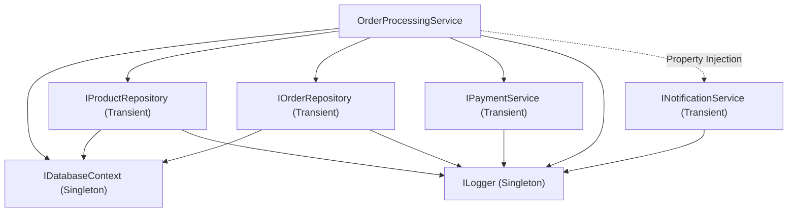
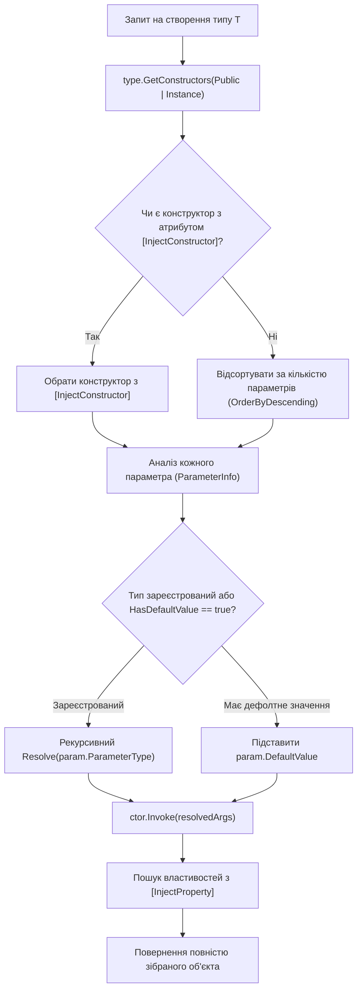

# 06. Фінальний проєкт: Власний IoC/DI Контейнер (IoC Container Deep Dive & Architecture)

Цей проєкт є вершиною навчального модуля. Він демонструє практичне поєднання всіх вивчених концепцій рефлексії: інспекції типів, дослідження конструкторів і параметрів, аналізу атрибутів, роботи з інтерфейсами та динамічної активації об'єктів для побудови промислового Dependency Injection контейнера.

---

## 1. Понятійний апарат: Архітектурні принципи IoC та DI

### 1.1. Що таке Inversion of Control (IoC)?
**Інверсія керування (Inversion of Control — IoC)** — це архітектурний принцип проєктування програмного забезпечення, за якого традиційний потік керування змінюється на протилежний: замість того, щоб користувацький код самостійно створював залежні компоненти та викликав бібліотечні функції, зовнішній каркас (фреймворк) бере на себе керування життєвим циклом об'єктів і викликає користувацький код.

- **Голлівудський принцип (Hollywood Principle)**: *"Не дзвоніть нам, ми самі вам зателефонуємо"*. Клас більше не пише `new SqlDatabase()`, а пасивно очікує, поки контейнер створить і надасть йому необхідний ресурс.

### 1.2. Що таке Dependency Inversion Principle (DIP)?
**Принцип інверсії залежностей (DIP)** — це літера "D" у принципах SOLID:
1. Модулі високих рівнів не повинні залежати від модулів низьких рівнів. Обидва типи мають залежати від абстракцій (інтерфейсів).
2. Абстракції не повинні залежати від деталей. Деталі повинні залежати від абстракцій.

### 1.3. Що таке Dependency Injection (DI)?
**Впровадження залежностей (Dependency Injection — DI)** — це конкретний патерн проектування, що реалізує принцип IoC. Він полягає в тому, що залежності передаються в об'єкт ззовні (найчастіше через параметри конструктора — Constructor Injection або через властивості — Property Injection), а не створюються об'єктом самостійно.

### 1.4. Що таке IoC-контейнер?
**IoC-контейнер (DI-контейнер)** — це програмний модуль (фреймворк), який автоматизує процес конструювання об'єктів. Він слугує централізованим реєстром відповідностей між абстракціями (інтерфейсами) та їхніми конкретними реалізаціями, рекурсивно розв'язує граф залежностей та керує життєвими циклами створених екземплярів.

---

## 2. Математична модель: Орієнтований ациклічний граф (DAG)

Процес розв'язання залежностей у контейнері формалізується як побудова та топологічний обхід **орієнтованого ациклічного графу (Directed Acyclic Graph — DAG)**:
- **Вершини ($V$)**: зареєстровані типи сервісів (`OrderService`, `IOrderRepository`, `ILogger`).
- **Орієнтовані ребра ($E$)**: конструкторні залежності між типами ($A \to B$ означає, що клас $A$ вимагає у своєму конструкторі тип $B$).



Граф розв'язання обов'язково повинен бути **ациклічним**. Поява будь-якого циклу робить конструювання об'єктів неможливим.

---

## 3. Захист від циклічних залежностей (Circular Dependency Detection)

Якщо розробники припустилися архітектурної помилки і створили взаємну залежність класів:
$$\text{ServiceA} \longrightarrow \text{ServiceB} \longrightarrow \text{ServiceC} \longrightarrow \text{ServiceA}$$

Наївний рекурсивний алгоритм увійде в нескінченну рекурсію. У середовищі CLR це гарантовано призведе до вичерпання пам'яті стека потоку та фатального аварійного завершення процесу з помилкою **`StackOverflowException`**, яку в .NET неможливо перехопити через блок `try-catch`!

### 3.1. Алгоритм виявлення циклів за допомогою стеку
Контейнер підтримує внутрішній контекстний стек поточного ланцюжка резолюції `Stack<Type> _resolutionStack`:
1. Перед початком створення будь-якого типу перевіряється умова: `_resolutionStack.Contains(serviceType)`.
2. Якщо тип уже є у стеку — зафіксовано наявність зворотного ребра в графі (цикл!).
3. Контейнер негайно припиняє обхід і викидає виняток `CircularDependencyException`, формуючи зрозумілий ланцюжок помилки для діагностики:

```csharp
if (_resolutionStack.Contains(serviceType))
{
    var cycleChain = _resolutionStack.Reverse().Concat(new[] { serviceType }).Select(t => t.Name);
    string formattedChain = string.Join(" -> ", cycleChain);
    throw new CircularDependencyException($"Виявлено циклічну залежність! Ланцюжок: {formattedChain}");
}
```

- Посилання на реалізацію алгоритму виявлення циклів: [19-DependencyInjection/Container/Container.cs](../19-DependencyInjection/Container/Container.cs#L85-L95).

---

## 4. Алгоритм розв'язання конструкторів (Constructor Resolution Engine)

Клас може мати декілька відкритих конструкторів. Контейнер використовує такий детермінований алгоритм вибору:



### 4.1. Етапи конструювання:
1. **Явна вказівка**: якщо присутній конструктор із міткою `[InjectConstructor]`, контейнер обирає його беззастережно.
2. **Жадібний вибір (Greedy Constructor Selection)**: якщо мітки немає, конструктори сортуються за спаданням кількості параметрів (`c.GetParameters().Length`). Контейнер намагається задовольнити конструктор із найбільшою кількістю залежностей.
3. **Параметри за замовчуванням**: якщо залежність не зареєстрована в контейнері, але параметр конструктора має значення за замовчуванням (`param.HasDefaultValue == true`), контейнер безпечно підставляє `param.DefaultValue`.
4. **Впровадження у властивості (Property Injection)**: після створення екземпляра контейнер знаходить усі відкриті властивості з атрибутом `[InjectProperty]` і викликає для них `prop.SetValue(instance, resolvedDependency)`.

- Посилання на реалізацію механізму інстанціювання: [19-DependencyInjection/Container/Container.cs](../19-DependencyInjection/Container/Container.cs#L165-L215).

---

## 5. Керування життєвими циклами (Service Lifetimes)

Контейнер підтримує дві фундаментальні моделі життєвого циклу:

| Життєвий цикл | Поведінка в пам'яті | Збереження посилання | Сценарії застосування |
| :--- | :--- | :--- | :--- |
| **`Transient`** | Новий об'єкт створюється при кожному зверненні до `Resolve<T>()`. | Посилання не зберігається контейнером. Об'єкт знищується збирачем сміття (GC), коли його перестає використовувати клієнтський код. | Легковагові сервіси та репозиторії без внутрішнього стану. |
| **`Singleton`** | Створюється рівно один екземпляр при першому зверненні. | Контейнер кешує посилання у внутрішньому потокобезпечному словнику `_registrations` на весь час життя додатка. | Контексти баз даних (`IDatabaseContext`), логери (`ILogger`), кеші. |

---

## 6. Демонстраційний запуск та візуалізація дерева розв'язання

Проєкт `19-DependencyInjection` містить повнофункціональну консольну демонстрацію інтернет-магазину зі структурованою емуляцією бази даних:

```csharp
var container = new Container();

// 1. Реєстрація компонентів
container.RegisterSingleton<ILogger, ConsoleLogger>();
container.RegisterSingleton<IDatabaseContext, InMemoryDatabaseContext>();
container.RegisterTransient<IProductRepository, ProductRepository>();
container.RegisterTransient<IOrderRepository, OrderRepository>();
container.RegisterTransient<IPaymentService, CreditCardPaymentService>();
container.RegisterTransient<INotificationService, EmailNotificationService>();
container.RegisterTransient<IOrderProcessingService, OrderProcessingService>();

// 2. Рекурсивне розв'язання зі створенням повного графа об'єктів
var orderService = container.Resolve<IOrderProcessingService>();

// 3. Виконання бізнес-операцій: списання оплати, оновлення складу, збереження в БД, надсилання сповіщення
orderService.PlaceOrder(customerId: 1, productId: 1, quantity: 2);
```

- Посилання на вихідний код контейнера: [19-DependencyInjection/Container/Container.cs](../19-DependencyInjection/Container/Container.cs).
- Посилання на контракт контейнера: [19-DependencyInjection/Container/IContainer.cs](../19-DependencyInjection/Container/IContainer.cs).
- Посилання на емуляцію бази даних: [19-DependencyInjection/Data/InMemoryDatabaseContext.cs](../19-DependencyInjection/Data/InMemoryDatabaseContext.cs).
- Посилання на бізнес-сервіс замовлень: [19-DependencyInjection/Services/Orders/OrderProcessingService.cs](../19-DependencyInjection/Services/Orders/OrderProcessingService.cs).
- Посилання на консольну демонстраційну програму: [19-DependencyInjection/Program.cs](../19-DependencyInjection/Program.cs).
