```mermaid
graph TD
    Shared["00-Shared (Спільна бібліотека Car, ICar, SportsCar)"]
    
    subgraph "1. Фундамент системи типів"
        TypeofDemo["01-TypeofDemo (typeof compile-time)"]
        GetTypeDemo["02-ObjectGetTypeDemo (obj.GetType runtime)"]
        TypeGetType["03-TypeGetTypeDemo (Type.GetType string)"]
        TypeProps["04-TypePropertiesDemo (Прапорці IsClass, IsValueType...)"]
        AssemblyDemo["05-AssemblyDemo (Assembly.GetTypes, DLL інспекція)"]
        InterfacesDemo["06-GetInterfacesDemo (GetInterfaceMap)"]
    end

    subgraph "2. Члени типу та BindingFlags"
        FieldsProps["07-GetFieldsPropertiesDemo (FieldInfo, PropertyInfo)"]
        MethodsDemo["08-GetMethodsDemo (MethodInfo, Invoke, Overloads)"]
        ParamsDemo["09-GetParameterInfoDemo (ParameterInfo, ref/out, defaults)"]
        CtorDemo["10-GetConstructorInfoDemo (ConstructorInfo)"]
    end

    subgraph "3. Динамічне виконання та Дженерики"
        LateBinding["11-LateBindingDemo (Activator.CreateInstance)"]
        GenericsDemo["12-GenericsReflectionDemo (MakeGenericType, MakeGenericMethod)"]
    end

    subgraph "4. Атрибути та Серіалізація"
        CustomAttr["13-CreateCustomAttributes (Валідація за атрибутами)"]
        XmlSer["14-SerializationDeserialization (Рефлексивний XML)"]
    end

    subgraph "5. Продуктивність та Фінал"
        PerfDemo["15-ReflectionPerformanceDemo (Invoke vs Expressions Benchmark)"]
        DI["16-DependencyInjection (Повний власний IoC/DI Контейнер)"]
    end

    Shared --> TypeofDemo
    Shared --> GetTypeDemo
    Shared --> TypeGetType
    Shared --> TypeProps
    Shared --> AssemblyDemo
    Shared --> InterfacesDemo
    Shared --> FieldsProps
    Shared --> MethodsDemo
    Shared --> ParamsDemo
    Shared --> CtorDemo
    Shared --> LateBinding
    Shared --> GenericsDemo
    Shared --> PerfDemo
    
    FieldsProps --> CustomAttr
    CustomAttr --> XmlSer
    CtorDemo --> DI
    ParamsDemo --> DI
    LateBinding --> DI
    CustomAttr --> DI
```

# Модуль 15: Рефлексія та метадані (Reflection & Metadata in .NET)

Цей навчальний модуль є повним практичним та теоретичним керівництвом з дослідження системи типів CLR, пізнього зв'язування, метаданих атрибутів, оптимізації продуктивності та створення власного повнофункціонального IoC/DI контейнера на базі рефлексії.

---

## 🧭 Навігація по навчальних матеріалах (Docs)

| Розділ | Тематика та ключові питання | Документ |
| :---: | :--- | :---: |
| **Roadmap** | **Повний навчальний план, послідовність викладу, узагальнююча таблиця тем та прикладів** | [00_Curriculum_And_Roadmap.md](Docs/00_Curriculum_And_Roadmap.md) |
| **01** | Дослідження системи типів (`Type`, `Assembly`, `MemberInfo`, 3 шляхи отримання `Type`) | [01_Type_System_And_Metadata_Inspection.md](Docs/01_Type_System_And_Metadata_Inspection.md) |
| **02** | Члени типу, параметри та бітові прапорці (`BindingFlags`, `FieldInfo`, `PropertyInfo`, `MethodInfo`, `ConstructorInfo`, `ParameterInfo`) | [02_Members_And_BindingFlags.md](Docs/02_Members_And_BindingFlags.md) |
| **03** | Пізнє зв'язування, динамічна активація та дженерики (`Activator`, `MakeGenericType`, `MakeGenericMethod`) | [03_Late_Binding_And_Generics.md](Docs/03_Late_Binding_And_Generics.md) |
| **04** | Метадані, атрибути та валідаційні рушії (`AttributeUsage`, `CustomAttributeData`, XML-серіалізація) | [04_Attributes_And_Metadata_Validation.md](Docs/04_Attributes_And_Metadata_Validation.md) |
| **05** | Продуктивність рефлексії та скомпільовані вирази (`MethodInfo.Invoke` vs `dynamic` vs `Expression Trees`) | [05_Performance_Optimization_And_Compiled_Expressions.md](Docs/05_Performance_Optimization_And_Compiled_Expressions.md) |
| **06** | **Фінальний проєкт: Власний IoC/DI Контейнер (Transient/Singleton, Injection, Circular Dependency Detection)** | [06_IoC_Container_Deep_Dive.md](Docs/06_IoC_Container_Deep_Dive.md) |

---

## 🏛️ Архітектура та структура проєктів у рішенні `OOP - Reflection.sln`

Рішення містить **17 пронумерованих проєктів**, які розташовані у чіткій логічній послідовності вивчення:



---

## 📋 Зведена таблиця проєктів у рішенні

| № | Проєкт | Призначення та ключові API | Кнопка перегляду коду |
| :-: | :--- | :--- | :---: |
| 00 | `00-Shared` | Доменні класи (`Car`, `SportsCar`, `ICar`), об'єкти для інспекції | [](00-Shared/Common/Car.cs) |
| 01 | `01-TypeofDemo` | Отримання `Type` на етапі компіляції (`typeof(T)`) | [](01-TypeofDemo/Program.cs) |
| 02 | `02-ObjectGetTypeDemo` | Отримання точного рантайм-типу через віртуальний `GetType()` | [](02-ObjectGetTypeDemo/Program.cs) |
| 03 | `03-TypeGetTypeDemo` | Динамічне завантаження типу за іменем (`Type.GetType`) | [](03-TypeGetTypeDemo/Program.cs) |
| 04 | `04-TypePropertiesDemo` | Загальні характеристики: `IsClass`, `IsValueType`, `IsAbstract`, `IsSealed` | [](04-TypePropertiesDemo/Program.cs) |
| 05 | `05-AssemblyDemo` | Завантаження збірки, перелік її типів та інспекція ресурсів | [](05-AssemblyDemo/Program.cs) |
| 06 | `06-GetInterfacesDemo` | Інтерфейси типу та карта методів (`GetInterfaceMap`) | [](06-GetInterfacesDemo/Program.cs) |
| 07 | `07-GetFieldsPropertiesDemo` | Фільтрація полів (`FieldInfo`) та властивостей (`PropertyInfo`) | [](07-GetFieldsPropertiesDemo/Program.cs) |
| 08 | `08-GetMethodsDemo` | Інспекція відкритих та закритих методів (`MethodInfo`) | [](08-GetMethodsDemo/Program.cs) |
| 09 | `09-GetParameterInfoDemo` | Інспекція параметрів: типи, `ref`/`out`, значення за замовчуванням | [](09-GetParameterInfoDemo/Program.cs) |
| 10 | `10-GetConstructorInfoDemo` | Аналіз конструкторів (`ConstructorInfo`), створення об'єктів | [](10-GetConstructorInfoDemo/Program.cs) |
| 11 | `11-LateBindingDemo` | Створення об'єкта (`Activator.CreateInstance`) та динамічний виклик | [](11-LateBindingDemo/Program.cs) |
| 12 | `12-GenericsReflectionDemo` | **[НОВИЙ]** Рефлексія дженериків: `MakeGenericType`, `MakeGenericMethod` | [](12-GenericsReflectionDemo/Program.cs) |
| 13 | `13-CreateCustomAttributes` | Створення атрибутів (`[MinValue]`, `[Required]`) та універсальний валідатор | [](13-CreateCustomAttributes/Program.cs) |
| 14 | `14-SerializationDeserialization` | Рефлексивний XML-серіалізатор довільних C# об'єктів | [](14-SerializationDeserialization/Program.cs) |
| 15 | `15-ReflectionPerformanceDemo` | **[НОВИЙ]** Бенчмарк: `Invoke` vs `dynamic` vs `Expression Trees` | [](15-ReflectionPerformanceDemo/Program.cs) |
| 16 | `16-DependencyInjection` | **[ФІНАЛЬНИЙ] Повнофункціональний IoC-контейнер з життєвими циклами та захистом від циклів** | [](16-DependencyInjection/Program.cs) |

---

## 🛠️ Як зібрати та запустити

```powershell
# 1. Повна збірка всього рішення
dotnet build "06-Advanced-DotNet/02-Reflection-And-Metadata/OOP - Reflection.sln" -c Release

# 2. Запуск фінального IoC-контейнера
dotnet run --project "06-Advanced-DotNet/02-Reflection-And-Metadata/16-DependencyInjection/16-DependencyInjection.csproj" -c Release

# 3. Запуск тесту продуктивності рефлексії
dotnet run --project "06-Advanced-DotNet/02-Reflection-And-Metadata/15-ReflectionPerformanceDemo/15-ReflectionPerformanceDemo.csproj" -c Release

# 4. Запуск демонстрації дженериків у рефлексії
dotnet run --project "06-Advanced-DotNet/02-Reflection-And-Metadata/12-GenericsReflectionDemo/12-GenericsReflectionDemo.csproj" -c Release
```
