# Модуль 15: Рефлексія та метадані (Reflection & Metadata in .NET)

Цей навчальний модуль є повним практичним та теоретичним керівництвом з дослідження системи типів CLR, пізнього зв'язування, метаданих атрибутів, оптимізації продуктивності та створення власного повнофункціонального IoC/DI контейнера на базі рефлексії.

---

## 🧭 Навігація по навчальних матеріалах (Docs)

| Розділ | Тематика та ключові питання | Документ |
| :---: | :--- | :---: |
| **Roadmap** | **Повний навчальний план, послідовність викладу, узагальнююча таблиця тем та прикладів** | [00_Curriculum_And_Roadmap.md](Docs/00_Curriculum_And_Roadmap.md) |
| **01** | Дослідження системи типів (`Type`, `Assembly`, `MemberInfo`, 3 шляхи отримання `Type`) | [01_Type_System_And_Metadata_Inspection.md](Docs/01_Type_System_And_Metadata_Inspection.md) |
| **02** | Члени типу, параметри та бітові прапорці (`BindingFlags`, `FieldInfo`, `PropertyInfo`, `MethodInfo`, `ConstructorInfo`, `ParameterInfo`) | [02_Members_And_BindingFlags.md](Docs/02_Members_And_BindingFlags.md) |
| **03** | Пізнє зв'язування, динамічна активація та дженерики (`Activator`, `MakeGenericType`, `MakeGenericMethod`) | [03_Late_Binding_And_Generics.md](Docs/03_Late_Binding_And_Generics.md) |
| **04** | Метадані, атрибути та валідаційні рушії (`AttributeUsage`, `CustomAttributeData`, XML-серіалізація) | [04_Attributes_And_Metadata_Validation.md](Docs/04_Attributes_And_Metadata_Validation.md) |
| **05** | Продуктивність рефлексії та скомпільовані вирази (`MethodInfo.Invoke` vs `dynamic` vs `Expression Trees`) | [05_Performance_Optimization_And_Compiled_Expressions.md](Docs/05_Performance_Optimization_And_Compiled_Expressions.md) |
| **06** | **Фінальний проєкт: Власний IoC/DI Контейнер (Transient/Singleton, Injection, Circular Dependency Detection)** | [06_IoC_Container_Deep_Dive.md](Docs/06_IoC_Container_Deep_Dive.md) |

---

## 🏛️ Архітектура та структура проектів у рішенні `OOP - Reflection.sln`

Рішення містить **17 взаємопов'язаних проектів**, згрупованих за логічними етапами навчання:

```mermaid
graph TD
    Shared["Shared (Спільна бібліотека Car, ICar, SportsCar)"]
    
    subgraph "1. Фундамент системи типів"
        TypeofDemo["TypeofDemo (typeof compile-time)"]
        GetTypeDemo["ObjectGetTypeDemo (obj.GetType runtime)"]
        TypeGetType["TypeGetTypeDemo (Type.GetType string)"]
        TypeProps["TypePropertiesDemo (Прапорці IsClass, IsValueType...)"]
        AssemblyDemo["AssemblyDemo (Assembly.GetTypes, DLL інспекція)"]
        InterfacesDemo["GetInterfacesDemo (GetInterfaceMap)"]
    end

    subgraph "2. Члени типу та BindingFlags"
        FieldsProps["GetFieldsPropertiesDemo (FieldInfo, PropertyInfo)"]
        MethodsDemo["GetMethodsDemo (MethodInfo, Invoke, Overloads)"]
        CtorDemo["GetConstractorInfoDemo (ConstructorInfo)"]
        ParamsDemo["GetParameterInfoDemo (ParameterInfo, ref/out, defaults)"]
    end

    subgraph "3. Динамічне виконання та Дженерики"
        LateBinding["LateBindingDemo (Activator.CreateInstance)"]
        GenericsDemo["GenericsReflectionDemo (MakeGenericType, MakeGenericMethod)"]
    end

    subgraph "4. Атрибути та Серіалізація"
        CustomAttr["CreateCustomAttributes (Валідація за атрибутами)"]
        XmlSer["SerializationDeserialization (Рефлексивний XML)"]
    end

    subgraph "5. Продуктивність та Фінал"
        PerfDemo["ReflectionPerformanceDemo (Invoke vs Expressions Benchmark)"]
        DI["DependencyInjection (Повний власний IoC/DI Контейнер)"]
    end

    Shared --> TypeofDemo
    Shared --> GetTypeDemo
    Shared --> TypeGetType
    Shared --> TypeProps
    Shared --> AssemblyDemo
    Shared --> InterfacesDemo
    Shared --> FieldsProps
    Shared --> MethodsDemo
    Shared --> CtorDemo
    Shared --> ParamsDemo
    Shared --> LateBinding
    Shared --> GenericsDemo
    Shared --> PerfDemo
    
    FieldsProps --> CustomAttr
    CustomAttr --> XmlSer
    CtorDemo --> DI
    ParamsDemo --> DI
    LateBinding --> DI
    CustomAttr --> DI
```



---

## 📋 Зведена таблиця проектів у рішенні

| № | Проект | Призначення та ключові API | Кнопка перегляду коду |
| :-: | :--- | :--- | :---: |
| 1 | `Shared` | Доменні класи (`Car`, `SportsCar`, `ICar`), об'єкти для інспекції | [](Shared/Common/Car.cs) |
| 2 | `TypeofDemo` | Отримання `Type` на етапі компіляції (`typeof(T)`) | [](TypeofDemo/Program.cs) |
| 3 | `ObjectGetTypeDemo` | Отримання точного рантайм-типу через віртуальний `GetType()` | [](ObjectGetTypeDemo/Program.cs) |
| 4 | `TypeGetTypeDemo` | Динамічне завантаження типу за іменем (`Type.GetType`) | [](TypeGetTypeDemo/Program.cs) |
| 5 | `TypePropertiesDemo` | Загальні характеристики: `IsClass`, `IsValueType`, `IsAbstract`, `IsSealed` | [](TypePropertiesDemo/Program.cs) |
| 6 | `AssemblyDemo` | Завантаження збірки, перелік її типів та інспекція ресурсів | [](AssemblyDemo/Program.cs) |
| 7 | `GetInterfacesDemo` | Інтерфейси типу та карта методів (`GetInterfaceMap`) | [](GetInterfacesDemo/Program.cs) |
| 8 | `GetFieldsPropertiesDemo` | Фільтрація полів (`FieldInfo`) та властивостей (`PropertyInfo`) | [](GetFieldsPropertiesDemo/Program.cs) |
| 9 | `GetMethodsDemo` | Інспекція відкритих та закритих методів (`MethodInfo`) | [](GetMethodsDemo/Program.cs) |
| 10 | `GetParameterInfoDemo` | Інспекція параметрів: типи, `ref`/`out`, значення за замовчуванням | [](GetParameterInfoDemo/Program.cs) |
| 11 | `GetConstractorInfoDemo` | Аналіз конструкторів (`ConstructorInfo`), створення об'єктів | [](GetConstractorInfoDemo/Program.cs) |
| 12 | `LateBindingDemo` | Створення об'єкта (`Activator.CreateInstance`) та динамічний виклик | [](LateBindingDemo/Program.cs) |
| 13 | `GenericsReflectionDemo` | **[НОВИЙ]** Рефлексія дженериків: `MakeGenericType`, `MakeGenericMethod` | [](GenericsReflectionDemo/Program.cs) |
| 14 | `CreateCustomAttributes` | Створення атрибутів (`[MinValue]`, `[Required]`) та універсальний валідатор | [](CreateCustomAttributes/Program.cs) |
| 15 | `SerializationDeserialization` | Рефлексивний XML-серіалізатор довільних C# об'єктів | [](SerializationDeserialization/Program.cs) |
| 16 | `ReflectionPerformanceDemo` | **[НОВИЙ]** Бенчмарк: `Invoke` vs `dynamic` vs `Expression Trees` | [](ReflectionPerformanceDemo/Program.cs) |
| 17 | `DependencyInjection` | **[ФІНАЛЬНИЙ] Повнофункціональний IoC-контейнер з життєвими циклами та захистом від циклів** | [](DependencyInjection/Program.cs) |

---

## 🛠️ Як зібрати та запустити

```powershell
# 1. Повна збірка всього рішення
dotnet build "06-Advanced-DotNet/02-Reflection-And-Metadata/OOP - Reflection.sln" -c Release

# 2. Запуск фінального IoC-контейнера
dotnet run --project "06-Advanced-DotNet/02-Reflection-And-Metadata/DependencyInjection/RealTime-DependencyInjection.csproj" -c Release

# 3. Запуск тесту продуктивності рефлексії
dotnet run --project "06-Advanced-DotNet/02-Reflection-And-Metadata/ReflectionPerformanceDemo/ReflectionPerformanceDemo.csproj" -c Release

# 4. Запуск демонстрації дженериків у рефлексії
dotnet run --project "06-Advanced-DotNet/02-Reflection-And-Metadata/GenericsReflectionDemo/GenericsReflectionDemo.csproj" -c Release
```
