# Модуль: Рефлексія та метадані (Reflection & Metadata in .NET)

Цей навчальний модуль є повним практичним і теоретичним керівництвом із дослідження системи типів CLR, пізнього зв'язування, метаданих атрибутів, оптимізації продуктивності та створення власного повнофункціонального IoC/DI контейнера на базі рефлексії.

Всі матеріали та проєкти структуровані у логічній послідовності — від базових понять метаданих до розробки складного архітектурного каркаса.

---

## 1. Навігація по теоретичних та практичних керівництвах (Docs)

| Розділ | Тематика та ключові питання | Документ |
| :---: | :--- | :--- |
| **00** | **Навчальний план, послідовність викладу, понятійний апарат і дорожня карта тем** | [Docs/00_Curriculum_And_Roadmap.md](Docs/00_Curriculum_And_Roadmap.md) |
| **01** | Дослідження системи типів (`Type`, `Assembly`, `MemberInfo`, 3 шляхи отримання `Type`) | [Docs/01_Type_System_And_Metadata_Inspection.md](Docs/01_Type_System_And_Metadata_Inspection.md) |
| **02** | Члени типу, параметри та бітові прапорці (`BindingFlags`, `FieldInfo`, `PropertyInfo`, `MethodInfo`, `ConstructorInfo`, `ParameterInfo`) | [Docs/02_Members_And_BindingFlags.md](Docs/02_Members_And_BindingFlags.md) |
| **03** | Пізнє зв'язування, динамічна активація та дженерики (`Activator`, `MakeGenericType`, `MakeGenericMethod`) | [Docs/03_Late_Binding_And_Generics.md](Docs/03_Late_Binding_And_Generics.md) |
| **04** | Метадані, атрибути та валідаційні рушії (`AttributeUsage`, `CustomAttributeData`, XML-серіалізація) | [Docs/04_Attributes_And_Metadata_Validation.md](Docs/04_Attributes_And_Metadata_Validation.md) |
| **05** | Продуктивність рефлексії та скомпільовані вирази (`MethodInfo.Invoke` vs `dynamic` vs `Expression Trees`) | [Docs/05_Performance_Optimization_And_Compiled_Expressions.md](Docs/05_Performance_Optimization_And_Compiled_Expressions.md) |
| **06** | **Фінальний проєкт: Власний IoC/DI Контейнер (Transient/Singleton, Injection, Circular Dependency Detection)** | [Docs/06_IoC_Container_Deep_Dive.md](Docs/06_IoC_Container_Deep_Dive.md) |

---

## 2. Архітектура та послідовність проєктів у рішенні `OOP - Reflection.sln`

Рішення містить **17 пронумерованих проєктів**, розташованих у строгій дидактичній послідовності вивчення:

```mermaid
graph TD
    Shared["00-Shared (Спільна бібліотека Car, ICar, SportsCar)"]
    
    subgraph "1. Фундамент системи типів"
        TypeofDemo["01-TypeofDemo (typeof compile-time)"]
        GetTypeDemo["02-ObjectGetTypeDemo (obj.GetType runtime)"]
        TypeGetType["03-TypeGetTypeDemo (Type.GetType string)"]
        TypeProps["04-TypePropertiesDemo (Прапорці IsClass, IsValueType...)"]
        AssemblyDemo["05-AssemblyDemo (Assembly.GetTypes, DLL інспекція)"]
        InterfacesDemo["06-GetInterfacesDemo (GetInterfaceMap)"]
    end

    subgraph "2. Члени типу та BindingFlags"
        FieldsProps["07-GetFieldsPropertiesDemo (FieldInfo, PropertyInfo)"]
        MethodsDemo["08-GetMethodsDemo (MethodInfo, Invoke, Overloads)"]
        ParamsDemo["09-GetParameterInfoDemo (ParameterInfo, ref/out, defaults)"]
        CtorDemo["10-GetConstructorInfoDemo (ConstructorInfo)"]
    end

    subgraph "3. Динамічне виконання та Дженерики"
        LateBinding["11-LateBindingDemo (Activator.CreateInstance)"]
        GenericsDemo["12-GenericsReflectionDemo (MakeGenericType, MakeGenericMethod)"]
    end

    subgraph "4. Атрибути та Серіалізація"
        CustomAttr["13-CreateCustomAttributes (Валідація за атрибутами)"]
        XmlSer["14-SerializationDeserialization (Рефлексивний XML)"]
    end

    subgraph "5. Продуктивність та Фінал"
        PerfDemo["15-ReflectionPerformanceDemo (Invoke vs Expressions Benchmark)"]
        DI["16-DependencyInjection (Повний власний IoC/DI Контейнер)"]
    end

    Shared --> TypeofDemo
    Shared --> GetTypeDemo
    Shared --> TypeGetType
    Shared --> TypeProps
    Shared --> AssemblyDemo
    Shared --> InterfacesDemo
    Shared --> FieldsProps
    Shared --> MethodsDemo
    Shared --> ParamsDemo
    Shared --> CtorDemo
    Shared --> LateBinding
    Shared --> GenericsDemo
    Shared --> PerfDemo
    
    FieldsProps --> CustomAttr
    CustomAttr --> XmlSer
    CtorDemo --> DI
    ParamsDemo --> DI
    LateBinding --> DI
    CustomAttr --> DI
```

---

## 3. Зведена таблиця проєктів у рішенні

| № | Назва проєкту | Призначення та ключові API | Посилання на вихідний код |
| :-: | :--- | :--- | :--- |
| 00 | `00-Shared` | Доменні класи (`Car`, `SportsCar`, `ICar`), об'єкти для інспекції | [00-Shared/Common/Car.cs](00-Shared/Common/Car.cs) |
| 01 | `01-TypeofDemo` | Отримання `Type` на етапі компіляції (`typeof(T)`) | [01-TypeofDemo/Program.cs](01-TypeofDemo/Program.cs) |
| 02 | `02-ObjectGetTypeDemo` | Отримання точного рантайм-типу через невіртуальний `GetType()` | [02-ObjectGetTypeDemo/Program.cs](02-ObjectGetTypeDemo/Program.cs) |
| 03 | `03-TypeGetTypeDemo` | Динамічне завантаження типу за текстовим ім'ям (`Type.GetType`) | [03-TypeGetTypeDemo/Program.cs](03-TypeGetTypeDemo/Program.cs) |
| 04 | `04-TypePropertiesDemo` | Загальні характеристики: `IsClass`, `IsValueType`, `IsAbstract`, `IsSealed` | [04-TypePropertiesDemo/Program.cs](04-TypePropertiesDemo/Program.cs) |
| 05 | `05-AssemblyDemo` | Завантаження збірки, перелік її типів та інспекція ресурсів | [05-AssemblyDemo/Program.cs](05-AssemblyDemo/Program.cs) |
| 06 | `06-GetInterfacesDemo` | Інтерфейси типу та карта реалізації методів (`GetInterfaceMap`) | [06-GetInterfacesDemo/Program.cs](06-GetInterfacesDemo/Program.cs) |
| 07 | `07-GetFieldsPropertiesDemo` | Фільтрація полів (`FieldInfo`) та властивостей (`PropertyInfo`) | [07-GetFieldsPropertiesDemo/Program.cs](07-GetFieldsPropertiesDemo/Program.cs) |
| 08 | `08-GetMethodsDemo` | Інспекція відкритих та закритих методів (`MethodInfo`, `Invoke`) | [08-GetMethodsDemo/Program.cs](08-GetMethodsDemo/Program.cs) |
| 09 | `09-GetParameterInfoDemo` | Інспекція параметрів: типи, `ref`/`out`, значення за замовчуванням | [09-GetParameterInfoDemo/Program.cs](09-GetParameterInfoDemo/Program.cs) |
| 10 | `10-GetConstructorInfoDemo` | Аналіз конструкторів (`ConstructorInfo`), створення об'єктів | [10-GetConstructorInfoDemo/Program.cs](10-GetConstructorInfoDemo/Program.cs) |
| 11 | `11-LateBindingDemo` | Створення об'єкта (`Activator.CreateInstance`) та динамічний виклик | [11-LateBindingDemo/Program.cs](11-LateBindingDemo/Program.cs) |
| 12 | `12-GenericsReflectionDemo` | Рефлексія дженериків: `MakeGenericType`, `MakeGenericMethod` | [12-GenericsReflectionDemo/Program.cs](12-GenericsReflectionDemo/Program.cs) |
| 13 | `13-CreateCustomAttributes` | Створення користувацьких атрибутів та декларативна валідація | [13-CreateCustomAttributes/Program.cs](13-CreateCustomAttributes/Program.cs) |
| 14 | `14-SerializationDeserialization` | Рефлексивний XML-серіалізатор і десеріалізатор | [14-SerializationDeserialization/Program.cs](14-SerializationDeserialization/Program.cs) |
| 15 | `15-ReflectionPerformanceDemo` | Бенчмарк швидкодії: Direct Call vs Delegates vs Expression Trees vs Invoke | [15-ReflectionPerformanceDemo/Program.cs](15-ReflectionPerformanceDemo/Program.cs) |
| 16 | `16-DependencyInjection` | **Фінальний проєкт**: повноцінний рефлексивний IoC/DI контейнер | [16-DependencyInjection/Program.cs](16-DependencyInjection/Program.cs) |

---

## 4. Як відкрити та запустити в Visual Studio

1. Відкрийте файл рішення `OOP - Reflection.sln` у Visual Studio (2022 або новішій).
2. У вікні **Solution Explorer** ви побачите:
   - Папку **`Docs`** з усіма інтерактивними теоретичними markdown-файлами.
   - Пронумеровані проєкти від `00-Shared` до `16-DependencyInjection`.
3. Щоб запустити будь-який приклад, натисніть правою кнопкою миші на відповідний проєкт і виберіть **Set as Startup Project** (або призначте активним у випадаючому списку панелі інструментів), після чого натисніть `F5` або `Ctrl+F5`.
