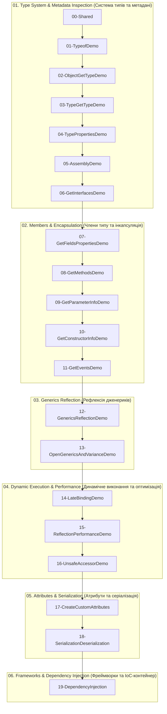

# Модуль: Рефлексія та метадані (Reflection & Metadata in .NET)

Цей навчальний модуль є повним практичним і теоретичним керівництвом із дослідження системи типів CLR, пізнього зв'язування, метаданих атрибутів, оптимізації продуктивності та створення власного повнофункціонального IoC/DI контейнера на базі рефлексії.

Всі матеріали та проєкти структуровані у логічній послідовності — від базових понять метаданих до розробки складного архітектурного каркаса.

---

## 1. Навігація по теоретичних та практичних керівництвах (Docs)

| Розділ | Тематика та ключові питання | Документ |
| :---: | :--- | :--- |
| **00** | **Навчальний план, послідовність викладу, понятійний апарат і дорожня карта тем** | [Docs/00_Curriculum_And_Roadmap.md](Docs/00_Curriculum_And_Roadmap.md) |
| **01** | Дослідження системи типів (`Type`, `Assembly`, `MemberInfo`, 3 шляхи отримання `Type`) | [Docs/01_Type_System_And_Metadata_Inspection.md](Docs/01_Type_System_And_Metadata_Inspection.md) |
| **02** | Члени типу, параметри та бітові прапорці (`BindingFlags`, `FieldInfo`, `PropertyInfo`, `MethodInfo`, `ConstructorInfo`, `ParameterInfo`) | [Docs/02_Members_And_BindingFlags.md](Docs/02_Members_And_BindingFlags.md) |
| **03** | Пізнє зв'язування, динамічна активація та дженерики (`Activator`, `MakeGenericType`, `MakeGenericMethod`) | [Docs/03_Late_Binding_And_Generics.md](Docs/03_Late_Binding_And_Generics.md) |
| **04** | Метадані, атрибути та валідаційні рушії (`AttributeUsage`, `CustomAttributeData`, XML-серіалізація) | [Docs/04_Attributes_And_Metadata_Validation.md](Docs/04_Attributes_And_Metadata_Validation.md) |
| **05** | Продуктивність рефлексії та скомпільовані вирази (`MethodInfo.Invoke` vs `dynamic` vs `Expression Trees`) | [Docs/05_Performance_Optimization_And_Compiled_Expressions.md](Docs/05_Performance_Optimization_And_Compiled_Expressions.md) |
| **06** | **Фінальний проєкт: Власний IoC/DI Контейнер (Transient/Singleton, Injection, Circular Dependency Detection)** | [Docs/06_IoC_Container_Deep_Dive.md](Docs/06_IoC_Container_Deep_Dive.md) |

---

## 2. Архітектура та структура Solution-тегів у рішенні `OOP - Reflection.sln`

Рішення містить **20 пронумерованих проєктів**, які рознесені по **6 тематичних Solution-тегах (Solution Folders)** для логічного структурування парадигм використання рефлексії:

---

## 3. Зведена таблиця проєктів у рішенні

| № | Solution-тег | Назва проєкту | Призначення та ключові API | Посилання на вихідний код |
| :-: | :--- | :--- | :--- | :--- |
| 00 | `01. Type System & Metadata Inspection` | `00-Shared` | Доменні класи (`Car`, `SportsCar`, `ICar`), об'єкти для інспекції | [00-Shared/Common/Car.cs](00-Shared/Common/Car.cs) |
| 01 | `01. Type System & Metadata Inspection` | `01-TypeofDemo` | Отримання `Type` на етапі компіляції (`typeof(T)`) | [01-TypeofDemo/Program.cs](01-TypeofDemo/Program.cs) |
| 02 | `01. Type System & Metadata Inspection` | `02-ObjectGetTypeDemo` | Отримання точного рантайм-типу через невіртуальний `GetType()` | [02-ObjectGetTypeDemo/Program.cs](02-ObjectGetTypeDemo/Program.cs) |
| 03 | `01. Type System & Metadata Inspection` | `03-TypeGetTypeDemo` | Динамічне завантаження типу за текстовим ім'ям (`Type.GetType`) | [03-TypeGetTypeDemo/Program.cs](03-TypeGetTypeDemo/Program.cs) |
| 04 | `01. Type System & Metadata Inspection` | `04-TypePropertiesDemo` | Загальні характеристики: `IsClass`, `IsValueType`, `IsAbstract`, `IsSealed` | [04-TypePropertiesDemo/Program.cs](04-TypePropertiesDemo/Program.cs) |
| 05 | `01. Type System & Metadata Inspection` | `05-AssemblyDemo` | Завантаження збірки, перелік її типів та інспекція ресурсів | [05-AssemblyDemo/Program.cs](05-AssemblyDemo/Program.cs) |
| 06 | `01. Type System & Metadata Inspection` | `06-GetInterfacesDemo` | Інтерфейси типу та карта реалізації методів (`GetInterfaceMap`) | [06-GetInterfacesDemo/Program.cs](06-GetInterfacesDemo/Program.cs) |
| 07 | `02. Members & Encapsulation` | `07-GetFieldsPropertiesDemo` | Фільтрація полів (`FieldInfo`) та властивостей (`PropertyInfo`) | [07-GetFieldsPropertiesDemo/Program.cs](07-GetFieldsPropertiesDemo/Program.cs) |
| 08 | `02. Members & Encapsulation` | `08-GetMethodsDemo` | Інспекція відкритих та закритих методів (`MethodInfo`, `Invoke`) | [08-GetMethodsDemo/Program.cs](08-GetMethodsDemo/Program.cs) |
| 09 | `02. Members & Encapsulation` | `09-GetParameterInfoDemo` | Інспекція параметрів: типи, `ref`/`out`, значення за замовчуванням | [09-GetParameterInfoDemo/Program.cs](09-GetParameterInfoDemo/Program.cs) |
| 10 | `02. Members & Encapsulation` | `10-GetConstructorInfoDemo` | Аналіз конструкторів (`ConstructorInfo`), створення об'єктів | [10-GetConstructorInfoDemo/Program.cs](10-GetConstructorInfoDemo/Program.cs) |
| 11 | `02. Members & Encapsulation` | `11-GetEventsDemo` | Інспекція `EventInfo`, динамічна підписка делегатів (`AddEventHandler`) | [11-GetEventsDemo/Program.cs](11-GetEventsDemo/Program.cs) |
| 12 | `03. Generics Reflection` | `12-GenericsReflectionDemo` | Рефлексія дженериків: `MakeGenericType`, `MakeGenericMethod` | [12-GenericsReflectionDemo/Program.cs](12-GenericsReflectionDemo/Program.cs) |
| 13 | `03. Generics Reflection` | `13-OpenGenericsAndVarianceDemo` | Відкриті дженерики (`IRepository<>`), коваріантність (`out`), контраваріантність (`in`) | [13-OpenGenericsAndVarianceDemo/Program.cs](13-OpenGenericsAndVarianceDemo/Program.cs) |
| 14 | `04. Dynamic Execution & Performance` | `14-LateBindingDemo` | Створення об'єкта (`Activator.CreateInstance`, `GetUninitializedObject`) | [14-LateBindingDemo/Program.cs](14-LateBindingDemo/Program.cs) |
| 15 | `04. Dynamic Execution & Performance` | `15-ReflectionPerformanceDemo` | Бенчмарк швидкодії: Direct Call vs Delegates vs Expression Trees vs Invoke | [15-ReflectionPerformanceDemo/Program.cs](15-ReflectionPerformanceDemo/Program.cs) |
| 16 | `04. Dynamic Execution & Performance` | `16-UnsafeAccessorDemo` | JIT Compiler Intrinsic `[UnsafeAccessor]` (.NET 8+): доступ до private без оверхеду | [16-UnsafeAccessorDemo/Program.cs](16-UnsafeAccessorDemo/Program.cs) |
| 17 | `05. Attributes & Serialization` | `17-CreateCustomAttributes` | Створення користувацьких атрибутів та декларативна валідація | [17-CreateCustomAttributes/Program.cs](17-CreateCustomAttributes/Program.cs) |
| 18 | `05. Attributes & Serialization` | `18-SerializationDeserialization` | Рефлексивний XML-серіалізатор і десеріалізатор | [18-SerializationDeserialization/Program.cs](18-SerializationDeserialization/Program.cs) |
| 19 | `06. Frameworks & Dependency Injection` | `19-DependencyInjection` | **Фінальний проєкт**: повноцінний рефлексивний IoC/DI контейнер | [19-DependencyInjection/Program.cs](19-DependencyInjection/Program.cs) |

---

## 4. Як відкрити та запустити в Visual Studio

1. Відкрийте файл рішення `OOP - Reflection.sln` у Visual Studio (2022 або новішій).
2. У вікні **Solution Explorer** ви побачите:
   - Папку **`Docs`** з усіма інтерактивними теоретичними markdown-файлами.
   - Тематичні **Solution-папки** (`01. Type System & Metadata Inspection`, `02. Members & Encapsulation`, `03. Generics Reflection`, `04. Dynamic Execution & Performance`, `05. Attributes & Serialization`, `06. Frameworks & Dependency Injection`).
   - Пронумеровані проєкти від `00-Shared` до `19-DependencyInjection`.
3. Щоб запустити будь-який приклад, натисніть правою кнопкою миші на відповідний проєкт і виберіть **Set as Startup Project** (або призначте активним у випадаючому списку панелі інструментів), після чого натисніть `F5` або `Ctrl+F5`.
