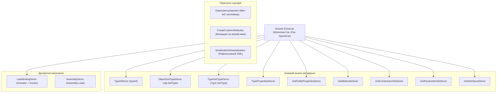

# Модуль 15: Рефлексія та метадані (Reflection & Metadata in .NET)

Цей навчальний модуль присвячений повному дослідженню механізмів рефлексії в .NET: від базового отримання метаданих типів до побудови власного IoC/DI контейнера та рушія серіалізації.

---

## 🧭 Навігація по навчальних матеріалах

1. [Дослідження системи типів та інспекція метаданих](Docs/01_Type_System_And_Metadata_Inspection.md)
2. [Пізнє зв'язування та динамічний виклик](Docs/02_Late_Binding_And_Dynamic_Invocation.md)
3. [Рефлексія на практиці: Власний DI-контейнер та серіалізація](Docs/03_Reflection_In_Practice_DI_And_Serialization.md)

---

## 🏛️ Архітектура та структура проектів у рішенні

Рішення `OOP - Reflection.sln` містить 15 взаємопов'язаних проектів, які демонструють кожен аспект роботи з `System.Reflection`:



### Детальний опис проектів:

| Проект | Призначення та ключові API |
| :--- | :--- |
| `Shared` | Доменні класи (`Car`, `SportsCar`, `ICar`), що використовуються іншими проектами як об'єкти інспекції. |
| `TypeofDemo` | Отримання `Type` на етапі компіляції через оператор `typeof`. |
| `ObjectGetTypeDemo` | Отримання точного рантайм-типу через віртуальний метод `object.GetType()`. |
| `TypeGetTypeDemo` | Динамічне завантаження типу за повним рядковим кваліфікованим ім'ям (`Type.GetType`). |
| `TypePropertiesDemo` | Загальні характеристики типу: `IsClass`, `IsValueType`, `IsAbstract`, `IsSealed`. |
| `GetFieldsPropertiesDemo` | Отримання та фільтрація полів (`FieldInfo`) та властивостей (`PropertyInfo`). |
| `GetMethodsDemo` | Інспекція відкритих та закритих методів (`MethodInfo`). |
| `GetConstractorInfoDemo` | Аналіз сигнатур конструкторів класу (`ConstructorInfo`). |
| `GetParameterInfoDemo` | Отримання інформації про параметри методів: типи, модифікатори `ref`/`out`, значення за замовчуванням. |
| `GetInterfacesDemo` | Перевірка реалізованих інтерфейсів (`Type.GetInterfaces()`). |
| `LateBindingDemo` | Створення об'єкта в runtime (`Activator.CreateInstance`) та виклик методів (`MethodInfo.Invoke`). |
| `AssemblyDemo` | Завантаження збірки, перелік усіх її типів та інспекція експортованих ресурсів. |
| `DependencyInjection` | Створення власного повноцінного міні IoC-контейнера з підтримкою авторозв'язання залежностей. |
| `CreateCustomAttributes` | Створення власного атрибута валідації `[MinValue]` та перевірка полів об'єкта рефлексією. |
| `SerializationDeserialization`| Реалізація серіалізатора довільних C# об'єктів у формат XML на базі рефлексії. |

---

## 🛠️ Як зібрати та запустити

```powershell
# Збірка всього рішення в конфігурації Release
dotnet build "06-Advanced-DotNet/02-Reflection-And-Metadata/OOP - Reflection.sln" -c Release

# Запуск прикладу Dependency Injection
dotnet run --project "06-Advanced-DotNet/02-Reflection-And-Metadata/DependencyInjection/RealTime-DependencyInjection.csproj"
```
