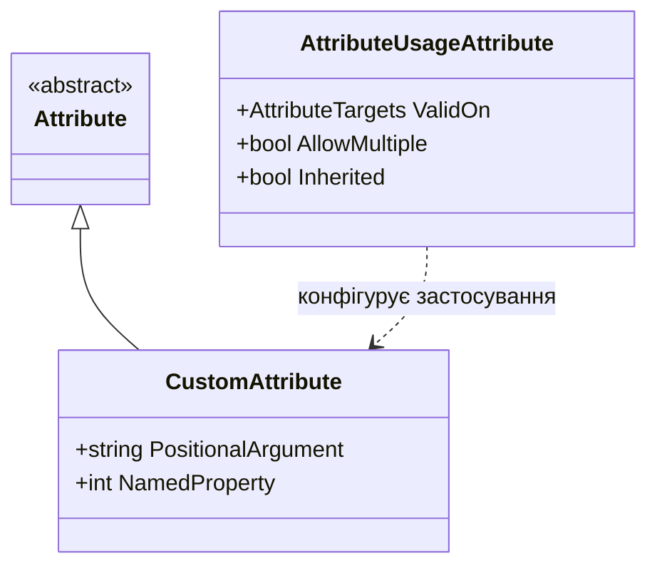

# Основи створення користувацьких атрибутів (Custom Attributes)

**Атрибути (Attributes)** в C# — це спеціальні декларативні теги, які дозволяють додавати структуровані метадані до елементів коду (класів, методів, властивостей, полів, параметрів тощо) та зчитувати їх під час виконання за допомогою рефлексії або під час компіляції (Source Generators, розаналізатори).

---

## 1. Створення власного класу атрибута

Будь-який користувацький атрибут є звичайним класом, який успадковується від базового класу `System.Attribute`:

```csharp
[AttributeUsage(AttributeTargets.Class | AttributeTargets.Struct, AllowMultiple = false, Inherited = true)]
public sealed class AuthorAttribute : Attribute
{
    // Позиційний параметр (обов'язковий)
    public string Name { get; }
    
    // Іменований параметр (опціональний)
    public int Version { get; set; } = 1;

    public AuthorAttribute(string name)
    {
        Name = name;
    }
}
```

> [!NOTE]
> За конвенцією іменування .NET назва класу атрибута завжди повинна закінчуватися суфіксом `Attribute` (наприклад, `AuthorAttribute`). Під час використання в коді суфікс можна опускати: `[Author("Юрій")]`.

---

## 2. Атрибут `[AttributeUsage]`

Клас `AttributeUsageAttribute` задає правила застосування атрибута:
- **`AttributeTargets`**: бітова маска, що визначає цільові елементи:
  - `AttributeTargets.Class`
  - `AttributeTargets.Method`
  - `AttributeTargets.Property`
  - `AttributeTargets.Parameter`
  - `AttributeTargets.All`
- **`AllowMultiple`**: `bool` — чи дозволено застосовувати атрибут кілька разів до одного й того самого елемента.
- **`Inherited`**: `bool` — чи успадковується атрибут похідними класами та перевизначеними методами.



---

## 3. Позиційні та іменовані параметри

- **Позиційні параметри** передаються через параметри конструктора атрибута:
  ```csharp
  public CustomAttribute(string description) { ... }
  ```
- **Іменовані параметри** відповідають публічним нестатичним властивостям або полям атрибута:
  ```csharp
  [Custom("Опис функціоналу", Priority = 5, IsActive = true)]
  public void ProcessOrder() { ... }
  ```
