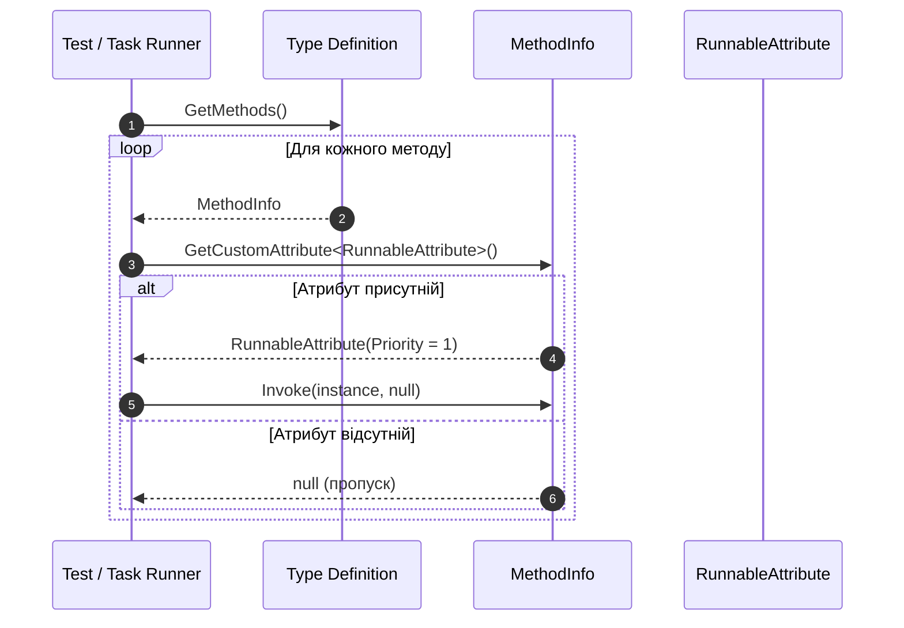

# Зчитування та обробка метаданих атрибутів у Runtime (Attribute Inspection)

Після декорування коду атрибутами їх можна аналізувати під час виконання програми за допомогою методів рефлексії: `System.Type`, `System.Reflection.MemberInfo` та `System.Attribute`.

---

## 1. Методи пошуку та отримання атрибутів

### 1.1. `Attribute.IsDefined` / `MemberInfo.IsDefined`
Швидка перевірка наявності атрибута без створення його екземпляра:
```csharp
MemberInfo member = typeof(Employee).GetMethod("PrintDetails")!;
bool isAudited = Attribute.IsDefined(member, typeof(MethodInfoAttribute));
```

### 1.2. `MemberInfo.GetCustomAttribute<T>()`
Отримання одиничного екземпляра атрибута (найчастіше використовуваний у сучасному .NET):
```csharp
var methodAttr = member.GetCustomAttribute<MethodInfoAttribute>();
if (methodAttr != null)
{
    Console.WriteLine($"Метод: {member.Name}, Опис: {methodAttr.Description}");
}
```

### 1.3. `MemberInfo.GetCustomAttributes<T>()`
Отримання колекції атрибутів, якщо атрибут підтримує `AllowMultiple = true`:
```csharp
IEnumerable<RoleAttribute> roles = typeof(AdminController).GetCustomAttributes<RoleAttribute>();
foreach (var role in roles)
{
    Console.WriteLine($"Дозволена роль: {role.RoleName}");
}
```

---

## 2. Практичний патерн: Маркування методів для динамічного виклику

Атрибути дозволяють створити механізм декларативного запуску тестових методів або обробників подій:



### Приклад коду:
```csharp
public class TestRunner
{
    public static void RunTests(object testClassInstance)
    {
        Type type = testClassInstance.GetType();
        foreach (MethodInfo method in type.GetMethods())
        {
            var attr = method.GetCustomAttribute<TestMethodAttribute>();
            if (attr != null)
            {
                Console.WriteLine($"[RUN] Виконується тест: {method.Name} (Опис: {attr.Description})");
                method.Invoke(testClassInstance, null);
            }
        }
    }
}
```
