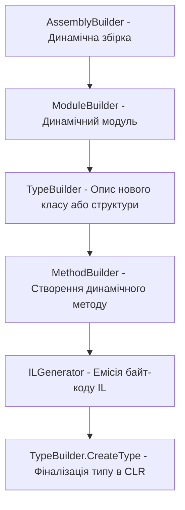

# Генерація проміжного коду та Reflection.Emit (IL Generation)

**`System.Reflection.Emit`** — це розширений простір імен .NET, що дозволяє динамічно генерувати метадані, типи, методи та байти проміжного коду (IL — Intermediate Language) під час виконання програми.

---

## 1. Навіщо потрібен Reflection.Emit?

1. **Максимальна продуктивність динамічного коду:** Згенерований IL JIT-компілюється у машинний код і виконується зі швидкістю нативного C# коду, на відміну від повільного `MethodInfo.Invoke`.
2. **Динамічні проксі-об'єкти:** Створення AOP-перехоплювачів (Castle DynamicProxy, Moq).
3. **Високошвидкісні серіалізатори:** Створення спеціалізованих десеріалізаторів під час старту програми (Dapper, MessagePack, Protobuf-net).

---

## 2. Структура динамічного створення типів



---

## 3. Приклад динамічного методу через `DynamicMethod`

Якщо не потрібно генерувати цілий клас, а лише один метод (делегат), використовується `DynamicMethod`:

```csharp
using System.Reflection.Emit;

// Створюємо динамічний метод: (int a, int b) -> int
DynamicMethod addMethod = new DynamicMethod(
    name: "AddNumbers",
    returnType: typeof(int),
    parameterTypes: new[] { typeof(int), typeof(int) },
    m: typeof(Program).Module);

ILGenerator il = addMethod.GetILGenerator();

// Завантажуємо перший аргумент у стек обчислень (arg0)
il.Emit(OpCodes.Ldarg_0);

// Завантажуємо другий аргумент у стек обчислень (arg1)
il.Emit(OpCodes.Ldarg_1);

// Додаємо два значення у верхівці стека
il.Emit(OpCodes.Add);

// Повертаємо результат
il.Emit(OpCodes.Ret);

// Створюємо типізований делегат для надшвидкого виклику
Func<int, int, int> addDelegate = (Func<int, int, int>)addMethod.CreateDelegate(typeof(Func<int, int, int>));

int sum = addDelegate(15, 27);
Console.WriteLine($"15 + 27 = {sum}"); // 42
```

---

## 4. Порівняння підходів у сучасному .NET

| Підхід | Плюси | Мінуси | Застосування в .NET 10 |
| :--- | :--- | :--- | :--- |
| **Reflection (`MethodInfo.Invoke`)** | Простота, не вимагає генерації байткоду | Оверхед перевірок, повільний | Рідкісні сценарії, плагіни |
| **Reflection.Emit** | Швидкість нативного виклику | Складність налагодження, заборонений в AOT | JIT/Server runtime, ORM |
| **Source Generators (Roslyn)** | Нульовий рантайм оверхед, повна AOT підтримка | Компіляція довша, типи повинні бути відомі | Сучасний .NET стандарт |
