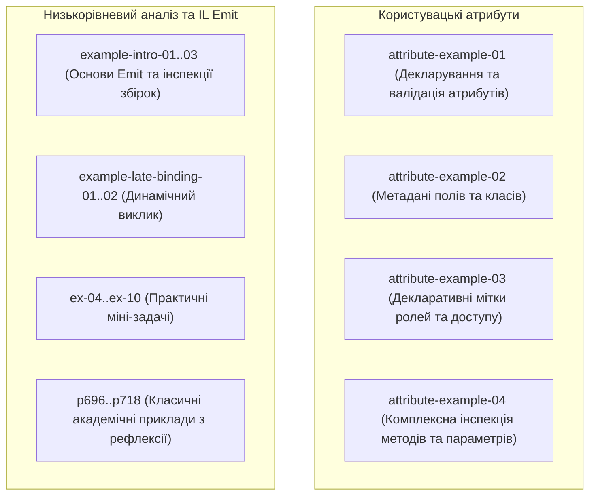

# Модуль 16: Користувацькі атрибути та Reflection.Emit (Custom Attributes & Dynamic IL)

Цей модуль занурює у створення користувацьких атрибутів, механізми їх інспекції у runtime, а також низькорівневу генерацію коду за допомогою `System.Reflection.Emit`.

---

## 🧭 Навігація по навчальних матеріалах

1. [Основи створення користувацьких атрибутів](Docs/01_Custom_Attributes_Fundamentals.md)
2. [Зчитування та обробка метаданих атрибутів у Runtime](Docs/02_Metadata_Querying_And_Runtime_Processing.md)
3. [Генерація проміжного коду та Reflection.Emit](Docs/03_IL_Generation_And_Reflection_Emit.md)

---

## 🏛️ Архітектура та структура проектів у рішенні

Рішення `OOP-Reflection-Attributes.sln` об'єднує практичні приклади проектування атрибутів, їх використання в архітектурі додатків та інспекції:



### Групи проектів:

| Група | Проекти | Опис |
| :--- | :--- | :--- |
| **Атрибути (Practical Attributes)** | `attribute-example-01` .. `attribute-example-04` | Розробка власних класів атрибутів, налаштування `AttributeUsage`, фільтрація та валідація сутностей. |
| **Інтродукція та Late Binding** | `example-intro`, `example-intro-02`, `example-intro-03`, `example-late-binding-01`, `reflection-example-late-binding-02` | Завантаження модулів, дослідження збірок, створення типів на льоту. |
| **Практичні задачі** | `ex-04` .. `ex-10` | Дослідження модифікаторів доступу, інспекція перевантажених методів, аналіз винятків. |
| **Академічні кейси** | `p696[SOLIS]` .. `p718[SOLIS]` | Структурований розбір розділів фундаментальної книги Solis C# з рефлексії та метаданих. |

---

## 🛠️ Як зібрати та запустити

```powershell
# Збірка всього рішення в конфігурації Release
dotnet build "06-Advanced-DotNet/03-Custom-Attributes/OOP-Reflection-Attributes.sln" -c Release

# Запуск демонстрації користувацьких атрибутів
dotnet run --project "06-Advanced-DotNet/03-Custom-Attributes/Attributes-Example-01/attribute-example-01.csproj"
```
