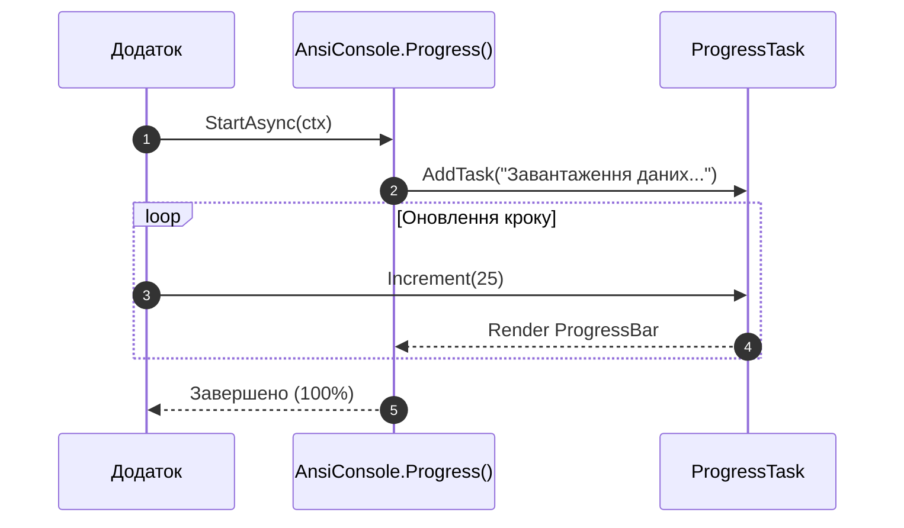

# Інтерактивні діалоги та візуальні віджети (Widgets & Prompts)

Spectre.Console пропонує набір готових компонентів для відображення даних та отримання вводу від користувача у зручній інтерактивній формі.

---

## 1. Інтерактивні діалоги (`Prompts`)

### 1.1. Текстовий запит з валідацією:
```csharp
string name = AnsiConsole.Ask<string>("Введіть ваше [green]ім'я[/]:");

int age = AnsiConsole.Prompt(
    new TextPrompt<int>("Введіть ваш [blue]вік[/]:")
        .Validate(a => a is >= 18 and <= 120
            ? ValidationResult.Success()
            : ValidationResult.Error("[red]Вік повинен бути від 18 до 120 років![/]")));
```

### 1.2. Вибір зі списку (`SelectionPrompt`):
```csharp
string fruit = AnsiConsole.Prompt(
    new SelectionPrompt<string>()
        .Title("Оберіть улюблений [green]фрукт[/]:")
        .PageSize(5)
        .AddChoices(new[] { "Яблуко", "Банан", "Апельсин", "Груша", "Манго" }));
```

### 1.3. Множинний вибір (`MultiSelectionPrompt`):
```csharp
var toppings = AnsiConsole.Prompt(
    new MultiSelectionPrompt<string>()
        .Title("Оберіть додатки до піци:")
        .NotRequired()
        .AddChoices("Сир", "Гриби", "Оливки", "Пепероні"));
```

---

## 2. Таблиці (`Table`) та Дерева (`Tree`)

### Таблиця:
```csharp
var table = new Table();
table.Border(TableBorder.Rounded);

table.AddColumn("[yellow]ID[/]");
table.AddColumn("[bold]Назва курсу[/]");
table.AddColumn(new TableColumn("[green]Тривалість[/]").RightAligned());

table.AddRow("1", "Об'єктно-орієнтоване програмування", "60 годин");
table.AddRow("2", "Шаблони проектування", "40 годин");

AnsiConsole.Write(table);
```

### Ієрархічне дерево:
```csharp
var root = new Tree("[bold blue]Проект CSharp-OOP-Mastery[/]");
var core = root.AddNode("[green]02-OOP-Core[/]");
core.AddNode("01-Inheritance");
core.AddNode("02-Interfaces-And-Polymorphism");

AnsiConsole.Write(root);
```

---

## 3. Індикатори прогресу та Live-відображення



```csharp
await AnsiConsole.Progress()
    .Columns(new ProgressColumn[]
    {
        new TaskDescriptionColumn(),
        new ProgressBarColumn(),
        new PercentageColumn(),
        new SpinnerColumn()
    })
    .StartAsync(async ctx =>
    {
        var task = ctx.AddTask("[green]Обробка файлів[/]");
        while (!ctx.IsFinished)
        {
            await Task.Delay(100);
            task.Increment(10);
        }
    });
```
