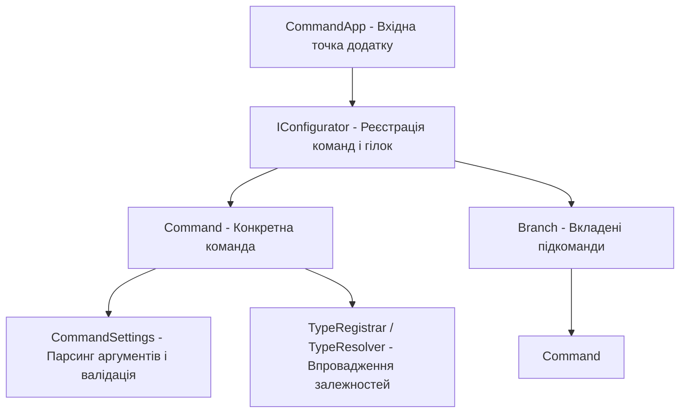

# Архітектура консольних додатків: Spectre.Console.Cli (Command App Architecture)

Пакет **`Spectre.Console.Cli`** надає потужний фреймворк для побудови складних CLI додатків зі структурованими командами, аргументами, прапорцями, автоматичною генерацією довідки (`--help`) та інтеграцією з Dependency Injection.

---

## 1. Архітектурні компоненти `Spectre.Console.Cli`



---

## 2. Створення налаштувань (`CommandSettings`)

Налаштування визначають опції командного рядка через атрибути:

```csharp
using Spectre.Console.Cli;
using System.ComponentModel;

public sealed class CopySettings : CommandSettings
{
    [CommandArgument(0, "<SOURCE>")]
    [Description("Шлях до вихідного файлу або директорії")]
    public required string Source { get; init; }

    [CommandArgument(1, "<DESTINATION>")]
    [Description("Шлях до цільового розташування")]
    public required string Destination { get; init; }

    [CommandOption("-f|--force")]
    [Description("Перезаписати існуючі файли")]
    [DefaultValue(false)]
    public bool Force { get; init; }

    public override ValidationResult Validate()
    {
        if (!File.Exists(Source) && !Directory.Exists(Source))
        {
            return ValidationResult.Error($"Вихідний шлях '{Source}' не існує.");
        }
        return ValidationResult.Success();
    }
}
```

---

## 3. Створення команди (`Command<TSettings>`)

Команда інкапсулює логіку виконання:

```csharp
public sealed class CopyCommand : Command<CopySettings>
{
    public override int Execute(CommandContext context, CopySettings settings)
    {
        AnsiConsole.MarkupLine($"Копіювання з [yellow]{settings.Source}[/] у [green]{settings.Destination}[/]...");
        // Виконання логіки...
        return 0; // Код завершення 0 = успіх
    }
}
```

---

## 4. Конфігурація та запуск у `Program.cs`

```csharp
using Spectre.Console.Cli;

var app = new CommandApp();

app.Configure(config =>
{
    config.SetApplicationName("copier");
    config.AddCommand<CopyCommand>("copy")
        .WithDescription("Копіює файли з джерела в призначення")
        .WithExample("copier", "copy", "source.txt", "dest.txt", "--force");
});

return app.Run(args);
```

---

## 5. Інтеграція з Dependency Injection

Spectre.Console.Cli легко інтегрується з `Microsoft.Extensions.DependencyInjection` шляхом реалізації інтерфейсів `ITypeRegistrar` та `ITypeResolver`, дозволяючи впроваджувати логери, сервіси та конфігурації прямо в конструктори команд.
