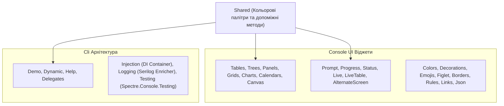

# Модуль 17: Сучасні консольні інтерфейси зі Spectre.Console (Modern CLI Development)

Цей комплексний модуль демонструє повний спектр можливостей розробки професійних консольних інтерфейсів (TUI) та CLI-утиліт за допомогою екосистеми **Spectre.Console**.

---

## 🧭 Навігація по навчальних матеріалах

1. [Основи Spectre.Console: Розмітка, Кольори та Текстові Ефекти](Docs/01_Spectre_Console_Basics_And_Markup.md)
2. [Інтерактивні діалоги та візуальні віджети](Docs/02_Interactive_Prompts_And_Widgets.md)
3. [Архітектура консольних додатків: Spectre.Console.Cli](Docs/03_CLI_Commands_And_Architecture.md)

---

## 🏛️ Архітектура та структура проектів у рішенні

Рішення `SpectreConsoleExamples.sln` містить 37 проектів, розділених на логічні категорії:



### Детальна класифікація проектів:

| Директорія | Проекти | Ключові концепції |
| :--- | :--- | :--- |
| **`Console/`** | `AlternateScreen`, `Borders`, `Calendars`, `Canvas`, `Charts`, `Colors`, `Columns`, `Cursor`, `Decorations`, `Emojis`, `Exceptions`, `Figlet`, `Grids`, `Info`, `Json`, `Layout`, `Links`, `Live`, `LiveTable`, `Minimal`, `Panels`, `Paths`, `Progress`, `Prompt`, `Rules`, `Showcase`, `Status`, `Tables`, `Trees` | Відображення розширених TUI-елементів: анімація статусів, прогрес-бари, графіки, JSON-форматування, рендеринг зображень у символи (`Canvas`), інтерактивні опитування. |
| **`Cli/`** | `Demo`, `Dynamic`, `Help`, `Delegates`, `Injection`, `Logging`, `Testing` | Побудова CLI-команд: підкоманди, валідація параметрів, налаштування довідки, впровадження залежностей (IoC), логування та модульне тестування CLI команд. |
| **`Shared/`** | `Shared` | Спільна бібліотека утиліт та палітр для демонстраційних проектів. |

---

## 🛠️ Як зібрати та запустити

```powershell
# Збірка всього рішення в конфігурації Release
dotnet build "06-Advanced-DotNet/04-CLI-Spectre-Console/SpectreConsoleExamples.sln" -c Release

# Запуск інтерактивної вітрини віджетів
dotnet run --project "06-Advanced-DotNet/04-CLI-Spectre-Console/Console/Showcase/Showcase.csproj"

# Запуск прикладу CLI-команд
dotnet run --project "06-Advanced-DotNet/04-CLI-Spectre-Console/Cli/Demo/Demo.csproj" -- --help
```
