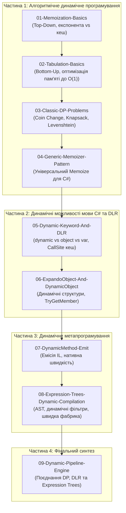

# Навчальний план та дорожня карта: Динамічне програмування та динамічні можливості C# (Dynamic Programming & DLR in .NET)

Цей розділ об'єднує в єдину цілісну систему два взаємодоповнюючі виміри поняття «динамічне програмування»:
1. **Алгоритмічне динамічне програмування (Algorithmic Dynamic Programming — DP)**: техніка розв'язання складних оптимізаційних задач шляхом декомпозиції на перекривні підзадачі зі збереженням проміжних станів (мемоізація та табуляція).
2. **Динамічні можливості платформи C# та .NET**: робота з динамічними типами даних через середовище Dynamic Language Runtime (DLR), об'єкти `ExpandoObject` та `DynamicObject`, а також генерація і компіляція коду під час виконання за допомогою `DynamicMethod` та Expression Trees.

---

## 1. Понятійний апарат і термінологічний глосарій

### 1.1. Алгоритмічне динамічне програмування (Algorithmic DP)

#### Динамічне програмування (Dynamic Programming)
* **Визначення**: Метод проєктування алгоритмів, розроблений Річардом Беллманом у 1950-х роках, для розв'язання оптимізаційних та комбінаторних задач. Полягає у розбитті вихідної задачі на менші взаємопов'язані підзадачі, одноразовому обчисленні кожної з них та збереженні результату в структурі пам'яті для запобігання повторним обчисленням.
* **Умови застосовності**:
  1. *Оптимальна підструктура (Optimal Substructure)*: оптимальний розв'язок усієї задачі формується з оптимальних розв'язків її окремих підзадач.
  2. *Перекривні підзадачі (Overlapping Subproblems)*: під час рекурсивного розв'язання одні й ті самі підзадачі виникають багаторазово (на відміну від методу «розділяй і володарюй», де підзадачі є незалежними, як у Merge Sort).

#### Мемоізація (Memoization / Top-Down Approach)
* **Визначення**: Низхідний підхід динамічного програмування, за якого алгоритм зберігає структуру класичної рекурсії, але перед кожним розрахунком звертається до структури даних кешу (словник або масив).
* **Принцип дії**: якщо результат для заданого набору аргументів уже існує у кеші, він повертається за час $O(1)$; якщо ні — підзадача рекурсивно обчислюється, а результат записується в кеш.
* **Переваги та недоліки**: код максимально природний і схожий на математичне визначення; проте присутній оверхед на виклики функцій у стеку потоку та ризик вичерпання стека (`StackOverflowException`) за великої глибини рекурсії.

#### Табуляція (Tabulation / Bottom-Up Approach)
* **Визначення**: Висхідний підхід динамічного програмування, за якого розв'язання починається з найпростіших базових станів і послідовно (найчастіше в ітеративному циклі) заповнює таблицю (масив або матрицю) аж до кінцевого стану.
* **Принцип дії**: усуває будь-яку рекурсію. Кожен наступний стан $dp[i]$ обчислюється на основі вже заповнених попередніх комірок $dp[i - 1], dp[i - 2]$ тощо.
* **Просторова оптимізація (Space Optimization)**: якщо для обчислення поточного стану потрібна інформація лише про фіксовану кількість попередніх кроків (наприклад, два попередніх числа Фібоначчі), повну таблицю розміру $O(N)$ можна замінити фіксованою кількістю локальних змінних, скоротивши використання пам'яті до $O(1)$.

---

### 1.2. Динамічні можливості мови C# та Dynamic Language Runtime (DLR)

#### Ключове слово `dynamic`
* **Визначення**: Статичний тип у мові C# (введений у C# 4.0), для якого компілятор вимикає перевірку типів під час збирання проєкту (compile-time) та переносить усі операції зв'язування викликів, читання властивостей та перевірки сумісності на етап виконання програми (runtime).
* **Внутрішнє представлення**: під капотом у збірці тип `dynamic` зберігається як звичайний `System.Object`, до якого компілятор додає метадані у вигляді атрибута `[System.Runtime.CompilerServices.DynamicAttribute]`.
* **Відмінність від `object`**: при використанні `object` будь-яке звернення до методів конкретного класу вимагає явного приведення типу `((MyClass)obj).DoWork()`. При використанні `dynamic` код `dyn.DoWork()` компілюється без помилок, а пошук методу виконує DLR.
* **Відмінність від `var`**: `var` — це лише інструкція компілятору автоматично вивести строгий тип під час компіляції (`var s = "text"` стає `string`). Тип `dynamic` залишається динамічним у рантаймі.

#### Dynamic Language Runtime (DLR)
* **Визначення**: Системний шар платформи .NET (простір імен `System.Dynamic`), розташований поверх CLR. Надає інфраструктуру для підтримки динамічних мов (IronPython, IronRuby) та динамічного зв'язування в C#.
* **Ключовий механізм (CallSite Cache)**: DLR створює об'єкти `CallSite<T>`, які інкапсулюють правила виклику операцій. При першому виклику спрацьовує компілятор біндеру (L1/L2 кеш), а наступні виклики на об'єктах однакового типу виконуються безпосередньо через скомпільований делегат, мінімізуючи витрати на повторний пошук.

#### `ExpandoObject` та `DynamicObject`
* **`System.Dynamic.ExpandoObject`**: готова реалізація динамічного типу, що дозволяє додавати нові властивості, методи-делегати та події до створеного екземпляра під час виконання. Внутрішньо реалізує інтерфейс `IDictionary<string, object?>`.
* **`System.Dynamic.DynamicObject`**: абстрактний базовий клас, що дозволяє створити власний динамічний провайдер шляхом перевизначення віртуальних методів: `TryGetMember`, `TrySetMember`, `TryInvokeMember`, `TryGetIndex` тощо.

#### `DynamicMethod` та Reflection.Emit
* **Визначення**: Механізм низькорівневої динамічної генерації коду (простір імен `System.Reflection.Emit`), що дозволяє створити легковаговий безіменний метод безпосередньо в оперативній пам'яті шляхом емісії інструкцій байт-коду IL (`ILGenerator.Emit(OpCodes...)`) та його подальшої JIT-компіляції у нативний типізований делегат (`Func` або `Action`).
* **Призначення**: усуває оверхед рефлексії (`MethodInfo.Invoke`), досягаючи швидкодії нативного C#-коду.

#### Дерева виразів (Expression Trees)
* **Визначення**: Структура даних у пам'яті (простір імен `System.Linq.Expressions`), яка представляє виконуваний код у вигляді абстрактного синтаксичного дерева (AST).
* **Можливості**: дозволяє динамічно інспектувати код як дані, модифікувати його, збирати динамічні фільтри/предикати за параметрами користувача та компілювати дерево у машинний код за допомогою методу `.Compile()`.

---

## 2. Дорожня карта та послідовність викладу матеріалу

Проєкти розташовані у строгій дидактичній послідовності: від базових математичних алгоритмів оптимізації до внутрішніх механізмів динамічного середовища CLR та їх об'єднання у практичний архітектурний рушій.

---

## 3. Зведена таблиця проєктів у рішенні `DynamicProgramming.sln`

| № | Назва проєкту | Тематика та ключові механізми | Посилання на вихідний код |
| :-: | :--- | :--- | :--- |
| 01 | `01-Memoization-Basics` | Низхідний підхід (Top-Down): усунення експоненційного вибуху наївного Фібоначчі $O(2^n) \to O(n)$ за допомогою кешу. | [01-Memoization-Basics/Program.cs](../01-Memoization-Basics/Program.cs) |
| 02 | `02-Tabulation-Basics` | Висхідний підхід (Bottom-Up): ітеративна побудова розв'язку без викликів стека; просторова оптимізація до $O(1)$. | [02-Tabulation-Basics/Program.cs](../02-Tabulation-Basics/Program.cs) |
| 03 | `03-Classic-DP-Problems` | Класичні індустріальні задачі: розмін монет (Coin Change), рюкзак (0/1 Knapsack), редакторська відстань (Levenshtein Distance) з відновленням відповіді. | [03-Classic-DP-Problems/Program.cs](../03-Classic-DP-Problems/Program.cs) |
| 04 | `04-Generic-Memoizer-Pattern` | Чистий функціональний C# патерн: потокобезпечний метод розширення `Memoize()` для одномісних, багатомісних та рекурсивних функцій. | [04-Generic-Memoizer-Pattern/Program.cs](../04-Generic-Memoizer-Pattern/Program.cs) |
| 05 | `05-Dynamic-Keyword-And-DLR` | Мовний `dynamic`: порівняння з `object`/`var`, робота кешу `CallSite`, динамічна мультидиспетчеризація методів у рантаймі. | [05-Dynamic-Keyword-And-DLR/Program.cs](../05-Dynamic-Keyword-And-DLR/Program.cs) |
| 06 | `06-ExpandoObject-And-DynamicObject` | Динамічні об'єкти: додавання полів і методів-делегатів через `ExpandoObject`, перехоплення операцій у `DynamicObject`. | [06-ExpandoObject-And-DynamicObject/Program.cs](../06-ExpandoObject-And-DynamicObject/Program.cs) |
| 07 | `07-DynamicMethod-Emit` | Динамічна кодогенерація: створення легковагових методів у пам'яті через `DynamicMethod` та інструкції байт-коду IL. | [07-DynamicMethod-Emit/Program.cs](../07-DynamicMethod-Emit/Program.cs) |
| 08 | `08-Expression-Trees-Dynamic-Compilation` | Дерева виразів (AST): динамічний конструктор предикатів валідації та надшвидка фабрика створення об'єктів. | [08-Expression-Trees-Dynamic-Compilation/Program.cs](../08-Expression-Trees-Dynamic-Compilation/Program.cs) |
| 09 | `09-Dynamic-Pipeline-Engine` | **Фінальний синтез**: конвеєр розрахунку замовлень, де поєднано алгоритмічний рюкзак (DP), мемоізацію тарифів, DLR мультидиспетчеризацію та динамічні бізнес-правила на базі Expression Trees. | [09-Dynamic-Pipeline-Engine/Program.cs](../09-Dynamic-Pipeline-Engine/Program.cs) |
