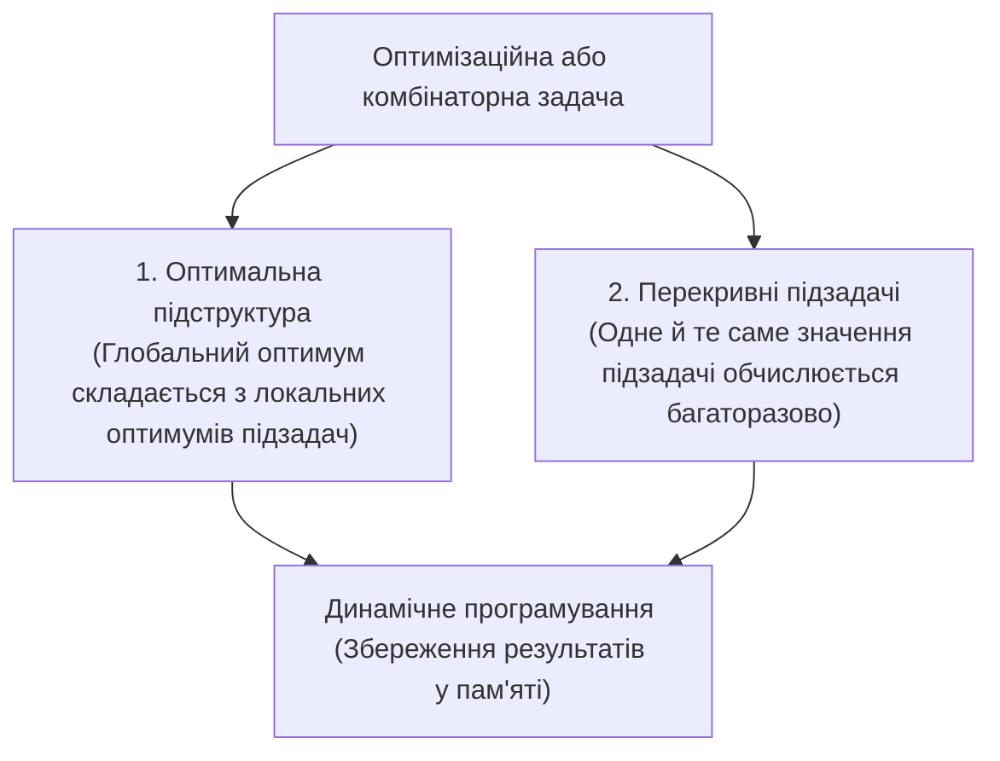

# 01. Алгоритмічне динамічне програмування в C# (Algorithmic Dynamic Programming)

**Алгоритмічне динамічне програмування (Dynamic Programming — DP)** — це метод оптимізації рекурсивних обчислень, що ґрунтується на математичному принципі декомпозиції складної задачі на простіші взаємопов'язані підзадачі.

---

## 1. Фундаментальні основи динамічного програмування

### 1.1. Принцип оптимальності Беллмана
У 1957 році американський математик Річард Беллман сформулював фундаментальний принцип:
> **Принцип оптимальності**: Оптимальна стратегія має ту властивість, що якими б не були початковий стан і початкове рішення, подальші рішення повинні становити оптимальну стратегію щодо стану, який виник у результаті першого рішення.

### 1.2. Дві обов'язкові умови застосування DP
Не будь-яку рекурсивну задачу можна оптимізувати через динамічне програмування. Необхідна наявність двох властивостей:



---

## 2. Мемоізація (Top-Down) проти Табуляції (Bottom-Up)

Існує дві діаметрально протилежні стратегії реалізації динамічного програмування:

| Критерій | Мемоізація (Top-Down) | Табуляція (Bottom-Up) |
| :--- | :--- | :--- |
| **Напрямок обходу** | Від кінцевої мети ($N$) вниз до базових станів ($0, 1$) | Від найпростіших базових станів ($0, 1$) вгору до мети ($N$) |
| **Архітектурна форма** | Рекурсія + асоціативний масив / словник кешу | Ітеративні цикли (`for`/`while`) + одновимірний/двовимірний масив |
| **Обчислювані стани** | Обчислюються **лише ті підзадачі, які дійсно потрібні** для розв'язку | Обчислюються **всі стани підряд** у порядку зростання індексів |
| **Використання пам'яті** | $O(N)$ для кешу + $O(N)$ для стека викликів | $O(N)$ для таблиці (або $O(1)$ при просторовій оптимізації) |
| **Стійкість до переповнення** | Можливе вичерпання пам'яті стека (`StackOverflowException`) | **100% безпечно**: виклики стека відсутні |

### 2.1. Чому наївна рекурсія зазнає експоненційного колапсу?
Розглянемо дерево викликів для числа Фібоначчі $N = 5$:

```
                         fib(5)
                     /           \
               fib(4)             fib(3)
              /      \            /     \
          fib(3)    fib(2)     fib(2)   fib(1)
          /    \     /   \      /   \
       fib(2) fib(1) fib(1)fib(0) fib(1)fib(0)
```

Зверніть увагу:
- Підзадача `fib(3)` обчислюється **2 рази**.
- Підзадача `fib(2)` обчислюється **3 рази**.
- Підзадача `fib(1)` обчислюється **5 разів**.

Кількість операцій зростає експоненційно зі швидкістю $O(2^n)$. Для $N = 40$ наївна рекурсія робить понад **330 мільйонів викликів**!

Мемоізація зберігає результат першого обчислення `fib(3)` у словник, перетворюючи дерево на лінійний ланцюг зі складністю $O(n)$ та всього **79 викликами**.

- Посилання на приклад мемоізації: [01-Memoization-Basics/Program.cs](../01-Memoization-Basics/Program.cs#L37-L70).
- Посилання на приклад табуляції та скорочення пам'яті до $O(1)$: [02-Tabulation-Basics/Program.cs](../02-Tabulation-Basics/Program.cs#L45-L95).

---

## 3. Розбір класичних задач динамічного програмування

### 3.1. Задача про розмін монет (Coin Change Problem)
* **Постановка**: Задано набір номіналів монет $C = [c_1, c_2, \dots, c_k]$ та цільову суму $S$. Знайти мінімальну кількість монет для формування цієї суми.
* **Рівняння стану**:
  $$dp[i] = \min_{coin \le i} (dp[i - coin] + 1), \quad \text{де } dp[0] = 0$$
* **Відновлення відповіді**: щоб дізнатися, які саме монети увійшли у набір, використовується додатковий масив батьківських переходів `parent[i] = coin`.

- Посилання на код розв'язання: [03-Classic-DP-Problems/Program.cs](../03-Classic-DP-Problems/Program.cs#L66-L102).

### 3.2. Задача про рюкзак 0/1 (0/1 Knapsack Problem)
* **Постановка**: Є $N$ предметів. Кожен предмет має вагу $w_i$ та цінність $v_i$. Вантажопідйомність рюкзака обмежена величиною $W$. Необхідно обрати таку підмножину предметів, щоб їхня сумарна вага не перевищувала $W$, а цінність була максимальною (кожен предмет можна взяти не більше одного разу).
* **Рівняння стану**:
  $$dp[i, w] = \begin{cases} dp[i - 1, w], & \text{якщо } w_i > w \\ \max(dp[i - 1, w], \; dp[i - 1, w - w_i] + v_i), & \text{якщо } w_i \le w \end{cases}$$

- Посилання на код розв'язання: [03-Classic-DP-Problems/Program.cs](../03-Classic-DP-Problems/Program.cs#L105-L148).

### 3.3. Відстань Левенштейна (Levenshtein Distance / Edit Distance)
* **Постановка**: Знайти мінімальну кількість редакторських операцій (вставка, видалення, заміна символу), необхідних для перетворення рядка $S_1$ довжиною $M$ у рядок $S_2$ довжиною $N$.
* **Рівняння стану**:
  $$dp[i, j] = \begin{cases} dp[i - 1, j - 1], & \text{якщо } S_1[i - 1] = S_2[j - 1] \\ 1 + \min \begin{pmatrix} dp[i - 1, j] & \text{(видалення)} \\ dp[i, j - 1] & \text{(вставка)} \\ dp[i - 1, j - 1] & \text{(заміна)} \end{pmatrix}, & \text{інакше} \end{cases}$$

- Посилання на код розв'язання: [03-Classic-DP-Problems/Program.cs](../03-Classic-DP-Problems/Program.cs#L150-L182).

---

## 4. Патерн Generic Memoizer у мові C#

У сучасному C# мемоізацію можна винести в універсальний повторно використовуваний метод розширення, що приймає довільну чисту функцію та повертає її кешовану версію:

```csharp
public static Func<T, TResult> Memoize<T, TResult>(this Func<T, TResult> func) where T : notnull
{
    var cache = new ConcurrentDictionary<T, TResult>();
    return arg => cache.GetOrAdd(arg, func);
}
```

Для багатомісних функцій як ключ кешу використовується типізований кортеж `(T1, T2)`:

```csharp
public static Func<T1, T2, TResult> Memoize<T1, T2, TResult>(this Func<T1, T2, TResult> func)
    where T1 : notnull where T2 : notnull
{
    var cache = new ConcurrentDictionary<(T1, T2), TResult>();
    return (arg1, arg2) => cache.GetOrAdd((arg1, arg2), key => func(key.Item1, key.Item2));
}
```

- Посилання на повну реалізацію патерну Generic Memoizer та рекурсивного фіксованого кешу: [04-Generic-Memoizer-Pattern/Program.cs](../04-Generic-Memoizer-Pattern/Program.cs#L55-L100).
