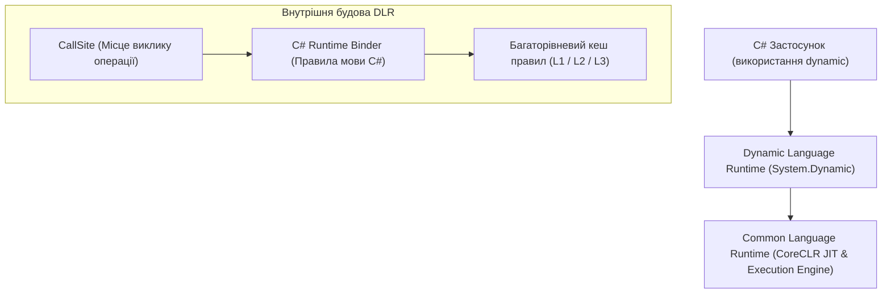

# 02. Динамічні можливості мови C# та архітектура DLR (CSharp Dynamic & DLR Internals)

У версії C# 4.0 платформа .NET зробила революційний крок, додавши підтримку динамічної типізації за допомогою ключового слова `dynamic` та середовища **Dynamic Language Runtime (DLR)**.

---

## 1. Понятійний апарат: `dynamic` у системі типів CLR

### 1.1. Що таке `dynamic`?
`dynamic` — це вбудований у C# псевдотип, який вказує компілятору: **«Вимкни статичну перевірку типів для цієї змінної; всі операції пошуку методів, властивостей, перевантажень та операторів будуть виконані під час роботи програми»**.

### 1.2. Як `dynamic` влаштований під капотом?
Усередині згенерованого коду IL типу `dynamic` **не існує як окремого типу CLR**!
- Компілятор представляє змінну типу `dynamic` як стандартний посилальний тип **`System.Object`**.
- Для збереження інформації про те, що тип є динамічним, компілятор маркує поле, параметр або локальну змінну спеціальним атрибутом метаданих:
  ```csharp
  [System.Runtime.CompilerServices.DynamicAttribute]
  ```
- Замість прямих інструкцій `call` або `callvirt` компілятор генерує статичне поле типу **`CallSite<T>`** та виклик через делегат `CallSite.Target`.

### 1.3. Порівняння: `object` проти `var` проти `dynamic`

| Критерій | `object` | `var` | `dynamic` |
| :--- | :--- | :--- | :--- |
| **Етап перевірки типів** | Компіляція (Compile-time) | Компіляція (Compile-time) | **Виконання (Runtime)** |
| **Фактичний тип у CLR** | `System.Object` | Конкретний виведений тип (`string`, `int`) | `System.Object` з `[DynamicAttribute]` |
| **Виклик методів** | Тільки методи класу `object` (або через явне приведення типу `((Car)obj).Drive()`) | Усі методи виведеного статичного типу | Будь-який метод викликається напряму (`dyn.Drive()`), валідується в рантаймі |
| **Перевірка помилок** | Помилки виявляються під час збирання проєкту | Помилки виявляються під час збирання проєкту | Помилка викличе виняток `RuntimeBinderException` під час виконання |
| **Вплив на швидкість** | Швидко (нативний виклик після приведення) | Швидко (нативний виклик без оверхеду) | Перший виклик вимагає компіляції сайту виклику, наступні кешуються |

- Посилання на приклад порівняння: [05-Dynamic-Keyword-And-DLR/Program.cs](../05-Dynamic-Keyword-And-DLR/Program.cs#L12-L28).

---

## 2. Архітектура Dynamic Language Runtime (DLR)

Середовище DLR складається з трьох ключових рівнів:



### 2.1. Як працює кешування у `CallSite`?
Щоб динамічні виклики не були такими повільними, як класична рефлексія (`MethodInfo.Invoke`), DLR застосовує трирівневу систему кешування:

1. **L1 Кеш (Рівень сайту виклику)**: безпосередньо у полі `CallSite.Target` зберігається скомпільований типізований делегат під конкретний тип, що викликався минулого разу (наприклад, для класу `MathService`). Якщо поточний екземпляр збігається за типом — виконується прямий перехід за вказівником.
2. **L2 Кеш (Рівень біндеру)**: якщо тип аргументу змінився, пошук звертається до кешу правил зв'язувача. Якщо для нового типу правило вже генерувалося раніше — воно підставляється в сайт виклику.
3. **L3 Кеш (Генерація нового правила)**: якщо тип зустрічається вперше, мовний біндер будує нове дерево виразів (AST) згідно з семантикою C#, компілює його через `DynamicMethod` і додає в кеш.

- Посилання на практичний замір швидкості холодного та гарячого виклику DLR: [05-Dynamic-Keyword-And-DLR/Program.cs](../05-Dynamic-Keyword-And-DLR/Program.cs#L30-L50).

---

## 3. Динамічна мультидиспетчеризація (Dynamic Multidispatch)

У стандартному C# вибір перевантаженого методу вирішується строго **на етапі компіляції** на основі статично задекларованого типу змінної.

Використання `dynamic` дозволяє реалізувати **Multiple Dispatch** — динамічний вибір методу під час виконання на основі фактичного рантайм-типу аргументів без використання спагетті-перевірок `if (obj is Order) ... else if (obj is Customer)`:

```csharp
// Виклик методу, де DLR автоматично знайде потрібне перевантаження Handle()
public void Dispatch(dynamic entity)
{
    processor.Handle(entity); // Обирає Handle(Order) або Handle(Customer) у Runtime!
}
```

- Посилання на приклад мультидиспетчеризації: [05-Dynamic-Keyword-And-DLR/Program.cs](../05-Dynamic-Keyword-And-DLR/Program.cs#L52-L80).

---

## 4. Динамічні типи даних: `ExpandoObject` та `DynamicObject`

### 4.1. `System.Dynamic.ExpandoObject`
`ExpandoObject` дозволяє створювати об'єкти з динамічною структурою на льоту без необхідності заздалегідь декларувати C#-класи:
- Можна додавати поля будь-яких типів: `user.Age = 30;`
- Можна додавати методи через делегати: `user.SayHello = new Action(() => Console.WriteLine("Hello"));`
- Оскільки `ExpandoObject` реалізує `IDictionary<string, object?>`, його можна у будь-який момент привести до словника і обійти циклом `foreach`.

- Посилання на приклад: [06-ExpandoObject-And-DynamicObject/Program.cs](../06-ExpandoObject-And-DynamicObject/Program.cs#L16-L45).

### 4.2. Створення власного провайдера через `DynamicObject`
Успадкування від `System.Dynamic.DynamicObject` дозволяє самостійно керувати поведінкою викликів через перевизначення віртуальних методів:

```csharp
public class DynamicConfiguration : DynamicObject
{
    private readonly Dictionary<string, object?> _members = new();

    // Перехоплює запис властивості: config.Port = 8080
    public override bool TrySetMember(SetMemberBinder binder, object? value)
    {
        _members[binder.Name] = value;
        return true;
    }

    // Перехоплює читання властивості: var p = config.Port
    public override bool TryGetMember(GetMemberBinder binder, out object? result)
    {
        return _members.TryGetValue(binder.Name, out result);
    }
}
```

- Посилання на повний приклад власного DynamicObject: [06-ExpandoObject-And-DynamicObject/Program.cs](../06-ExpandoObject-And-DynamicObject/Program.cs#L48-L105).
