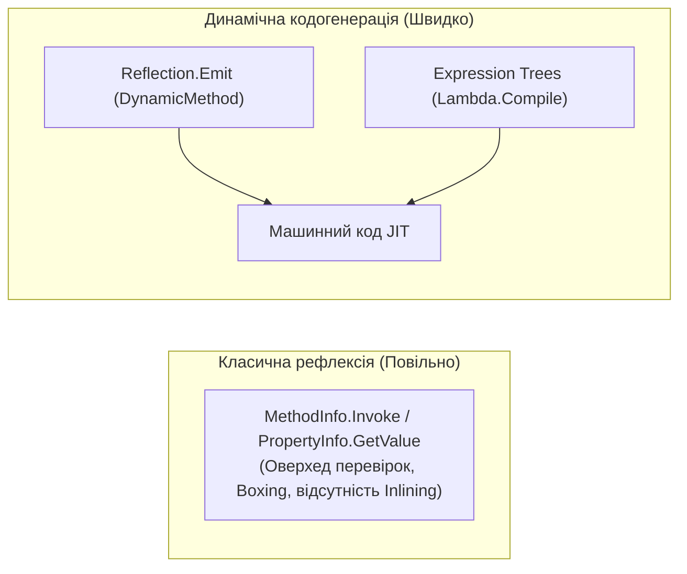

# 03. Динамічне метапрограмування та кодогенерація (Dynamic Metaprogramming & Code Generation)

Динамічне метапрограмування в .NET — це технологія, що дозволяє програмі аналізувати та генерувати новий виконуваний машинний або проміжний код безпосередньо під час роботи.

---

## 1. Понятійний апарат: Навіщо генерувати код у Runtime?

Класична рефлексія (`MethodInfo.Invoke`, `PropertyInfo.GetValue`) є надто повільною для високонавантажених систем через обов'язкові етапи перевірки прав доступу, валідацію типів аргументів та упаковку примітивів (boxing).

Динамічна кодогенерація розв'язує цю проблему: код генерується один раз у пам'яті, компілюється JIT у нативні процесорні інструкції і надалі виконується **зі швидкістю скомпільованого C#-коду**.



---

## 2. Низькорівнева емісія коду: `DynamicMethod` та `ILGenerator`

### 2.1. Що таке `DynamicMethod`?
`DynamicMethod` (простір імен `System.Reflection.Emit`) — це спеціальний клас середовища CLR, який представляє легковаговий безіменний метод, скомпільований у пам'яті під час виконання без необхідності створювати цілу фізичну збірку чи модуль.

### 2.2. Робота зі стековою моделлю IL
Середовище CLR є стековою віртуальною машиною (Stack-Based Virtual Machine). Усі операції виконуються через стек обчислень (Evaluation Stack):

```csharp
// Приклад генерації функції: f(a, b) = a * a + b * b
var dynamicMethod = new DynamicMethod("SumOfSquares", typeof(int), new[] { typeof(int), typeof(int) });
ILGenerator il = dynamicMethod.GetILGenerator();

il.Emit(OpCodes.Ldarg_0); // 1. Завантажити аргумент a у стек
il.Emit(OpCodes.Dup);     // 2. Продублювати a на вершині стека
il.Emit(OpCodes.Mul);     // 3. Помножити a * a (результат у стеку)

il.Emit(OpCodes.Ldarg_1); // 4. Завантажити аргумент b
il.Emit(OpCodes.Dup);     // 5. Продублювати b
il.Emit(OpCodes.Mul);     // 6. Помножити b * b

il.Emit(OpCodes.Add);     // 7. Додати два добутки
il.Emit(OpCodes.Ret);     // 8. Повернути значення

// Створення типізованого делегата:
Func<int, int, int> func = (Func<int, int, int>)dynamicMethod.CreateDelegate(typeof(Func<int, int, int>));
```

- Посилання на практичну реалізацію математичного методу та швидкого гетера властивостей: [07-DynamicMethod-Emit/Program.cs](../07-DynamicMethod-Emit/Program.cs#L35-L95).

---

## 3. Високорівневі дерева виразів (Expression Trees)

### 3.1. Що таке Expression Tree?
**Дерево виразів (Expression Tree)** — це абстрактне синтаксичне дерево (AST), де кожна операція мови C# (виклики методів, доступ до властивостей, арифметичні порівняння, логічні зв'язки) представлена екземпляром класу, успадкованого від `System.Linq.Expressions.Expression`.

### 3.2. Динамічний конструктор фільтрів (Dynamic Filter Builder)
Expression Trees дозволяють динамічно комбінувати умови пошуку в запитах до баз даних або колекцій без ручного склеювання рядків:

```csharp
// device => device.Price >= minPrice && device.InStock == true
var param = Expression.Parameter(typeof(Device), "d");

var priceCondition = Expression.GreaterThanOrEqual(
    Expression.Property(param, nameof(Device.Price)), Expression.Constant(1000m));

var stockCondition = Expression.Equal(
    Expression.Property(param, nameof(Device.InStock)), Expression.Constant(true));

var body = Expression.AndAlso(priceCondition, stockCondition);

// Компіляція виразу в машинний код у пам'яті:
Func<Device, bool> filter = Expression.Lambda<Func<Device, bool>>(body, param).Compile();
```

- Посилання на приклад динамічної побудови фільтрів: [08-Expression-Trees-Dynamic-Compilation/Program.cs](../08-Expression-Trees-Dynamic-Compilation/Program.cs#L19-L55).

### 3.3. Швидкі фабрики створення об'єктів
Виклик `Activator.CreateInstance(type, args)` здійснює динамічний пошук конструктора при кожному виклику. Натомість, скомпільоване дерево виразу `Expression.New(ctor, args)` викликає конструктор напряму, демонструючи багаторазове прискорення:

- Посилання на бенчмарк фабрик `Activator` проти `Expression.New`: [08-Expression-Trees-Dynamic-Compilation/Program.cs](../08-Expression-Trees-Dynamic-Compilation/Program.cs#L57-L95).

---

## 4. Порівняльна матриця технологій динамічного виконання

| Механізм | Складність розробки | Швидкодія виконання | Сумісність із Native AOT | Типові сфери застосування |
| :--- | :--- | :---: | :---: | :--- |
| **Рефлексія (`Invoke`)** | Низька | Низька (~1.5x оверхед) | Потребує анотацій | Плагінні системи, аналізатори |
| **DLR (`dynamic`)** | Низька | Середня (завдяки CallSite) | Обмежена | Мультидиспетчеризація, скрипти |
| **Expression Trees** | Середня | Висока (нативна) | Ні (потребує JIT) | Фреймворки ORM, валідатори, правила |
| **`DynamicMethod` (Emit)** | Висока (знання байт-коду IL) | **Максимальна (нативна)** | Ні (потребує JIT) | Високошвидкісні серіалізатори (Dapper) |
