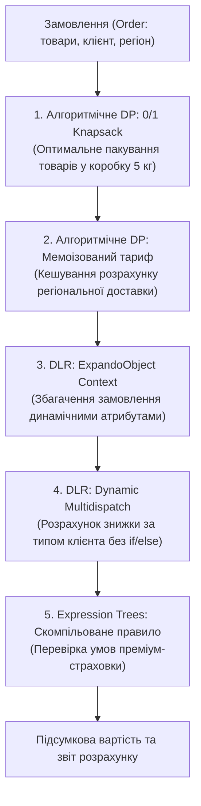

# 04. Фінальний проєкт: Динамічний конвеєр обробки замовлень (Dynamic Pipeline Engine)

Цей проєкт є фінальним синтезом усього модуля. Він демонструє, як у реальній прикладній архітектурі природно поєднуються класичне алгоритмічне динамічне програмування та динамічні мовні можливості платформи .NET.

---

## 1. Архітектурна концепція конвеєра

У сучасному E-Commerce сервісі процес розрахунку замовлення складається з кількох етапів: пакування товарів, тарифікація доставки, застосування знижок за статусом клієнта та перевірка промо-правил.



---

## 2. Інтеграція компонентів у коді

### 2.1. Алгоритмічне DP №1: Оптимізація пакування (0/1 Knapsack)
При відправці замовлень експрес-поштою діє суворе обмеження на вагу стандартної коробки (наприклад, не більше 5 кг). Клас `KnapsackOptimizer` заповнює двовимірну DP-матрицю і відновлює перелік найбільш цінних товарів, які поміщаються у коробку:

```csharp
var (packedWeight, packedItems) = KnapsackOptimizer.PackOptimalBox(order.Items, 5);
```

- Посилання на реалізацію алгоритму: [09-Dynamic-Pipeline-Engine/Program.cs](../09-Dynamic-Pipeline-Engine/Program.cs#L170-L215).

### 2.2. Алгоритмічне DP №2: Мемоізація регіональних тарифів
Розрахунок тарифів перевезення за географічними зонами є важкою операцією. Завдяки потокобезпечному кешуванню (Top-Down DP), запит для того самого регіону обчислюється лише один раз:

```csharp
private Func<string, decimal> CreateMemoizedShippingRateCalculator()
{
    var cache = new ConcurrentDictionary<string, decimal>();
    return region => cache.GetOrAdd(region, r => CalculateRateFromExternalProvider(r));
}
```

- Посилання на реалізацію: [09-Dynamic-Pipeline-Engine/Program.cs](../09-Dynamic-Pipeline-Engine/Program.cs#L145-L165).

### 2.3. DLR: Динамічний контекст та мультидиспетчеризація
- Контекст замовлення збагачується атрибутами під час виконання через `ExpandoObject` (`context.IsHolidayPromo = true;`).
- Вибір розміру знижки виконується через динамічну мультидиспетчеризацію `CalculateDiscountInternal(dynamic customer)`: середовище DLR автоматично знаходить потрібний метод для `RegularCustomer` або `CorporateClient` без використання конструкцій `if (customer is ...)`:

```csharp
private decimal ResolveCustomerDiscount(dynamic customer) => CalculateDiscountInternal(customer);
private decimal CalculateDiscountInternal(RegularCustomer regular) => 0.05m;
private decimal CalculateDiscountInternal(CorporateClient corporate) => corporate.ContractDiscount;
```

- Посилання на реалізацію: [09-Dynamic-Pipeline-Engine/Program.cs](../09-Dynamic-Pipeline-Engine/Program.cs#L135-L144).

### 2.4. Дерева виразів: Динамічне бізнес-правило
Правило преміум-замовлення (Order Total $\ge \$10,000$) конструюється у пам'яті через `Expression.GreaterThanOrEqual` та компілюється в машинний код під час ініціалізації конвеєра:

```csharp
var isHighValue = _compiledHighValuePredicate(order);
```

- Посилання на побудову та компіляцію виразу: [09-Dynamic-Pipeline-Engine/Program.cs](../09-Dynamic-Pipeline-Engine/Program.cs#L150-L175).

---

## 3. Демонстраційний запуск

Запустити проєкт можна за допомогою команди:

```powershell
dotnet run --project "06-Advanced-DotNet/06-Dynamic-Programming/09-Dynamic-Pipeline-Engine/09-Dynamic-Pipeline-Engine.csproj"
```

Вивід програми наочно демонструє роботу кожного з динамічних механізмів, включаючи перший промах кешу (`[DP Cache Miss]`) та миттєве потрапляння в кеш при повторному замовленні.
