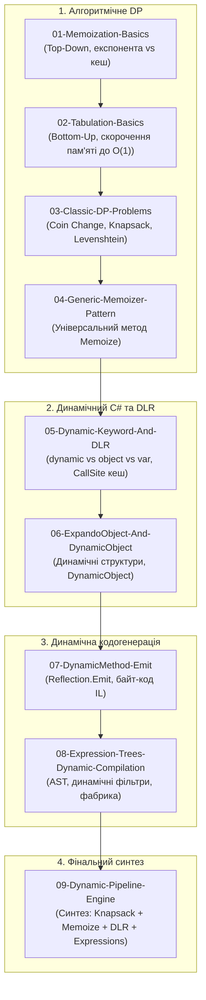

# Модуль: Динамічне програмування та динамічні можливості C# (Dynamic Programming & DLR)

Цей розділ є вичерпним керівництвом, що поєднує в єдину навчальну траєкторію два фундаментальні напрямки:
1. **Алгоритмічне динамічне програмування**: принципи Беллмана, декомпозиція задач, мемоізація (Top-Down), табуляція (Bottom-Up), просторова оптимізація до $O(1)$ та класичні задачі (Coin Change, 0/1 Knapsack, Levenshtein Distance).
2. **Динамічні можливості та метапрограмування C#**: ключове слово `dynamic`, архітектура Dynamic Language Runtime (DLR) та кешування `CallSite`, динамічні об'єкти `ExpandoObject` / `DynamicObject`, низькорівнева генерація IL через `DynamicMethod` та компіляція Expression Trees.

---

## 1. Навігація по теоретичних матеріалах (Docs)

| Розділ | Тематика та ключові питання | Посилання на документ |
| :---: | :--- | :--- |
| **00** | **Навчальний план, послідовність викладу, понятійний глосарій та дорожня карта** | [Docs/00_Curriculum_And_Roadmap.md](Docs/00_Curriculum_And_Roadmap.md) |
| **01** | Алгоритмічне динамічне програмування (Top-Down vs Bottom-Up, класичні задачі, патерн Generic Memoizer) | [Docs/01_Algorithmic_Dynamic_Programming.md](Docs/01_Algorithmic_Dynamic_Programming.md) |
| **02** | Динамічні можливості C# та DLR (`dynamic`, DLR CallSite кеш, `ExpandoObject`, `DynamicObject`) | [Docs/02_CSharp_Dynamic_And_DLR_Internals.md](Docs/02_CSharp_Dynamic_And_DLR_Internals.md) |
| **03** | Динамічне метапрограмування та кодогенерація (`DynamicMethod`, емісія IL, Expression Trees) | [Docs/03_Dynamic_Metaprogramming_And_Code_Generation.md](Docs/03_Dynamic_Metaprogramming_And_Code_Generation.md) |
| **04** | **Фінальний проєкт: Динамічний конвеєр обробки замовлень (Dynamic Pipeline Engine)** | [Docs/04_Capstone_Pipeline_Deep_Dive.md](Docs/04_Capstone_Pipeline_Deep_Dive.md) |

---

## 2. Архітектура та структура проєктів у рішенні `DynamicProgramming.sln`

Рішення містить **9 проєктів**, розташованих у дидактичній послідовності вивчення:

---

## 3. Зведена таблиця проєктів

| № | Назва проєкту | Ключові концепції та механізми | Вихідний код |
| :-: | :--- | :--- | :--- |
| 01 | `01-Memoization-Basics` | Низхідне DP (Top-Down): замір прискорення $O(2^n) \to O(n)$ на числах Фібоначчі. | [01-Memoization-Basics/Program.cs](01-Memoization-Basics/Program.cs) |
| 02 | `02-Tabulation-Basics` | Висхідне DP (Bottom-Up): ітеративний розрахунок без стека, оптимізація пам'яті до $O(1)$. | [02-Tabulation-Basics/Program.cs](02-Tabulation-Basics/Program.cs) |
| 03 | `03-Classic-DP-Problems` | Задачі розміну монет, 0/1 рюкзака та відстані Левенштейна з відновленням розв'язку. | [03-Classic-DP-Problems/Program.cs](03-Classic-DP-Problems/Program.cs) |
| 04 | `04-Generic-Memoizer-Pattern` | Чистий патерн функціонального кешування `Memoize()` для одномісних і рекурсивних функцій. | [04-Generic-Memoizer-Pattern/Program.cs](04-Generic-Memoizer-Pattern/Program.cs) |
| 05 | `05-Dynamic-Keyword-And-DLR` | DLR `dynamic`: `CallSite` кешування, `[DynamicAttribute]`, динамічна мультидиспетчеризація. | [05-Dynamic-Keyword-And-DLR/Program.cs](05-Dynamic-Keyword-And-DLR/Program.cs) |
| 06 | `06-ExpandoObject-And-DynamicObject` | `ExpandoObject` з полями/методами та власний динамічний клас на базі `DynamicObject`. | [06-ExpandoObject-And-DynamicObject/Program.cs](06-ExpandoObject-And-DynamicObject/Program.cs) |
| 07 | `07-DynamicMethod-Emit` | Емісія байт-коду IL: динамічний математичний метод і надшвидкий гетер властивості. | [07-DynamicMethod-Emit/Program.cs](07-DynamicMethod-Emit/Program.cs) |
| 08 | `08-Expression-Trees-Dynamic-Compilation` | Динамічна компіляція дерев виразів: предикати пошуку та швидка фабрика створення об'єктів. | [08-Expression-Trees-Dynamic-Compilation/Program.cs](08-Expression-Trees-Dynamic-Compilation/Program.cs) |
| 09 | `09-Dynamic-Pipeline-Engine` | **Фінальний проєкт**: комбінація алгоритмічного DP, мемоізації, DLR та Expression Trees у бізнес-конвеєрі. | [09-Dynamic-Pipeline-Engine/Program.cs](09-Dynamic-Pipeline-Engine/Program.cs) |

---

## 4. Як відкрити та запустити в Visual Studio

1. Відкрийте файл рішення `DynamicProgramming.sln` у Visual Studio.
2. У вікні **Solution Explorer** будуть доступні:
   - Папка **`Docs`** із теоретичними матеріалами.
   - Пронумеровані проєкти від `01-Memoization-Basics` до `09-Dynamic-Pipeline-Engine`.
3. Щоб запустити будь-який проєкт: правий клік миші на проєкт -> **Set as Startup Project**, після чого натисніть `Ctrl+F5`.
