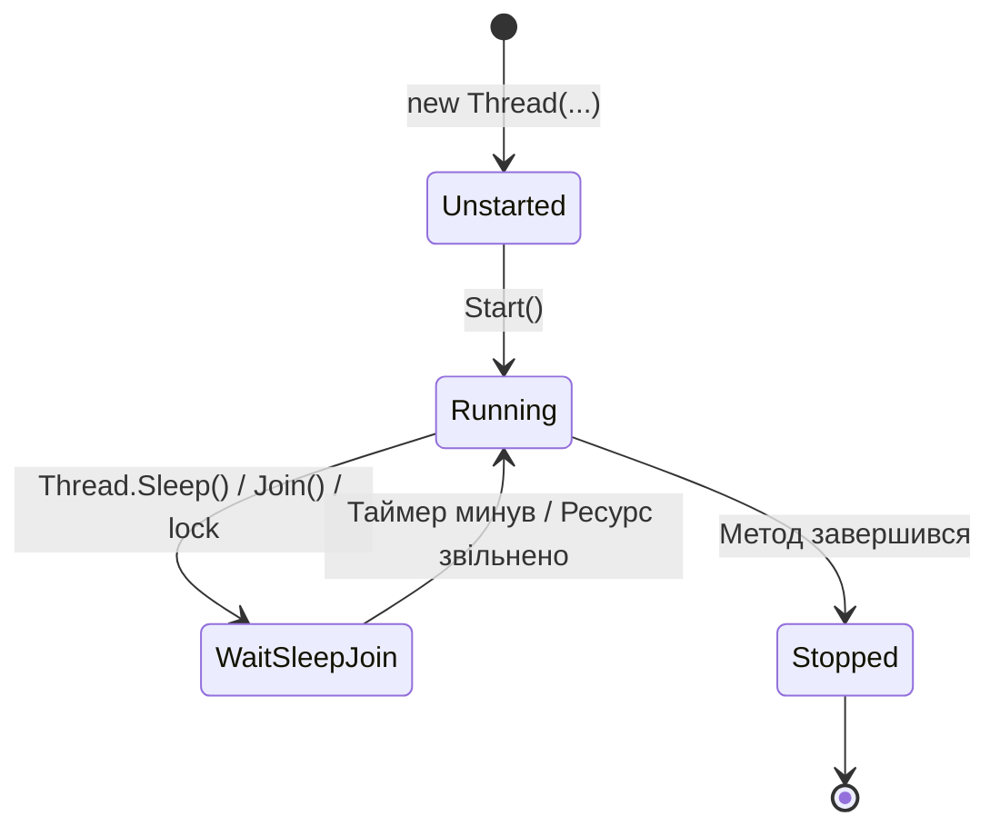

# 01. Потоки ОС (`System.Threading.Thread`) та Пул потоків (`ThreadPool`)

## 1. Що таке потік (Thread)?
**Потік (Thread)** — це найменша одиниця виконання, якій планувальник операційної системи виділяє процесорний час. Кожен процес у .NET починається з одного головного потоку (`MainThread`), але може створювати додаткові потоки.

Кожен виділений потік ОС має:
- Власний стек викликів (за замовчуванням **~1 МБ** віртуальної пам'яті).
- Власний набір регістрів CPU (включно з лічильником інструкцій `IP` та вказівником стека `SP`).
- Стан життєвого циклу (`ThreadState`: `Unstarted`, `Running`, `WaitSleepJoin`, `Stopped`).

---

## 2. Foreground проти Background потоків
У .NET кожен потік є або **основним (Foreground)**, або **фоновим (Background)**:
- **Foreground (`IsBackground = false`)**: Процес .NET **не завершиться**, доки працює хоча б один Foreground-потік (навіть якщо метод `Main` вже завершився). Усі потоки, створені через `new Thread(...)`, за замовчуванням є Foreground.
- **Background (`IsBackground = true`)**: Коли всі Foreground-потоки завершують роботу, середовище CLR автоматично зупиняє всі Background-потоки і закриває процес. Усі потоки з `ThreadPool` завжди є фоновими (`IsBackground = true`).

---

## 3. Чому потрібен `ThreadPool`?
Створення нового потоку через `new Thread()` є дорогою системною операцією (виділення 1 МБ пам'яті, системний виклик ядра ОС, перемикання контексту). Якщо веб-сервер створюватиме новий потік на кожен HTTP-запит, при 5 000 одночасних клієнтів лише під стеки потоків знадобиться **5 ГБ ОЗП**.

`System.Threading.ThreadPool` вирішує цю проблему за рахунок пулу попередньо створених фонових потоків:
1. Завдання ставиться в чергу викликом `ThreadPool.QueueUserWorkItem(...)` або `Task.Run(...)`.
2. Вільний потік із пулу бере завдання, виконує його та **повертається до пулу** для виконання наступного завдання без знищення потоку ОС.

---

## 4. Основні властивості та методи API

### Властивості класу `Thread`

| Властивість | Опис | Приклад у коді | Документація MSDN |
|:---|:---|:---|:---|
| `CurrentThread` | Повертає об'єкт `Thread`, який виконує поточний код | [Program.cs](../01-ThreadCreationAndLifecycle/Program.cs#L24) | [Thread.CurrentThread](https://learn.microsoft.com/en-us/dotnet/api/system.threading.thread.currentthread) |
| `ManagedThreadId` | Унікальний числовий ідентифікатор керованого потоку | [Program.cs](../01-ThreadCreationAndLifecycle/Program.cs#L25) | [Thread.ManagedThreadId](https://learn.microsoft.com/en-us/dotnet/api/system.threading.thread.managedthreadid) |
| `IsBackground` | Визначає, чи є потік фоновим (`true`) або основним (`false`) | [Program.cs](../01-ThreadCreationAndLifecycle/Program.cs#L61) | [Thread.IsBackground](https://learn.microsoft.com/en-us/dotnet/api/system.threading.thread.isbackground) |
| `IsThreadPoolThread` | Вказує, чи належить потік до системного пулу `ThreadPool` | [Program.cs](../02-ThreadPoolAndWorkItems/Program.cs#L22) | [Thread.IsThreadPoolThread](https://learn.microsoft.com/en-us/dotnet/api/system.threading.thread.isthreadpoolthread) |
| `ThreadState` | Поточний стан потоку в кінцевому автоматі CLR | [Program.cs](../01-ThreadCreationAndLifecycle/Program.cs#L64) | [Thread.ThreadState](https://learn.microsoft.com/en-us/dotnet/api/system.threading.thread.threadstate) |

### Методи класів `Thread` та `ThreadPool`

| Метод | Опис | Приклад у коді | Документація MSDN |
|:---|:---|:---|:---|
| `Thread.Start()` | Запускає виконання потоку на рівні операційної системи | [Program.cs](../01-ThreadCreationAndLifecycle/Program.cs#L65) | [Thread.Start](https://learn.microsoft.com/en-us/dotnet/api/system.threading.thread.start) |
| `Thread.Join()` | Блокує викликаючий потік до моменту завершення цільового потоку | [Program.cs](../01-ThreadCreationAndLifecycle/Program.cs#L69) | [Thread.Join](https://learn.microsoft.com/en-us/dotnet/api/system.threading.thread.join) |
| `Thread.Sleep(int)` | Призупиняє поточний потік на вказану кількість мілісекунд | [Program.cs](../01-ThreadCreationAndLifecycle/Program.cs#L30) | [Thread.Sleep](https://learn.microsoft.com/en-us/dotnet/api/system.threading.thread.sleep) |
| `ThreadPool.QueueUserWorkItem` | Додає делегат у чергу завдань системного пулу потоків | [Program.cs](../02-ThreadPoolAndWorkItems/Program.cs#L62) | [ThreadPool.QueueUserWorkItem](https://learn.microsoft.com/en-us/dotnet/api/system.threading.threadpool.queueuserworkitem) |
