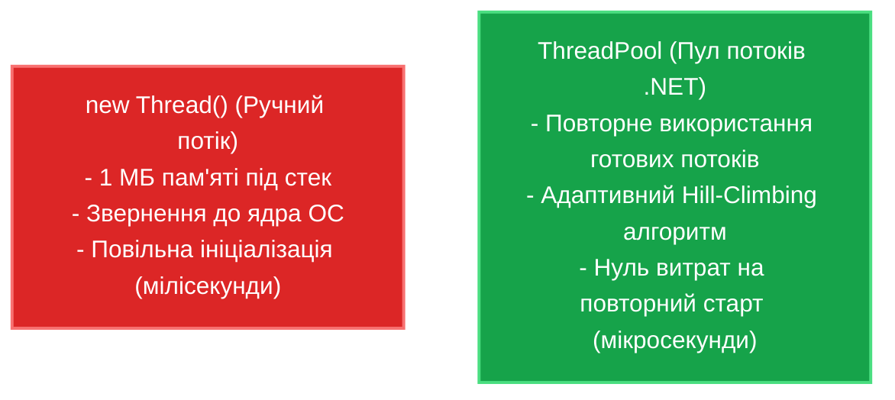
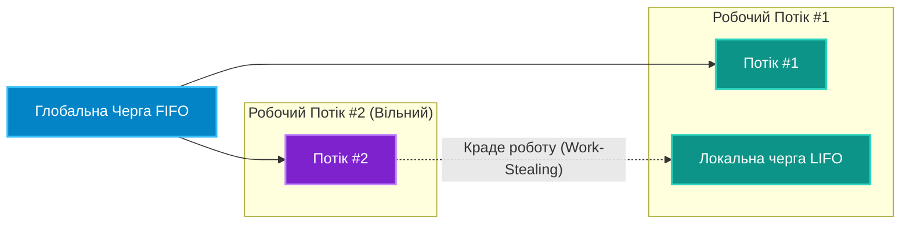

# 01. Керовані потоки (`Thread`) та Пул потоків (`ThreadPool`)

## 1. Анатомія потоку в ОС та CLR

У сучасних багатозадачних операційних системах (Windows, Linux, macOS) потік є найменшою одиницею планування виконання процесора:
* **Стек пам'яті**: За замовчуванням під стек кожного нового потоку виділяється **1 МБ пам'яті** в адресному просторі процесу. Створення 1 000 ручних потоків миттєво забере 1 ГБ оперативної пам'яті виключно під стекові кадри.
* **Перемикання контексту (Context Switch)**: Коли планувальник ОС зупиняє один потік і перемикає ядро процесора на інший, він зберігає всі регістри процесора, скидає конвеєр команд та інвалідує процесорні кеші (L1/L2). Це забирає сотні тактових циклів CPU.

Створення ручних потоків через `new Thread()` є вкрай дорогою операцією:



---

## 2. Архітектура ThreadPool: Алгоритм Work-Stealing

Пул потоків .NET оптимізований для уникнення взаємних блокувань між завданнями:
1. **Глобальна черга (Global Queue)**: Завдання, поставлені ззовні (наприклад, через `ThreadPool.QueueUserWorkItem`), потрапляють у спільну чергу FIFO (First In, First Out).
2. **Локальні черги (Local Queues)**: Кожен робочий потік пулу має власну внутрішню чергу, організовану за принципом LIFO (Last In, First Out) для кращої локальності кешу CPU.
3. **Крадіжка завдань (Work-Stealing)**: Якщо потік завершив усі завдання зі своєї локальної черги, він не засинає, а "краде" завдання з кінця черги іншого завантаженого потоку.



---

## 3. Фоновий проти Головного потоку (`IsBackground`)

* **Foreground Thread (Головний потік за замовчуванням при `new Thread`)**: Процес додатка продовжує працювати доти, доки живий хоча б один такий потік, навіть якщо функція `Main()` давно завершилася.
* **Background Thread (Усі потоки ThreadPool)**: Якщо всі головні потоки завершили роботу, CLR негайно аварійно завершує процес, не чекаючи завершення фонових потоків.

```csharp
var thread = new Thread(() =>
{
    Thread.Sleep(5000);
    Console.WriteLine("Цей текст не буде надрукований, якщо IsBackground = true!");
});

thread.IsBackground = true; // Тепер потік не блокує закриття процесу
thread.Start();
```

---

## 4. Порівняння: Прямий `Thread` проти `ThreadPool`

| Характеристика | Пряме створення `Thread` | Пул потоків `ThreadPool` |
|:---|:---|:---|
| **Витрати пам'яті** | ~1 МБ на потік | Використовує вже виділені потоки з пулу |
| **Швидкість запуску** | Повільна (звернення до ядра ОС) | Майже миттєва (передача делегата в чергу) |
| **Кількість** | Обмежена пам'яттю (ризик `OutOfMemoryException`) | Динамічно масштабується алгоритмом Hill-Climbing |
| **Коли використовувати** | Тільки для надтривалих завдань або специфічних пріоритетів | Для 99.9% повсякденних обчислювальних та I/O операцій |

---

## 5. Матриця проєкту цієї секції

| Проєкт | Посилання на вихідний код | Що демонструє під капотом |
|:---|:---|:---|
| [`01-ThreadCreationAndLifecycle`](../01-ThreadCreationAndLifecycle/Program.cs) | [Program.cs](../01-ThreadCreationAndLifecycle/Program.cs) | Створення та запуск потоків `Thread`, порівняння поведінки `IsBackground = true` проти `false`. |
| [`02-ThreadPoolAndWorkItems`](../02-ThreadPoolAndWorkItems/Program.cs) | [Program.cs](../02-ThreadPoolAndWorkItems/Program.cs) | Черга пулу потоків через `ThreadPool.QueueUserWorkItem`, бенчмарк швидкості запуску завдань у порівнянні з `new Thread`. |
