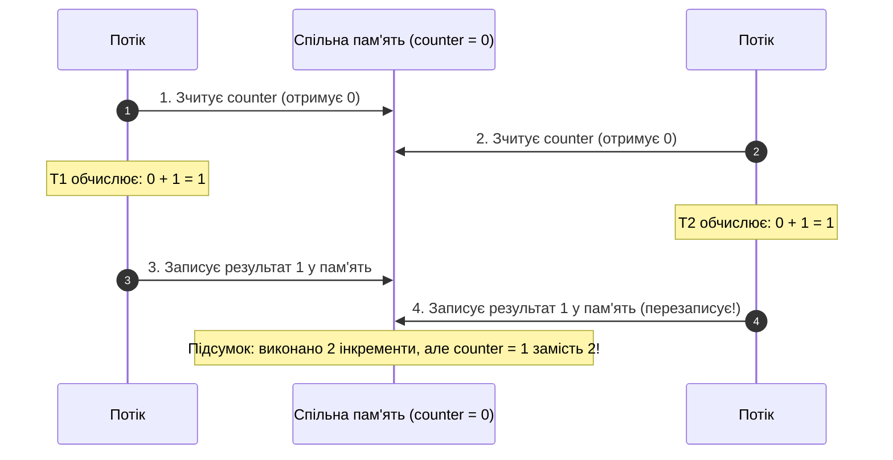

# 02. Стан гонитви (Race Condition) та Атомарні Операції `Interlocked`

## 1. Природа стану гонитви (Race Condition)

Коли декілька потоків одночасно читають і записують спільну змінну без синхронізації, результат операції стає залежним від випадкового порядку виконання інструкцій планувальником процесора. Це називається **станом гонитви (Race Condition)**.

Навіть найпростіша операція інкременту `counter++` у C# **не є атомарною**! На рівні асемблера вона складається з трьох окремих процесорних інструкцій:
1. `MOV EAX, [counter]` — зчитати значення з пам'яті в регістр процесора.
2. `INC EAX` — збільшити значення в регістрі на 1.
3. `MOV [counter], EAX` — записати оновлене значення назад у пам'ять.



---

## 2. Процесорний захист: Клас `System.Threading.Interlocked`

Для забезпечення безблокувальної атомарності на рівні заліза процесори сімейства x86/x64 надають інструкцію з префіксом `LOCK` (наприклад, `LOCK XADD` або `LOCK CMPXCHG`). Вона апаратно блокує шину пам'яті або відповідну кеш-лінію (Cache Line) на час виконання операції.

У .NET цей низькорівневий апаратний механізм доступний через методи класу **`Interlocked`**:

```csharp
// ПОГАНО: Стан гонитви при багатопотоковому виклику!
private int _unsafeCounter = 0;
public void IncrementUnsafe() => _unsafeCounter++;

// ДОБРЕ: Атомарний апаратний інкремент без блокування потоку
private int _safeCounter = 0;
public void IncrementSafe() => Interlocked.Increment(ref _safeCounter);
```

---

## 3. Патерн CAS (Compare-And-Swap) цикл

Найпотужнішим методом класу є `Interlocked.CompareExchange`:
```csharp
// Атомарно записує newValue в location, якщо поточне значення дорівнює expectedValue.
// Повертає ОРИГІНАЛЬНЕ значення, яке було в location до спроби запису.
int original = Interlocked.CompareExchange(ref location, newValue, expectedValue);
```

За допомогою CAS можна реалізувати будь-яку довільну математичну або логічну трансформацію над числом без використання важких блокувань `lock`:

```csharp
// Безблокувальне множення спільного лічильника:
public static void Multiply(ref int target, int factor)
{
    int currentVal = target;
    while (true)
    {
        int desiredVal = currentVal * factor;
        // Намагаємося записати desiredVal, якщо ніхто інший не змінив currentVal
        int prevVal = Interlocked.CompareExchange(ref target, desiredVal, currentVal);

        if (prevVal == currentVal)
            break; // Успішно оновлено!

        // Якщо хтось змінив target у паралельному потоці, оновлюємо поточне значення і повторюємо спробу
        currentVal = prevVal;
    }
}
```

---

## 4. Порівняння: `lock` проти `Interlocked`

| Характеристика | Блокування `lock` | Атомарний `Interlocked` |
|:---|:---|:---|
| **Механізм** | Монітор синхронізації об'єкта CLR | Безпосередня процесорна інструкція CPU |
| **Блокування потоків** | Так (потоки засинають у черзі ядра) | Ні (потік не блокується взагалі) |
| **Швидкодія** | Середня (~20-50 нс при колізіях) | Максимальна (~5-10 нс) |
| **Область застосування** | Складні блоки коду з кількома полями | Одиничні 32/64-бітні змінні (числа, посилання) |

---

## 5. Матриця проєкту цієї секції

| Проєкт | Посилання на вихідний код | Що демонструє під капотом |
|:---|:---|:---|
| [`03-RaceConditionAndInterlocked`](../03-RaceConditionAndInterlocked/Program.cs) | [Program.cs](../03-RaceConditionAndInterlocked/Program.cs) | Емуляція колізій паралельного інкременту, застосування `Interlocked.Increment`, `Add` та реалізація циклу Compare-Exchange. |
