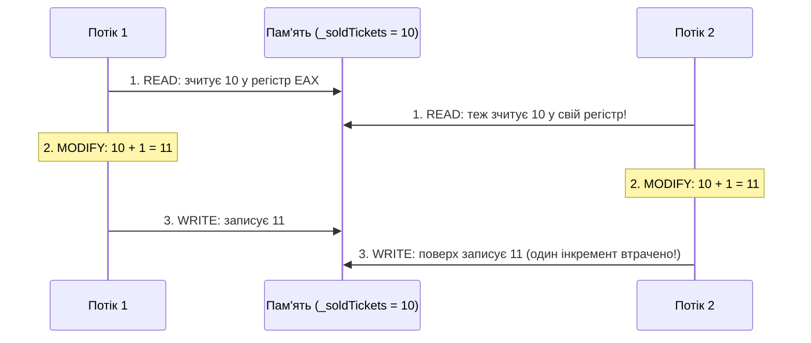

# 02. Стан гонитви (Race Condition) та атомарні операції `Interlocked`

## 1. Чому `counter++` ламається у багатопотоковому середовищі?
У C# запис `_soldTickets++` виглядає як одна команда, проте компілятор перетворює його на три окремі машинні інструкції **Read-Modify-Write**:

Це явище називається **станом гонитви (Race Condition)** — результат роботи програми залежить від непередбачуваного порядку перемикання потоків планувальником ОС.

---

## 2. Апаратна атомарність через `System.Threading.Interlocked`
Для простих числових операцій (лічильники, суматори, прапорці стану) використання повноцінного `lock` є надмірним. Клас `Interlocked` використовує спеціальні атомарні інструкції процесора (наприклад, `LOCK XADD` або `LOCK CMPXCHG` на архітектурі x86/x64), які гарантують неподільність операції на рівні кеш-ліній CPU.

### Методи класу `Interlocked`

| Метод | Опис | Приклад у коді | Документація MSDN |
|:---|:---|:---|:---|
| `Increment(ref int)` | Атомарно збільшує змінну на 1 і повертає нове значення | [Program.cs](../03-RaceConditionAndInterlocked/Program.cs#L37) | [Interlocked.Increment](https://learn.microsoft.com/en-us/dotnet/api/system.threading.interlocked.increment) |
| `Add(ref long, long)` | Атомарно додає число до змінної і повертає результат | [Program.cs](../03-RaceConditionAndInterlocked/Program.cs#L40) | [Interlocked.Add](https://learn.microsoft.com/en-us/dotnet/api/system.threading.interlocked.add) |
| `Read(ref long)` | Атомарно зчитує 64-бітне значення навіть на 32-бітних системах | [Program.cs](../03-RaceConditionAndInterlocked/Program.cs#L32) | [Interlocked.Read](https://learn.microsoft.com/en-us/dotnet/api/system.threading.interlocked.read) |
| `CompareExchange(ref T, T, T)` | Порівнює значення з очікуваним і, якщо вони рівні, замінює на нове (CAS) | [Program.cs](../03-RaceConditionAndInterlocked/Program.cs#L56) | [Interlocked.CompareExchange](https://learn.microsoft.com/en-us/dotnet/api/system.threading.interlocked.compareexchange) |
