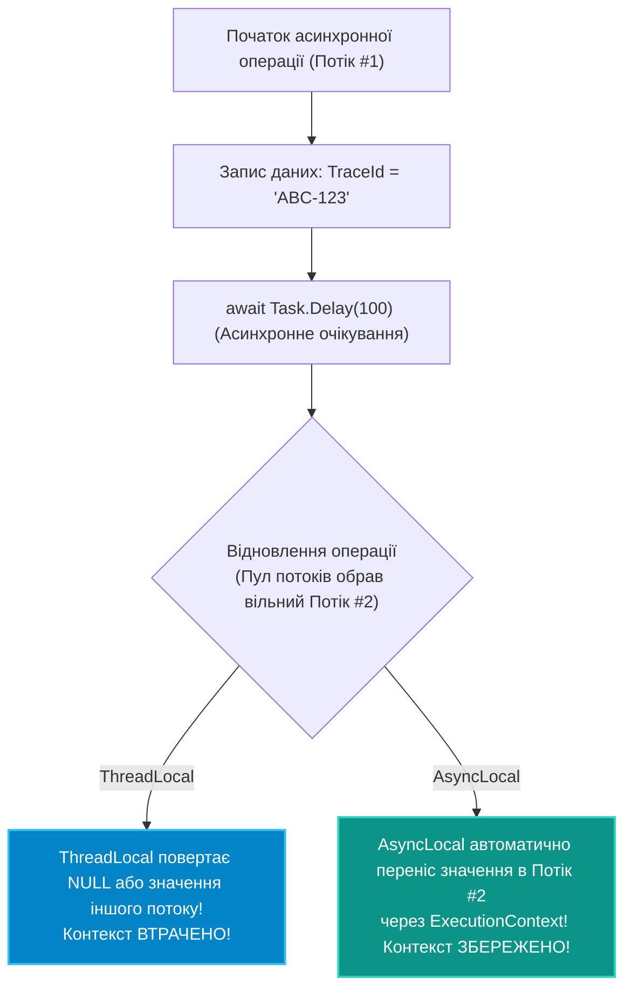

# 03. Локальне сховище: `ThreadLocal<T>` проти `AsyncLocal<T>`

## 1. Проблема ізоляції контексту в багатопотокових додатках

Коли кілька потоків одночасно обробляють запити, часто виникає потреба зберегти дані, специфічні для поточного виконання (наприклад, ID користувача, CorrelationId транзакції або не-потокобезпечний екземпляр генератора випадкових чисел `Random`).

Для цього в .NET існують два різних механізми з фундаментально різною семантикою передачі даних:
1. **`ThreadLocal<T>`** — прив'язка до фізичного потоку ОС (Thread-Local Storage).
2. **`AsyncLocal<T>`** — прив'язка до логічного асинхронного потоку керування (`ExecutionContext`).

---

## 2. Порівняння життєвих циклів та поведінки через `await`



---

## 3. Чому `ThreadLocal<T>` ламається в асинхронному коді?

Клас `ThreadLocal<T>` зберігає значення у внутрішній таблиці потоку ОС (**TLS**). При виконанні `await` CLR відпускає поточний потік у пул. Коли асинхронна операція повертає результат, планувальник призначає для продовження **зовсім інший потік із пулу**, у якого значення в TLS або відсутнє, або залишилося від попереднього чужого завдання!

### Демонстрація відмінностей у коді

```csharp
private static readonly ThreadLocal<string> _threadLocal = new();
private static readonly AsyncLocal<string> _asyncLocal = new();

public static async Task RunDemoAsync()
{
    _threadLocal.Value = "Початкове значення";
    _asyncLocal.Value = "Початкове значення";

    Console.WriteLine($"До await (Потік #{Thread.CurrentThread.ManagedThreadId}): " +
        $"TL={_threadLocal.Value}, AL={_asyncLocal.Value}");

    await Task.Delay(100); // Повернення відбудеться на іншому потоці пулу!

    Console.WriteLine($"Після await (Потік #{Thread.CurrentThread.ManagedThreadId}): " +
        $"TL={_threadLocal.Value ?? "NULL (Втрачено!)"}, AL={_asyncLocal.Value}");
}
```

---

## 4. Порівняльна таблиця сховищ локальних даних

| Характеристика | `[ThreadStatic]` | `ThreadLocal<T>` | `AsyncLocal<T>` |
|:---|:---|:---|:---|
| **Механіка збереження** | Поле класу в пам'яті TLS | Об'єктна обгортка над TLS | `ExecutionContext` поточного логічного ланцюжка |
| **Сумісність з `await`** | **Ні** (втрачає дані при зміні потоку) | **Ні** (втрачає дані при зміні потоку) | **Так** (гарантовано копіюється в новий потік) |
| **Ініціалізація фабрикою** | Ні (лише значення за замовчуванням) | Так (`new ThreadLocal<T>(() => ...))`) | Ні |
| **Сценарії використання** | Оптимізація старих синхронних бібліотек | Кешування важких об'єктів на потік (`Random`, буфери) | CorrelationId, контекст безпеки, трасування OpenTelemetry |

---

## 5. Матриця проєкту цієї секції

| Проєкт | Посилання на вихідний код | Що демонструє під капотом |
|:---|:---|:---|
| [`04-ThreadLocalAndAsyncLocal`](../04-ThreadLocalAndAsyncLocal/Program.cs) | [Program.cs](../04-ThreadLocalAndAsyncLocal/Program.cs) | Практичний експеримент зі збереженням значень у `ThreadLocal<T>` та `AsyncLocal<T>` до та після асинхронної паузи `await Task.Yield()`. |
