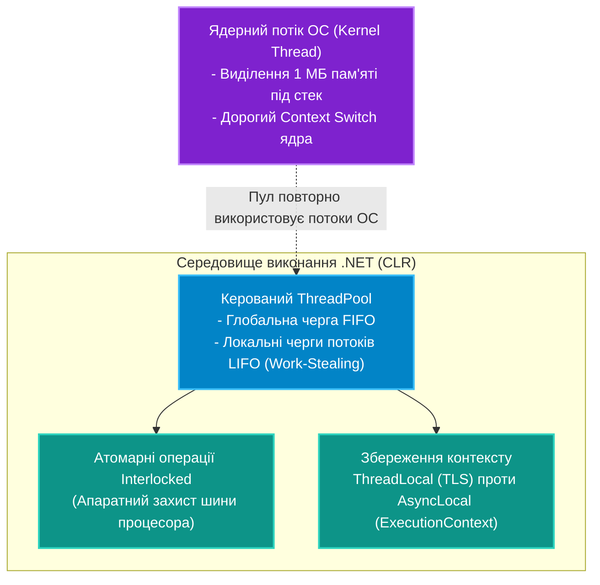

# Підмодуль 01: Основи багатопотоковості в .NET (`OOP - Multithreading Basics.sln`)

Цей підмодуль знайомить з фундаментом багатопотокового програмування на рівні віртуальної машини CLR та операційної системи: від важких ядерних потоків ОС (`System.Threading.Thread`) та високоефективного пулу потоків (`ThreadPool`) до механізмів виникнення станів гонитви (Race Conditions), атомарних процесорних інструкцій (`Interlocked`) та локального контексту пам'яті (`ThreadLocal<T>` проти `AsyncLocal<T>`).

---

## Архітектура потокової моделі CLR

---

## Навігація по навчальних посібниках (`Docs`)

| № | Посібник | Ключові теми та системні інструменти | Посилання на документ |
|:---:|:---|:---|:---|
| 01 | **Потоки та Пул потоків (ThreadPool)** | Життєвий цикл `Thread`, пріоритети, фонові та головні потоки, алгоритм крадіжки завдань (Work-Stealing), ціна створення потоку | [Docs/01_Threads_And_ThreadPool.md](Docs/01_Threads_And_ThreadPool.md) |
| 02 | **Стан гонитви та атомарні операції Interlocked** | Race Condition, Read-Modify-Write, процесорний кеш (L1/L2/L3), бар'єри пам'яті, Compare-and-Swap (CAS) цикл | [Docs/02_Race_Conditions_And_Interlocked.md](Docs/02_Race_Conditions_And_Interlocked.md) |
| 03 | **Локальне сховище: ThreadLocal проти AsyncLocal** | Thread-Local Storage (TLS), чому `ThreadLocal` втрачає контекст при переході через `await`, поширення `ExecutionContext` | [Docs/03_ThreadLocal_And_AsyncLocal.md](Docs/03_ThreadLocal_And_AsyncLocal.md) |

---

## Структура проєктів рішення `OOP - Multithreading Basics.sln`

* **`01-ThreadCreationAndLifecycle`**:
  * Створення та ручне керування потоками за допомогою класу `System.Threading.Thread`.
  * Демонстрація різниці між фоновими (`IsBackground = true`) та основними потоками процесу.
  * Посилання на вихідний код: [`Program.cs`](01-ThreadCreationAndLifecycle/Program.cs).
* **`02-ThreadPoolAndWorkItems`**:
  * Делегування завдань у глобальну чергу пулу через `ThreadPool.QueueUserWorkItem`.
  * Вимірювання часу виділення ресурсів у порівнянні з прямим викликом `new Thread()`.
  * Посилання на вихідний код: [`Program.cs`](02-ThreadPoolAndWorkItems/Program.cs).
* **`03-RaceConditionAndInterlocked`**:
  * Емуляція колізій паралельного інкременту спільного лічильника.
  * Безпечна ліквідація гонитви даних за допомогою процесорних операцій `Interlocked.Increment` та `CompareExchange`.
  * Посилання на вихідний код: [`Program.cs`](03-RaceConditionAndInterlocked/Program.cs).
* **`04-ThreadLocalAndAsyncLocal`**:
  * Збереження ідентифікаторів у `ThreadLocal<T>` та порівняння з поведінкою `AsyncLocal<T>` у багатозадачному асинхронному середовищі.
  * Посилання на вихідний код: [`Program.cs`](04-ThreadLocalAndAsyncLocal/Program.cs).
