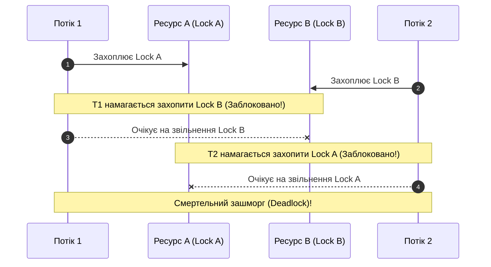

# 02. Взаємні блокування (`Deadlock`) та превентивні стратегії

## 1. Що таке Deadlock?

**Взаємне блокування (Deadlock)** — це стан системи, коли два або більше потоків нескінченно очікують на звільнення ресурсів, заблокованих один одним. Жоден потік не може продовжити виконання, а процесорне навантаження падає до нуля при застиглому застосунку.



---

## 2. Антипатерн (Bad) та Еталонне рішення (Good)

### Порушення: неконтрольований порядок блокувань (Bad)
```csharp
// Потік 1:
lock (accountA)
{
    Thread.Sleep(100);
    lock (accountB) { /* переказ */ }
}

// Потік 2 (одночасно в протилежному порядку):
lock (accountB)
{
    Thread.Sleep(100);
    lock (accountA) { /* переказ */ } // DEADLOCK!
}
```

### Еталонне рішення: Ієрархічне впорядкування ресурсів (Lock Ordering)
Якщо всі потоки захоплюють ресурси у **строго однаковому порядку** (наприклад, за унікальним числовим ID), Deadlock стає фізично неможливим!

```csharp
public static void TransferMoney(Account from, Account to, decimal amount)
{
    // Завжди спочатку блокуємо об'єкт із меншим ID:
    Account firstLock = from.Id < to.Id ? from : to;
    Account secondLock = from.Id < to.Id ? to : from;

    lock (firstLock)
    {
        lock (secondLock)
        {
            from.Withdraw(amount);
            to.Deposit(amount);
        }
    }
}
```

---

## 3. Матриця проєкту цієї секції

| Проєкт | Посилання на вихідний код | Що демонструє під капотом |
|:---|:---|:---|
| [`02-DeadlockAndPrevention`](../02-DeadlockAnatomyAndPrevention/Program.cs) | [Program.cs](../02-DeadlockAnatomyAndPrevention/Program.cs) | Відтворення сценарію взаємного блокування банківських рахунків та еталонне розв'язання за патерном Lock Ordering. |
