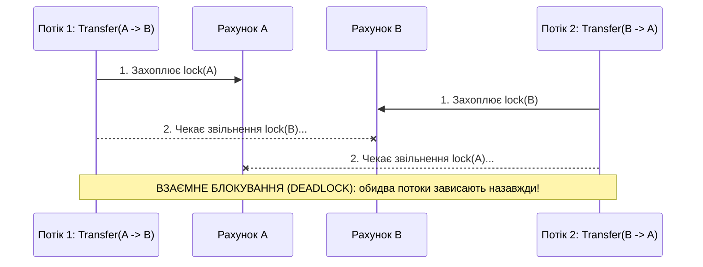

# 02. Анатомія взаємного блокування (Deadlock) та способи запобігання

## 1. Як виникає класичний Deadlock (AB-BA)?
**Deadlock (взаємне блокування)** виникає тоді, коли два або більше потоків циклічно очікують на ресурси, утримувані один одним:

---

## 2. Два головні способи запобігання Deadlock
1. **Впорядкування блокувань (Lock Ordering)**: Якщо кожен ресурс має унікальний ключ (наприклад, `Account.Id`), усі потоки повинні захоплювати ресурси **в однаковому глобальному порядку** (спочатку менший `Id`, потім більший `Id`). Це математично унеможливлює цикл очікування.
2. **Обмеження часу очікування (`Monitor.TryEnter`)**: Замість нескінченного блокування використовувати таймаут і відкочувати операцію у разі невдачі.
