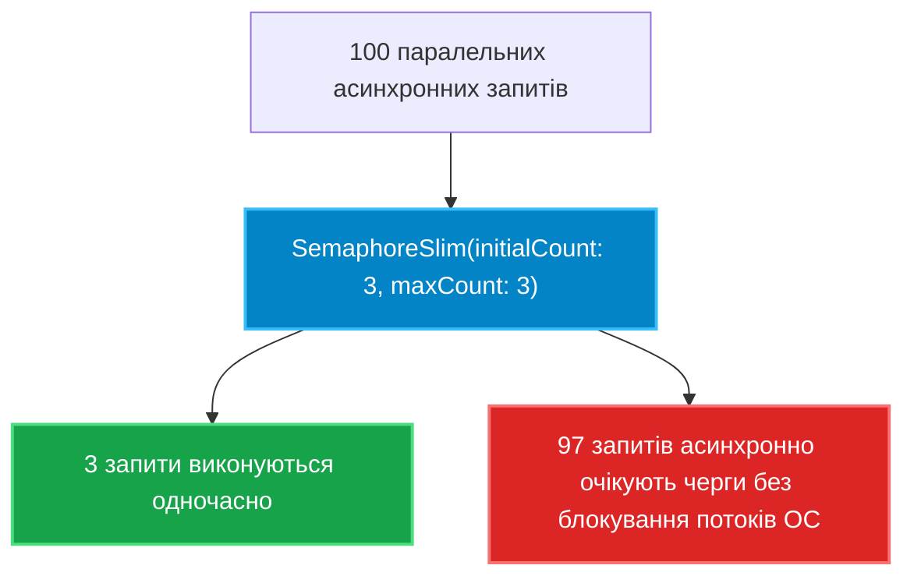

# 03. Сигнальні примітиви: `SemaphoreSlim` та `ReaderWriterLockSlim`

## 1. Обмеження взаємного виключення (`lock` / `Monitor`)

Стандартний блок `lock` дозволяє перебувати в критичній секції строго **одному** потоку. Проте в реальних архітектурах виникають задачі іншого типу:
1. **Обмеження пропускної здатності (Throttling)**: Дозволити паралельний доступ до обмеженого пулу ресурсів не більше ніж $N$ потокам одночасно (наприклад, не більше 5 одночасних підключень до зовнішнього API).
2. **Перевага читання над записом (Readers-Writer)**: Спільний кеш зчитується тисячами потоків на секунду без взаємних конфліктів, але запис нового значення повинен бути ексклюзивним.

Для таких задач застосовуються спеціалізовані високорівневі примітиви: **`SemaphoreSlim`** та **`ReaderWriterLockSlim`**.

---

## 2. `SemaphoreSlim`: Асинхронне дротелювання запитів

`SemaphoreSlim` є полегшеною керованою версією семафора ОС:
* На відміну від `Monitor`, він підтримує повністю асинхронний вхід через **`await semaphore.WaitAsync()`**. Це критично важливо, оскільки звичайний `lock` заборонено використовувати разом із ключовим словом `await` (викличе помилку компілятора `CS1996`).



### Патерн безпечного використання SemaphoreSlim

```csharp
private readonly SemaphoreSlim _semaphore = new(initialCount: 5, maxCount: 5);

public async Task DownloadFileAsync(string url)
{
    // Асинхронне очікування слота (не блокує потік ОС!):
    await _semaphore.WaitAsync();
    try
    {
        await ProcessDownloadInternalAsync(url);
    }
    finally
    {
        // Гарантоване звільнення слота для наступного завдання в черзі:
        _semaphore.Release();
    }
}
```

---

## 3. `ReaderWriterLockSlim`: Оптимізація паралельного читання

Якщо блокувати операції читання через `lock`, паралельні потоки будуть шикуватися в чергу, навіть якщо вони не змінюють дані. `ReaderWriterLockSlim` розв'язує цю проблему, розділяючи рівні доступу:
* **Read Lock (`EnterReadLock`)**: Дозволяє довільній кількості потоків одночасно читати спільний стан.
* **Write Lock (`EnterWriteLock`)**: Повністю блокує всі читання та інші записи на час модифікації.
* **Upgradeable Read Lock (`EnterUpgradeableReadLock`)**: Дозволяє читати стан і атомарно перемикатися в режим запису без ризику виникнення взаємного блокування (Deadlock).

---

## 4. Порівняльна таблиця примітивів синхронізації

| Примітив | Підтримка `await` | Кількість одночасних потоків | Призначення |
|:---|:---:|:---:|:---|
| **`lock` (`Monitor`)** | **Ні** | Строго 1 | Прості короткі критичні секції в пам'яті |
| **`System.Threading.Lock` (.NET 9)** | **Ні** | Строго 1 | Ультрашвидкий ексклюзивний вхід без boxing |
| **`SemaphoreSlim`** | **Так (`WaitAsync`)** | Від $1$ до $N$ | Обмеження черги, доступ до зовнішніх API |
| **`ReaderWriterLockSlim`** | **Ні** | Багато читачів, 1 письменник | Швидкі кеші в пам'яті з частим читанням |

---

## 5. Матриця проєкту цієї секції

| Проєкт | Посилання на вихідний код | Що демонструє під капотом |
|:---|:---|:---|
| [`03-SemaphoreSlimAndReaderWriterLock`](../03-SemaphoreSlimAndReaderWriterLock/Program.cs) | [Program.cs](../03-SemaphoreSlimAndReaderWriterLock/Program.cs) | Дротелювання асинхронних викликів за допомогою `SemaphoreSlim.WaitAsync()` та оптимізація читань кешу через `ReaderWriterLockSlim`. |
