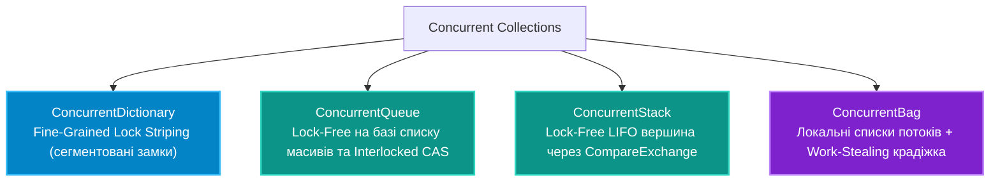

# 04. Потокобезпечні колекції (`System.Collections.Concurrent`)

## 1. Чому стандартні колекції (`List<T>`, `Dictionary<TKey, TValue>`) небезпечні?

Стандартні колекції простору імен `System.Collections.Generic` оптимізовані під максимальну продуктивність в одному потоці. При спробі паралельного запису:
1. `Dictionary`: Може зациклитися внутрішній зв'язаний список колізій хеш-таблиці, що призводить до **100% завантаження процесора (Infinite Loop)**.
2. `List`: Одночасний виклик `.Add()` призводить до пошкодження внутрішнього масиву та тихих втрат елементів.

Захист кожної операції через глобальний `lock (_syncRoot)` створює "вузьке горло" (Bottleneck), повністю зводячи нанівець переваги багатоядерних процесорів.

---

## 2. Огляд колекцій простору `System.Collections.Concurrent`



---

## 3. Детальний аналіз внутрішнього устрою

### 1. `ConcurrentDictionary<TKey, TValue>` (Сегментоване блокування - Lock Striping)
Замість одного спільного замка словник використовує масив окремих незалежних замків. Читання взагалі виконується **без блокувань**. Запис блокує лише один відповідний бакет (сегмент), дозволяючи іншим потокам паралельно записувати в сусідні слоти.

Методи модифікації є атомарними:
```csharp
var dict = new ConcurrentDictionary<string, int>();

// Атомарно: якщо ключ є — оновлює значення, якщо немає — додає
dict.AddOrUpdate("downloads", 1, (key, current) => current + 1);

// Отримання або ліниве створення значення:
var data = dict.GetOrAdd("key", key => LoadDataFromDb(key));
```

### 2. `ConcurrentQueue<T>` (Безблокувальна черга FIFO)
Побудована на базі зв'язаного списку сегментів фіксованого розміру (32 елементи). Всі операції постановки `Enqueue` та вилучення `TryDequeue` виконуються через безблокувальні цикли процесорних інструкцій `Interlocked.CompareExchange`.

### 3. `ConcurrentBag<T>` (Невпорядкована сумка)
Ідеальна для задач, де один і той самий потік спочатку генерує елементи, а потім сам їх споживає. Кожен потік має власне сховище, що мінімізує будь-яку міжпотокову конкуренцію.

---

## 4. Порівняльна матриця колекцій

| Колекція | Порядок елементів | Механізм безпеки | Найкраще застосування |
|:---|:---:|:---|:---|
| **`ConcurrentDictionary`** | За хеш-ключами | Дрібнозернисті замки (Lock Striping) | Кеші спільних даних, словники сесій |
| **`ConcurrentQueue`** | Суворий FIFO | Повністю Lock-Free (CAS) | Конвеєри обробки повідомлень Producer-Consumer |
| **`ConcurrentStack`** | Суворий LIFO | Повністю Lock-Free (CAS) | Пули повторного використання важких об'єктів |
| **`ConcurrentBag`** | Не гарантовано | Thread-Local сховища + Work-Stealing | Паралельні цикли `Parallel.ForEach` |

---

## 5. Матриця проєкту цієї секції

| Проєкт | Посилання на вихідний код | Що демонструє під капотом |
|:---|:---|:---|
| [`04-ConcurrentCollectionsDemo`](../04-ConcurrentCollectionsDemo/Program.cs) | [Program.cs](../04-ConcurrentCollectionsDemo/Program.cs) | Практика багатопотокового наповнення `ConcurrentDictionary`, виклик методів `AddOrUpdate` та тестування черги `ConcurrentQueue`. |
