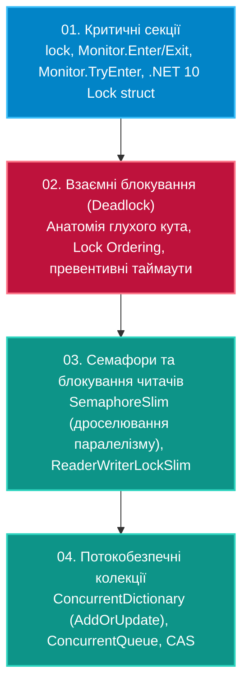

# Підмодуль 02: Синхронізація та безпека потоків (`OOP - Synchronization.sln`)

Цей підмодуль охоплює критичні концепції координації потоків у .NET:
від класичного `lock` і `Monitor` до інноваційного типу `.NET 9 / .NET 10 System.Threading.Lock`, аналіз та превентивне запобігання взаємним блокуванням (**Deadlock**) за правилом Lock Ordering, дроселювання запитів через `SemaphoreSlim`, оптимізація читання-запису через `ReaderWriterLockSlim` та робота з потокобезпечними колекціями `System.Collections.Concurrent`.

---

## Навчальна дорожня карта синхронізації



---

## Навігація по навчальних посібниках (`Docs`)

| № | Посібник | Ключові теми та системні механізми | Посилання на документ |
|:---:|:---|:---|:---|
| 01 | **Критичні секції: lock, Monitor та .NET 10 Lock** | Механізм SyncBlockIndex у заголовку об'єкта, TryEnter із таймаутом, новий тип `System.Threading.Lock` | [Docs/01_Lock_Monitor_And_DotNet9_Lock.md](Docs/01_Lock_Monitor_And_DotNet9_Lock.md) |
| 02 | **Взаємні блокування (Deadlock)** | Циклічні очікування ресурсів, ієрархічне впорядкування захоплення блокувань (Lock Hierarchy) | [Docs/02_Deadlocks_And_Prevention.md](Docs/02_Deadlocks_And_Prevention.md) |
| 03 | **Семафори та ReaderWriterLock** | Обмеження кількості одночасних операцій (`SemaphoreSlim`), поділ доступу на читачів і письменників | [Docs/03_SemaphoreSlim_And_ReaderWriterLock.md](Docs/03_SemaphoreSlim_And_ReaderWriterLock.md) |
| 04 | **Потокобезпечні колекції** | `ConcurrentDictionary`, `ConcurrentQueue`, `ConcurrentBag`, атомарний метод `AddOrUpdate` | [Docs/04_Concurrent_Collections.md](Docs/04_Concurrent_Collections.md) |

---

## Структура проєктів рішення `OOP - Synchronization.sln`

* **`01. Критичні секції: lock, Monitor та .NET 10 System.Threading.Lock`**
  * `01-LockAndMonitor`
* **`02. Взаємне блокування (Deadlock) та ієрархічне впорядкування ресурсів`**
  * `02-DeadlockAndPrevention`
* **`03. Семафори (SemaphoreSlim) та блокування читання-запису (ReaderWriterLockSlim)`**
  * `03-SemaphoreSlimAndReaderWriterLock`
* **`04. Потокобезпечні колекції (ConcurrentDictionary, ConcurrentQueue)`**
  * `04-ConcurrentCollections`

---

## Збірка та запуск

```powershell
dotnet build "06-Multithreading-And-Parallelism/02-Synchronization-And-ThreadSafety/OOP - Synchronization.sln" -c Release
```
