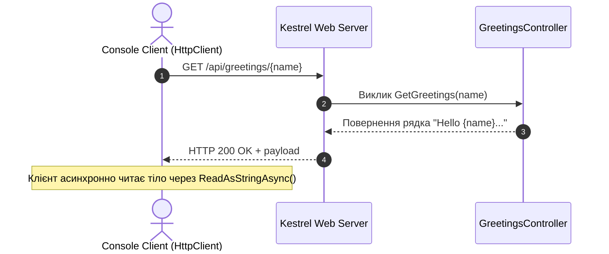

# 03. Web API Backend для асинхронних клієнтів (ReturnAValueFromTask-API)

## Теоретичний огляд

В архітектурі розподілених систем веб-сервер (наприклад, **Kestrel** у .NET) повинен ефективно обробляти тисячі паралельних з'єднань.
- Якщо обробник запиту синхронно очікує I/O (базу даних, зовнішній сервіс), потік веб-сервера блокується.
- В асинхронній моделі сервер приймає запит, делегує операцію драйверу I/O і відпускає потік Kestrel назад у пул. Коли відповідь готова, вільний потік повертає HTTP-відповідь клієнту.

Цей проект виступає локальним тестовим сервером для консольних клієнтів `03-ReturnAValueFromTask-Console` та `03-ReturnAValueFromTask-ConsolewithERROR`.

---

## Візуалізація: Клієнт-Серверна взаємодія

---

## Маршрутизація

- **Ендпоінт**: `GET api/greetings/{name}`
- **Контролер**: `GreetingsController`
- **Відповідь**: Текстовий рядок привітання: `Hello {name}, Welcome to Web API`.

---

## Modern .NET Best Practices для Web API

1. **`ActionResult<T>` замість примітивного типу:**
   Для продакшен API рекомендується повертати `Task<ActionResult<string>>`, що дозволяє легко повертати HTTP-статуси `Ok()`, `NotFound()`, `BadRequest()`.
2. **Асинхронні дії контролера:**
   Якщо контролер звертається до БД або стороннього сервісу, метод обов'язково має бути `async Task<...>`.
