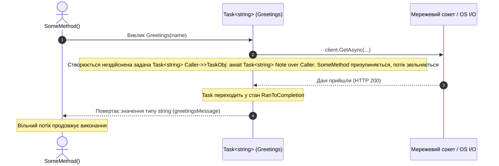

# 03. Отримання результату з Task<T> (ReturnAValueFromTask-Console)

## Теоретичний огляд

Коли асинхронна операція повинна повернути обчислене значення або дані I/O, вона повертає не чистий тип `T`, а обгортку **`Task<T>`** (майбутнє значення або "Promise"):
- Поки операція триває, `Task<T>` перебуває у стані `WaitingForActivation` або `Running`.
- Коли результат готовий, задача переходить у стан `RanToCompletion`, а властивість `task.Result` заповнюється даними.

### Роль оператора `await`:
Замість блокуючого читання `task.Result` (яке заморожує потік ОС і загрожує взаємним блокуванням — Deadlock), оператор `await`:
1. Призупиняє виконання поточного методу.
2. Повертає потік у пул.
3. Після завершення операції автоматично розгортає `Task<T>` і повертає значення типу `T`.

---

## Візуалізація: Розгортання Task<T> без блокування



---

## Розбір коду

```csharp
// 1. Повернення задачі з типом результату Task<string> public static async Task<string> Greetings(string name)
{
    using var client = new HttpClient { BaseAddress = new Uri("https://localhost:7118/") };
    
    // Асинхронний I/O: потік не чекає на байти мережі
    HttpResponseMessage response = await client.GetAsync($"api/greetings/{name}");
    return await response.Content.ReadAsStringAsync();
}

// 2. Споживання результату через await
var greetingsMessage = await Greetings(name); // Тип змінної - string, а не Task<string>!
```

---

## Важливі застереження: Socket Exhaustion
У цьому навчальному прикладі `HttpClient` загорнуто в `using`. У високонавантажених системах багаторазове створення/знищення `HttpClient` призводить до вичерпання дескрипторів сокетів (**Socket Exhaustion** в стані `TIME_WAIT`).
- **Рішення в реальних проектах:** Використання єдиного статичного екземпляра `static readonly HttpClient` або впровадження `IHttpClientFactory` через Dependency Injection.
