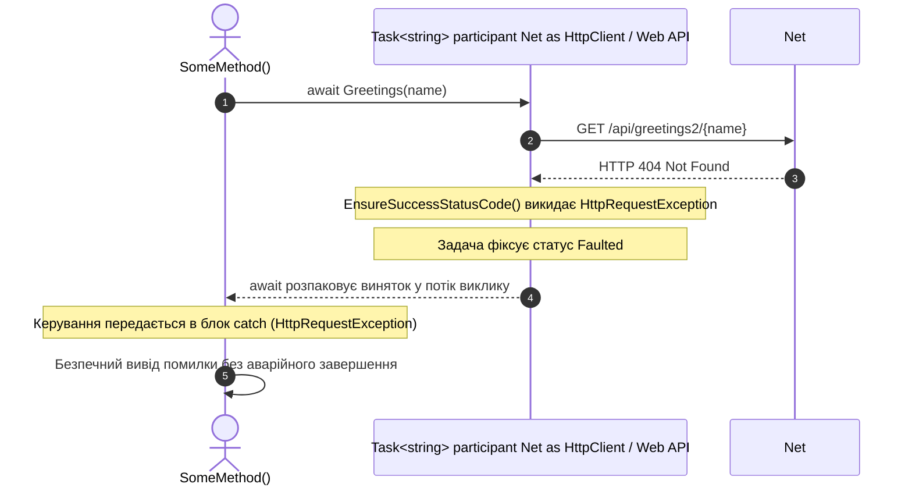

# 03. Асинхронні помилки та винятки (ReturnAValueFromTask-ConsolewithERROR)

## Теоретичний огляд

В асинхронному програмуванні винятки не можуть просто «спливти» по стеку викликів, оскільки викликаючий потік міг давно повернутися в пул потоків.
- Коли всередині `Task` виникає помилка, вона упаковується в об'єкт **`AggregateException`**, а сама задача переходить у стан **`Faulted`**.
- Коли ми робимо **`await task`**, компілятор .NET автоматично витягує (розгортає) перший внутрішній виняток (`InnerException`) і повторно викидає його так, ніби це звичайний синхронний код.

Це дозволяє писати звичні конструкції `try { await ... } catch (SpecificException ex) { ... }`.

---

## Візуалізація: Життєвий цикл помилки в асинхронному виклику



---

## Ключові моменти коду

```csharp
// 1. Метод перевіряє статус та генерує виняток при неуспішній відповіді
HttpResponseMessage response = await client.GetAsync($"api/greetings2/{name}");
response.EnsureSuccessStatusCode(); // Викидає HttpRequestException при 404/500

// 2. Безпечне перехоплення винятку через try/catch
try
{
    var message = await Greetings(name);
}
catch (HttpRequestException ex)
{
    Console.WriteLine($"[Помилка мережі]: {ex.Message}");
}
```

---

## Modern .NET Best Practices

1. **`async void` і неперехоплені винятки:**
   Якщо в методі з `async void` виникає виняток поза блоком `try/catch`, програма аварійно завершується без можливості глобального перехоплення через `TaskScheduler.UnobservedTaskException`. Завжди повертайте `Task`!
2. **Типізовані клієнти:**
   У сучасних архітектурах для викликів зовнішніх API використовують типізовані `HttpClient` з політиками повторних спроб (**Polly retry / circuit breaker**).
