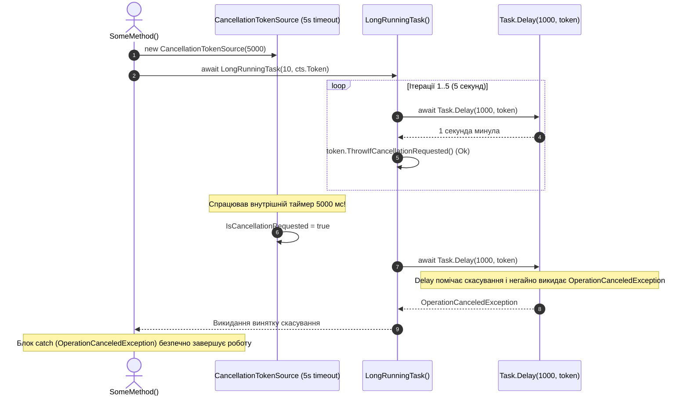

# 07. Кооперативне скасування операцій (CancellationTokenToCancelATask)

## Теоретичний огляд

В ранніх версіях .NET існував метод `Thread.Abort()`, який примусово вбивав потік. Це визнано небезпечним антипатерном, оскільки примусова зупинка призводить до пошкодженого стану пам'яті (corrupted memory state), незакритих з'єднань із базою даних та завислих дескрипторів файлів.

У сучасному .NET застосовується **кооперативне скасування (Cooperative Cancellation)**:
1. **`CancellationTokenSource` (CTS):** Об'єкт-керівник, який видає токен і керує сигналом (`Cancel()` або автоматично через таймаут `new CancellationTokenSource(timeoutMs)` чи `cts.CancelAfter(...)`).
2. **`CancellationToken` (CT):** Легковажна структура, яку метод-виконавець отримує як параметр. Вона дозволяє лише перевіряти статус скасування (`IsCancellationRequested` або `ThrowIfCancellationRequested()`), але не може сама ініціювати скасування.

---

## Візуалізація: Двостороння модель кооперативного скасування



---

## Ключові конструкції коду

### 1. Передача токена у вкладені методи:
```csharp
// Найкраща практика: передавати токен у всі асинхронні бібліотечні виклики
await Task.Delay(1000, token);
await httpClient.GetAsync(url, token);
await dbContext.SaveChangesAsync(token);
```

### 2. Ідіоматична перевірка:
```csharp
// Замість ручного if:
// if (token.IsCancellationRequested) throw new TaskCanceledException();

// Використовуйте стандартний метод:
token.ThrowIfCancellationRequested(); // Генерує OperationCanceledException(token)
```

---

## Об'єднання токенів (Linked Tokens)
Якщо потрібно враховувати і ручне скасування від користувача (наприклад, клік на кнопку «Скасувати»), і внутрішній таймаут (наприклад, 30 секунд), створюють зв'язаний токен:
```csharp
using var linkedCts = CancellationTokenSource.CreateLinkedTokenSource(userToken, timeoutCts.Token);
await DoWorkAsync(linkedCts.Token);
```
Операція скасується, якщо спрацює **хоча б одне** із джерел.
