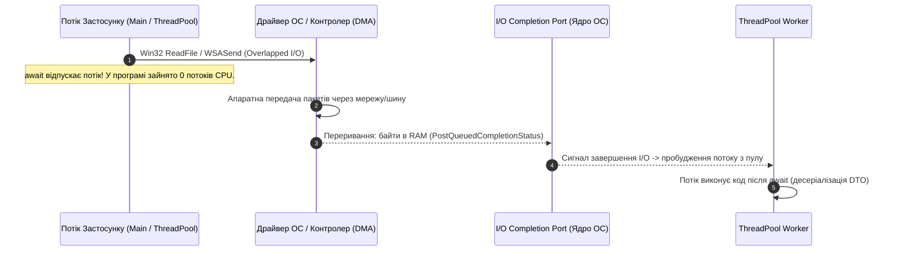
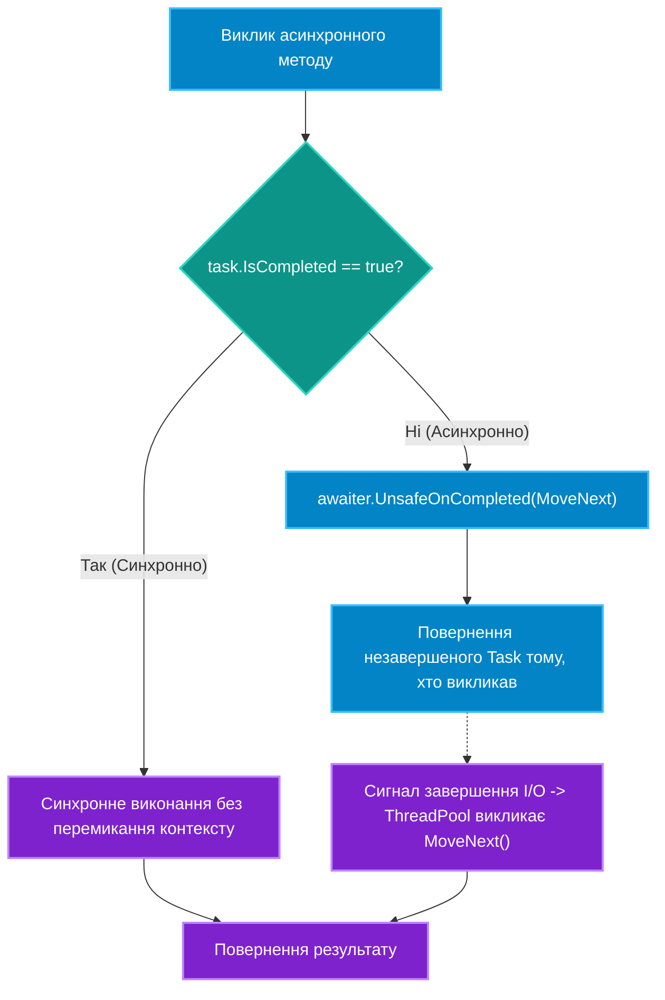

# 01. Архітектура Async / Await та Кінцевий Автомат Task (`IAsyncStateMachine`)

## 1. Вступ: Парадигма TAP (Task-based Asynchronous Pattern)

Асинхронне програмування в сучасному C# базується на патерні **TAP** та ключових словах `async` і `await`. Воно покликане радикально підвищити масштабованість додатків під час операцій введення-виведення (**I/O-Bound**: взаємодія з базами даних, мережею, дисковою підсистемою, зовнішніми HTTP API), повністю звільняючи потік процесора на час очікування апаратної відповіді.

---

## 2. Асинхронність (I/O-Bound) проти Багатопоточності (CPU-Bound)

| Характеристика | Асинхронність (I/O-Bound) | Багатопоточність (CPU-Bound) |
|:---|:---|:---|
| **Основна мета** | Звільнити поточний потік, доки зовнішній контролер очікує дані | Розпаралелити важкі обчислення між кількома фізичними ядрами CPU |
| **Споживання потоків** | **0 потоків** під час фізичного очікування пакетів сокета в ОС | 1 або більше постійно зайнятих ядер процесора (100% Load) |
| **Типові операції** | SQL-запити, HTTP REST-запити, читання/запис файлів на диск | Відеорендеринг, машинне навчання, криптографія, парсинг гігабайтних архівів |

### 2.1. Фундаментальний принцип: "There is no thread" та низькорівневий I/O
Найпоширеніша помилка новачків — вважати, що коли виконується `await httpClient.GetAsync(...)`, у фоні створено додатковий потік, який "сидить і чекає відповіді". **Ніякого потоку немає!**

1. **Overlapped I/O**: Рантайм C# через системні виклики ОС (Win32 API або Linux Sockets) передає запит драйверу мережевої карти чи контролеру диска і негайно відпускає потік .NET.
2. **Апаратна передача (DMA)**: Контролер SSD або мережевий адаптер сам перекачує байти безпосередньо в оперативну пам'ять за технологією Direct Memory Access (DMA). Процесор (CPU) у цей час не завантажений.
3. **IOCP (Windows) / io_uring (Linux)**: Коли передача закінчена, залізо генерує апаратне переривання. Ядро ОС кладе пакет завершення в чергу **I/O Completion Port (IOCP)**. Спеціальний I/O-потік з пулу .NET миттєво зчитує статус і передає сигнал автомату станів продовжити виконання коду після `await`.



### 2.2. Чому операції над RAM (математика, сортування) вимагають потоку?
Оперативна пам'ять (RAM) — це пасивний масив кремнієвих комірок, у неї **немає власного процесора**. Будь-яке сортування списку в пам'яті, фільтрація через LINQ чи розрахунок хешу вимагають тактів CPU.
* Написати `async Task SortAsync()` без виклику фонового потоку — означає виконати сортування **синхронно в поточному потоці**, заблокувавши його.
* Для CPU-Bound обчислень обов'язково використовувати багатопотоковість через **`Task.Run(() => HeavyCompute())`**.

### 2.3. Динаміка пулу потоків (ThreadPool) та алгоритм Hill Climbing
* **Мінімум потоків**: За замовчуванням дорівнює кількості логічних ядер CPU (наприклад, 8 або 16). Вони створюються миттєво.
* **Максимум потоків**: Зазвичай 32 767 потоків (на 64-бітних системах).
* **Алгоритм Hill Climbing**: Якщо всі мінімальні потоки заблоковані (наприклад, через `Thread.Sleep`), пул не створює тисячі потоків одразу. Він додає приблизно 1–2 потоки на секунду, щоб уникнути виснаження оперативної пам'яті (~1 МБ на потік) та надмірного перемикання контексту (Context Switching).

---

## 3. Компіляторна трансформація: Структура `IAsyncStateMachine`

Ключове слово `async` не створює новий потік автоматично. Компілятор Roslyn виконує так зване "опускання коду" (lowering), перетворюючи ваш метод на структуру, яка реалізує інтерфейс `IAsyncStateMachine`:
1. Усі локальні змінні методу перетворюються на поля структури стану.
2. Метод розбивається на блоки `switch (state)` всередині методу `MoveNext()`.
3. При зустрічі виразу `await task`:
   * Якщо задача вже завершена синхронно (`task.IsCompleted == true`), виконання йде далі без затримок і без перемикання потоків.
   * Якщо задача ще виконується, призначається продовження (`awaiter.UnsafeOnCompleted`), стан фіксується числом (наприклад, `state = 0`), а поточний потік повертається в пул або до черги UI.



---

## 4. Небезпека "Sync-over-Async" та блокувань Deadlock

### Чому виклики `.Result` та `.Wait()` є антипатерном?
1. **Thread Pool Starvation**: Блокування робочого потоку пулу в очікуванні відповіді позбавляє сервер здатності обробляти інші клієнтські запити.
2. **Класичний Deadlock у UI (WPF / WinForms)**:
   * UI-потік викликає `GetDataAsync().Result`.
   * `GetDataAsync` відпускає потік на час I/O.
   * Коли I/O завершується, `await` намагається повернутися в UI-потік через `SynchronizationContext`.
   * Але UI-потік **намертво заблокований** викликом `.Result`! Виникає взаємне вічне блокування.
3. **AggregateException**: Блокуючі виклики загортають справжню помилку у важкодоступну "матрьошку" `AggregateException`.

```csharp
// ПОГАНО: Синхронне блокування асинхронного методу викликає взаємне блокування (Deadlock)
public void ProcessData()
{
    // ПОМИЛКА: .Result блокує потік і ховає реальні винятки
    string json = FetchDataAsync().Result; 
}

// ДОБРЕ: Наскрізне асинхронне проектування ("Async all the way")
public async Task ProcessDataAsync()
{
    string json = await FetchDataAsync();
}
```

---

## 5. Типи повернення: `Task`, `Task<T>`, `ValueTask<T>` та заборона `async void`

| Тип повернення | Призначення | Виділення пам'яті (Heap Allocation) |
|:---|:---|:---|
| **`Task`** | Асинхронна операція без повернення значення | 1 об'єкт у heap на кожну операцію |
| **`Task<T>`** | Асинхронна операція, що повертає значення `T` | 1 об'єкт у heap |
| **`ValueTask<T>`** | Структура для високонавантажених шляхів, де результат часто вже в кеші | **0 алокацій**, якщо результат доступний синхронно |
| **`async void`** | **Заборонено в бізнес-коді!** Тільки для UI-подій (`btn_Click`) | Неможливо перехопити через `try-catch` ззовні, обвалює процес |

---

## 6. Матриця проєктів цієї секції

| Проєкт | Посилання на вихідний код | Що демонструє під капотом |
|:---|:---|:---|
| [`01-AsyncAndAwait`](../01-AsyncAndAwait/Program.cs) | [Program.cs](../01-AsyncAndAwait/Program.cs) | Базовий синтаксис `async` / `await`, відмінність від синхронного блокування потоків. |
| [`02-Tasks`](../02-Tasks/Program.cs) | [Program.cs](../02-Tasks/Program.cs) | Створення та запуск завдань через `Task.Run` та управління станами задачі. |
| [`03-ReturnAValueFromTask-Console`](../03-ReturnAValueFromTask-Console/Program.cs) | [Program.cs](../03-ReturnAValueFromTask-Console/Program.cs) | Робота з `Task<T>`, коректне розгортання значення через `await`. |
| [`EX_01_async_await`](../EX_01_async_await/Program.cs) | [Program.cs](../EX_01_async_await/Program.cs) | Трасування ідентифікаторів потоків до та після оператора `await`. |
