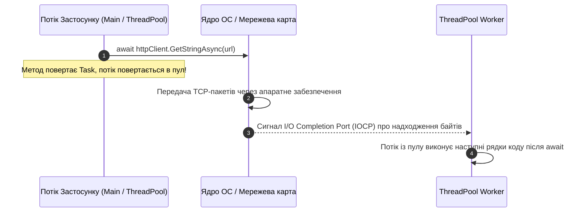

# 01. Архітектура Async / Await та Кінцевий Автомат Task (`IAsyncStateMachine`)

## 1. Вступ: Парадигма TAP (Task-based Asynchronous Pattern)

Асинхронне програмування в сучасному C# базується на патерні **TAP** та ключових словах `async` і `await`. Воно покликане радикально підвищити масштабованість додатків під час операцій введення-виведення (**I/O-Bound**: взаємодія з базами даних, мережею, дисковою підсистемою, зовнішніми HTTP API), повністю звільняючи потік процесора на час очікування апаратної відповіді.

---

## 2. Асинхронність (I/O-Bound) проти Багатопоточності (CPU-Bound)

| Характеристика | Асинхронність (I/O-Bound) | Багатопоточність (CPU-Bound) |
|:---|:---|:---|
| **Основна мета** | Звільнити поточний потік, доки зовнішній контролер очікує дані | Розпаралелити важкі обчислення між кількома фізичними ядрами CPU |
| **Споживання потоків** | **0 потоків** під час фізичного очікування пакетів сокета в ОС | 1 або більше постійно зайнятих ядер процесора (100% Load) |
| **Типові операції** | SQL-запити, HTTP REST-запити, читання/запис файлів на диск | Відеорендеринг, машинне навчання, криптографія, парсинг гігабайтних архівів |



---

## 3. Компіляторна трансформація: Структура `IAsyncStateMachine`

Ключове слово `async` не створює новий потік автоматично. Компілятор Roslyn виконує так зване "опускання коду" (lowering), перетворюючи ваш метод на структуру, яка реалізує інтерфейс `IAsyncStateMachine`:
1. Усі локальні змінні методу перетворюються на поля структури стану.
2. Метод розбивається на блоки `switch (state)` всередині методу `MoveNext()`.
3. При зустрічі виразу `await task`:
   * Якщо задача вже завершена синхронно (`task.IsCompleted == true`), виконання йде далі без затримок.
   * Якщо задача ще виконується, призначається продовження (`awaiter.UnsafeOnCompleted`), стан фіксується числом (наприклад, `state = 0`), а керування повертається викликаючому коду.

```mermaid
flowchart TD
    classDef st fill:#0284c7,stroke:#38bdf8,color:#ffffff,stroke-width:2px;
    classDef chk fill:#0d9488,stroke:#2dd4bf,color:#ffffff,stroke-width:2px;
    classDef run fill:#7e22ce,stroke:#c084fc,color:#ffffff,stroke-width:2px;

    Start["Виклик асинхронного методу"]:::st --> Check{"task.IsCompleted == true?"}:::chk
    Check -->|Так (Синхронно)| Next["Синхронне виконання без перемикання контексту"]:::run
    Check -->|Ні (Асинхронно)| Hook["awaiter.UnsafeOnCompleted(MoveNext)"]:::st
    Hook --> ReturnTask["Повернення незавершеного Task тому, хто викликав"]:::st
    ReturnTask -.-> Complete["Сигнал завершення I/O -> ThreadPool викликає MoveNext()"]:::run
    Next --> End["Повернення результату"]:::run
    Complete --> End
```

---

## 4. Небезпека "Sync-over-Async" та блокувань Deadlock

### Антипатерн проти правильної взаємодії

```csharp
// ПОГАНО: Синхронне блокування асинхронного методу викликає взаємне блокування (Deadlock)
// або виснаження пулу потоків (Thread Pool Starvation)!
public void ProcessData()
{
    // ПОМИЛКА: .Result або .Wait() блокує поточний потік в очікуванні задачі,
    // яка потребує цей же контекст для завершення!
    string json = FetchDataAsync().Result; 
}

// ДОБРЕ: Наскрізне асинхронне проектування ("Async all the way")
public async Task ProcessDataAsync()
{
    string json = await FetchDataAsync();
}
```

---

## 5. Типи повернення: `Task`, `Task<T>`, `ValueTask<T>` та заборона `async void`

| Тип повернення | Призначення | Виділення пам'яті (Heap Allocation) |
|:---|:---|:---|
| **`Task`** | Асинхронна операція без повернення значення | 1 об'єкт у heap на кожну операцію |
| **`Task<T>`** | Асинхронна операція, що повертає значення `T` | 1 об'єкт у heap |
| **`ValueTask<T>`** | Структура для високонавантажених шляхів, де результат часто вже в кеші | **0 алокацій**, якщо результат доступний синхронно |
| **`async void`** | **Заборонено в бізнес-коді!** Тільки для UI-подій (`btn_Click`) | Неможливо перехопити через `try-catch` ззовні, обвалює процес |

---

## 6. Матриця проєктів цієї секції

| Проєкт | Посилання на вихідний код | Що демонструє під капотом |
|:---|:---|:---|
| [`01-AsyncAndAwait`](../01-AsyncAndAwait/Program.cs) | [Program.cs](../01-AsyncAndAwait/Program.cs) | Базовий синтаксис `async` / `await`, відмінність від синхронного блокування потоків. |
| [`02-Tasks`](../02-Tasks/Program.cs) | [Program.cs](../02-Tasks/Program.cs) | Створення та запуск завдань через `Task.Run` та управління станами задачі. |
| [`03-ReturnAValueFromTask-Console`](../03-ReturnAValueFromTask-Console/Program.cs) | [Program.cs](../03-ReturnAValueFromTask-Console/Program.cs) | Робота з `Task<T>`, коректне розгортання значення через `await`. |
| [`EX_01_async_await`](../EX_01_async_await/Program.cs) | [Program.cs](../EX_01_async_await/Program.cs) | Трасування ідентифікаторів потоків до та після оператора `await`. |
