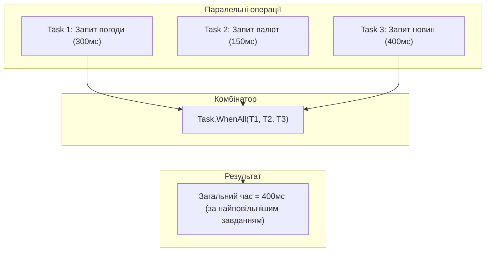

# Координація завдань, комбінатори Task.WhenAll та троттлінг через SemaphoreSlim

## Вступ
При одночасному виконанні множини асинхронних операцій критично важливо правильно координувати їхнє завершення та контролювати навантаження на зовнішні ресурси.

---

## 1. Комбінатори завдань: Task.WhenAll та Task.WhenAny



### Застосування Task.WhenAll:
```csharp
Task<string> weatherTask = GetWeatherAsync();
Task<decimal> ratesTask = GetExchangeRatesAsync();

// Чекаємо завершення обох операцій паралельно
await Task.WhenAll(weatherTask, ratesTask);

string weather = await weatherTask;
decimal rate = await ratesTask;
```

### Патерн конкурентної гонки через Task.WhenAny:
`Task.WhenAny` повертає першу задачу, яка перейшла в стан завершення (успіх, скасування чи помилка). Це ідеально для реалізації таймаутів або вибору найшвидшого дзеркала:
```csharp
Task<string> downloadTask = DownloadDataAsync(url);
Task timeoutTask = Task.Delay(5000); // 5 секунд ліміт

Task completedTask = await Task.WhenAny(downloadTask, timeoutTask);
if (completedTask == timeoutTask)
{
    throw new TimeoutException("Сервер не відповів за 5 секунд!");
}

string result = await downloadTask;
```

---

## 2. Троттлінг: Обмеження паралелізму через SemaphoreSlim

Якщо потрібно завантажити 10 000 файлів або відправити 5 000 HTTP-запитів, прямий виклик `Task.WhenAll` призведе до вичерпання пулу сокетів (Socket Exhaustion) або відмови бази даних через перевантаження пулу з'єднань.

### 2.1. Чому звичайний `lock` заборонений в async/await?
* У C# конструкція `lock(locker)` компілюється в методи `Monitor.Enter` та `Monitor.Exit`.
* Монітор вимагає **Thread Affinity** — той самий потік, який захопив замок, зобов'язаний його звільнити.
* Оскільки після виклику `await` код продовжує виконуватися на **іншому потоці з пулу**, виклик `Monitor.Exit` кине критичний виняток `SynchronizationLockException`.
* **Рішення**: Для асинхронного блокування критичних секцій використовується `SemaphoreSlim(1, 1)`:
  ```csharp
  private static readonly SemaphoreSlim _asyncLock = new(1, 1);

  await _asyncLock.WaitAsync(); // Неблокуюче очікування черги!
  try
  {
      await UpdateSharedResourceAsync();
  }
  finally
  {
      _asyncLock.Release();
  }
  ```

### 2.2. Чому "Slim"?
* Класичний `System.Threading.Semaphore` — це важкий об'єкт ядра операційної системи (Kernel Object), що дозволяє синхронізувати різні процеси, але створює значні накладні витрати CPU.
* `SemaphoreSlim` — це легкий керований примітив (Managed), оптимізований суто для одного процесу. Він надає неблокуючий метод `WaitAsync()` і підтримує передачу `CancellationToken`.

### 2.3. Патерн троттлінгу з SemaphoreSlim:
```csharp
var semaphore = new SemaphoreSlim(initialCount: 5); // Максимум 5 одночасних завдань
var tasks = urls.Select(async url => {
    await semaphore.WaitAsync(); // Чекаємо дозволу
    try
    {
        return await client.GetStringAsync(url);
    }
    finally
    {
        semaphore.Release(); // Звільняємо слот для іншого завдання
    }
});

string[] results = await Task.WhenAll(tasks);
```

### 2.4. Сучасна альтернатива: `Parallel.ForEachAsync` (.NET 6+)
У сучасному .NET для пакетної обробки з обмеженням паралелізму часто зручніше використовувати вбудований метод `Parallel.ForEachAsync`:
```csharp
await Parallel.ForEachAsync(urls, new ParallelOptions { MaxDegreeOfParallelism = 5 }, async (url, ct) =>
{
    var content = await client.GetStringAsync(url, ct);
    await SaveToDbAsync(content, ct);
});
```

---

## 3. Проєкти для практики

- [04-ExecuteMultipleTasks](../04-ExecuteMultipleTasks/Program.cs) — Запуск кількох незалежних завдань без блокування головного потоку.
- [04-ExecuteMultipleTasks-Task.WhenAll](../04-ExecuteMultipleTasks-Task.WhenAll/Program.cs) — Координація масиву завдань через `Task.WhenAll`.
- [05-LimitTheNumberOfConcurrentTasks](../05-LimitTheNumberOfConcurrentTasks/Program.cs) — Обмеження пулу одночасних завдань за допомогою семафора.
- [06-HandleResponseWhenExecutingMultipleTasks](../06-HandleResponseWhenExecutingMultipleTasks/Program.cs) — Обробка результатів кожного завдання в міру їхньої готовності.
