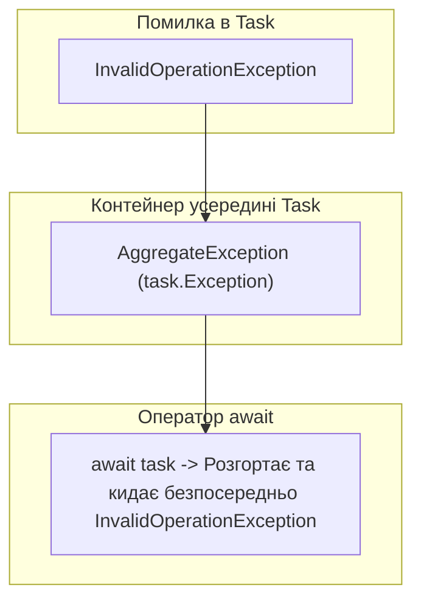

# Обробка виключень в асинхронному коді: Розгортання AggregateException

## Вступ
Асинхронні операції виконуються в іншому контексті або потоці, тому класична обробка виключень вимагає розуміння того, як `Task` інкапсулює помилки і як оператор `await` розгортає їх.

---

## 1. Як Task зберігає виключення: Контейнер AggregateException

Коли в асинхронному методі виникає виключення, викликаючий потік не падає негайно. Замість цього `Task` переходить у стан `Faulted`, а об'єкт виключення огортається в контейнер `AggregateException` і зберігається у властивості `task.Exception`.



### Магія оператора await:
Якщо звертатися до завдання через блокуючі властивості `task.Wait()` або `task.Result`, ви отримаєте `AggregateException`.
Але якщо використовувати **`await task`**, компілятор автоматично розпаковує перше виключення зі списку, дозволяючи використовувати звичайні типізовані блоки `catch`:

```csharp
try
{
    await ReadConfigurationFileAsync("missing_settings.json");
}
catch (FileNotFoundException ex) // Працює напряму без AggregateException!
{
    Console.WriteLine($"Перехоплено помилку відсутності файлу: {ex.Message}");
}
```

---

## 2. Чому поява AggregateException вважається антипатерном?

Сам по собі клас `AggregateException` є законним типом у .NET (необхідним під час паралельної обробки), проте його поява в прикладному бізнес-коді майже завжди свідчить про використання антипатерну **Sync-over-Async (`.Result` / `.Wait()`)**.

### Три проблеми AggregateException:
1. **Приховування першопричини ("Матрьошка")**:  
   Замість зрозумілого `HttpRequestException` або `SqlException` розробник отримує загальну обгортку `AggregateException`. Всередині неї лежить `InnerException`, у якому може бути ще один вкладений виняток. Доводиться писати громіздкий код із `ex.Flatten().Handle(...)`.
2. **Неможливість використання стандартних фільтрів винятків**:  
   Код виду `catch (FileNotFoundException)` просто проігнорується середовищем, оскільки тип винятку зверху — `AggregateException`.
3. **Спотворення трасування стека (Stack Trace)**:  
   Стек помилки вказує не на рядок у глибині методу, де сталася аварія, а на поверхневий рядок виклику `.Wait()` або `.Result`.

### Порівняння способів очікування:

| Спосіб | Блокує потік? | Як викидає помилку? | Рекомендація |
|:---|:---:|:---|:---|
| **`await task`** | **Ні** | Розгортає до первинного винятку (`ArgumentException`) | **Золотий стандарт C#** |
| **`task.Result` / `.Wait()`** | **Так** | Загортає в `AggregateException` | **Антипатерн** (викликає deadlocks) |
| **`task.GetAwaiter().GetResult()`** | **Так** | Розгортає до первинного винятку, але блокує потік | Тільки у крайніх випадках (Legacy Main / синхронні інтерфейси) |

---

## 3. Множинні виключення у Task.WhenAll

Якщо ви запускаєте декілька завдань через `Task.WhenAll`, і кілька з них зазнають аварії:
* Оператор `await Task.WhenAll(...)` кине **лише перше** виключення (щоб стек залишився чистим).
* Щоб отримати доступ до всіх помилок одночасно, необхідно зберегти посилання на завдання комбінатора:

```csharp
Task allTasks = Task.WhenAll(task1, task2, task3);
try
{
    await allTasks;
}
catch
{
    // Отримуємо повний список усіх виключень, що сталися в усіх паралельних завданнях
    foreach (var innerEx in allTasks.Exception!.InnerExceptions)
    {
        Console.WriteLine($"Помилка: {innerEx.GetType().Name} -> {innerEx.Message}");
    }
}
```

### Метод `ex.Flatten()`:
Якщо асинхронні задачі були вкладеними одна в одну, дерево винятків може мати кілька рівнів. Метод `Flatten()` розгортає всю ієрархію в один плаский список:
```csharp
try
{
    task.Wait();
}
catch (AggregateException ex)
{
    var flatList = ex.Flatten();
    foreach (var e in flatList.InnerExceptions)
    {
        Console.WriteLine($"Пласка помилка: {e.Message}");
    }
}
```

---

## 4. Неспостережувані винятки (UnobservedTaskException)

Якщо асинхронна задача завершилася помилкою, але її результат ніколи не очікували через `await` і не перевіряли через `task.Exception`:
* Помилка залишається "висіти" у пам'яті до наступного складання сміття (Garbage Collection).
* При фіналізації об'єкта `Task` спрацьовує глобальна подія `TaskScheduler.UnobservedTaskException`.
* Починаючи з .NET 4.5, неспостережувані винятки за замовчуванням більше не обвалюють весь процес, проте вони засмічують логи та сигналізують про архітектурні баги в коді.

---

## 5. Проєкти для практики

- [03-ReturnAValueFromTask-ConsolewithERROR](../03-ReturnAValueFromTask-ConsolewithERROR/Program.cs) — Демонстрація помилки при асинхронному обчисленні.
- [EX_05-exceptions](../EX_05-exceptions/Program.cs) — Комплексна обробка виключень у групах асинхронних завдань.
