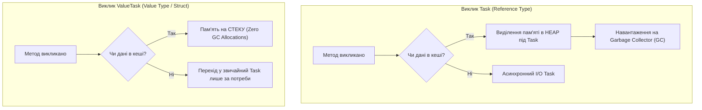

# EX_03. Типи значень, що повертаються з асинхронних методів (EX_03_async_await)

## Теоретичний огляд

В асинхронних методах C# тип повернення визначає, як викликаючий код взаємодіє з операцією.

| Тип повернення | Призначення | Чи можна викликати `await`? | Обробка помилок |
| :--- | :--- | :---: | :--- |
| **`void`** | **Лише для обробників подій (Event Handlers).** За межами подій — небезпечний антипатерн. | Ні | Не перехоплюється блоком `try/catch`. Падіння процесу. |
| **`Task`** | Для методів, які не повертають значення (асинхронний еквівалент `void`). | Так | Винятки упаковуються в `Task` і перехоплюються через `catch`. |
| **`Task<T>`** | Для методів, що повертають обчислене значення або результат I/O типу `T`. | Так | `await` автоматично повертає чистий тип `T`. |
| **`ValueTask<T>`** | Високопродуктивна структура (**struct**), призначена для усунення зайвих алокацій у GC Heap. | Так | Ідеально для методів, які часто повертають результат синхронно (наприклад, із кешу). |

---

## Візуалізація: Порівняння виділення пам'яті (Task vs ValueTask)



---

## Розбір коду: Коли використовувати async void?

Єдине легітимне використання `async void` — це підписка на подію .NET (`event`):
```csharp
// Сигнатура делегата EventHandler вимагає метод із типом повернення void:
// public delegate void EventHandler<TEventArgs>(object? sender, TEventArgs e);

account.Added += async (sender, message) => {
    await Task.Delay(100);
    Console.WriteLine(message);
};
```
У всіх інших випадках метод **завжди** повинен повертати `Task` або `Task<T>`.
