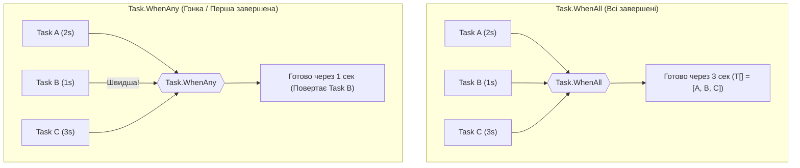

# EX_04. Комбінатори задач Task.WhenAll та Task.WhenAny (EX_04_async_await)

## Теоретичний огляд

В асинхронному програмуванні на C# є два основні комбінатори для паралельного виконання декількох завдань:

1. **`Task.WhenAll` (Логічне І / AND):**
   - Чекає, поки **всі** передані задачі перейдуть у фінальний стан (`RanToCompletion`, `Faulted` або `Canceled`).
   - Якщо задачі повертають значення (`Task<T>`), метод повертає масив значень `T[]` у тому самому порядку, в якому передавалися задачі.
2. **`Task.WhenAny` (Логічне АБО / OR):**
   - Завершується в момент, коли **хоча б одна** задача приходить першою.
   - Повертає посилання на саму першу завершену задачу `Task<Task<T>>`.
   - Застосовується в патернах:
     - **Резервування (Hedging):** відправити однаковий запит у 2 репліки сервера і взяти ту, що відповість швидше.
     - **Таймаути:** `await Task.WhenAny(operationTask, Task.Delay(timeout))` (якщо першим закінчився `Task.Delay` — стався таймаут).

---

## Візуалізація: WhenAll проти WhenAny



---

## Безпечний доступ до `task.Result`

Зазвичай звернення до `.Result` небезпечне, бо синхронно блокує потік. Проте після `await Task.WhenAll(...)` звертатися до `.Result` **безпечно**, оскільки задача гарантовано завершена:
```csharp
var taskA = SquareAsync(5);
var taskB = SquareAsync(6);

await Task.WhenAll(taskA, taskB);

// Тут .Result не викликає блокування, бо задача вже в стані RanToCompletion:
Console.WriteLine(taskA.Result); // 25
```
