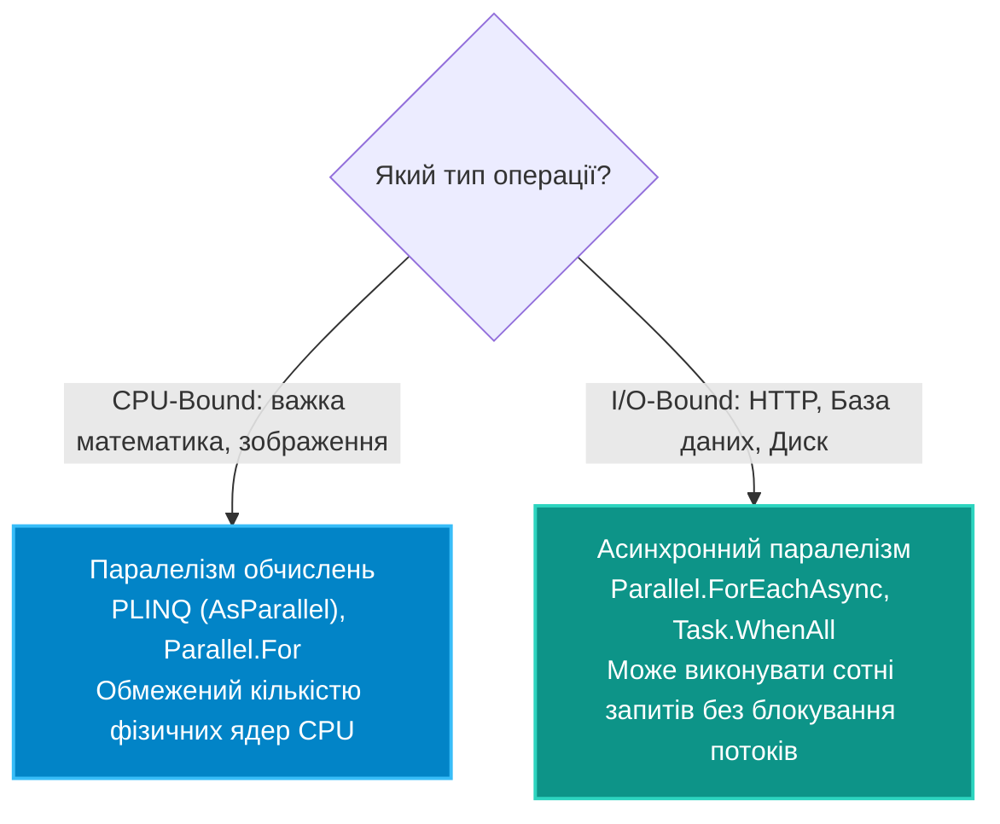
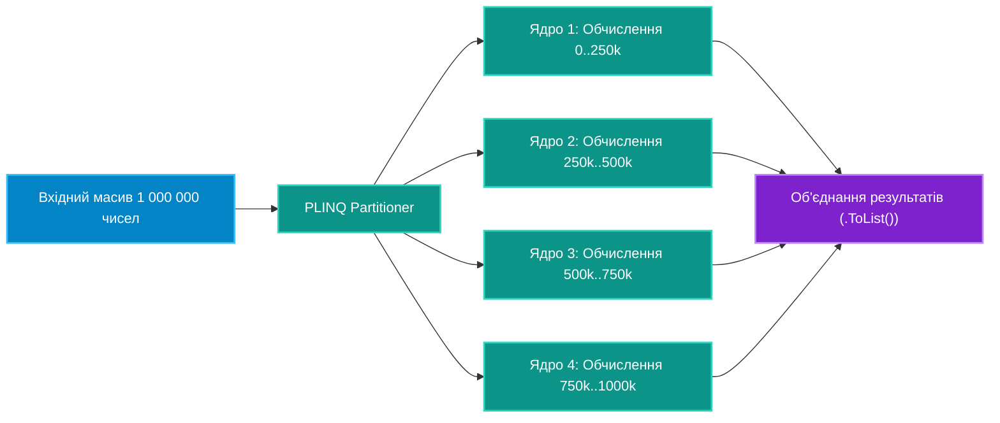

# 01. Паралелізм у .NET: `Parallel.ForEachAsync` та PLINQ

## 1. I/O-Bound Concurrency проти CPU-Bound Parallelism

У сучасній архітектурі високопродуктивних систем критично розрізняти природу паралелізму:



---

## 2. Асинхронний паралелізм через `Parallel.ForEachAsync` (.NET 6+)

До появи .NET 6 типовою помилкою було написання коду:
```csharp
// ПОГАНО: Неконтрольований спам запитів
await Task.WhenAll(urls.Select(url => httpClient.GetStringAsync(url)));
```
Якщо в списку 10 000 посилань, цей код спробує відкрити 10 000 сокетів одночасно, що призведе до вичерпання пулу портів (Socket Exhaustion) або блокування сервером.

### Рекомендоване рішення: дротелювання через `Parallel.ForEachAsync`

```csharp
var parallelOptions = new ParallelOptions
{
    MaxDegreeOfParallelism = 8, // Одночасно виконується не більше 8 асинхронних завдань
    CancellationToken = cancellationToken
};

await Parallel.ForEachAsync(urls, parallelOptions, async (url, token) =>
{
    var content = await httpClient.GetStringAsync(url, token);
    await File.WriteAllTextAsync(GetFileName(url), content, token);
});
```

---

## 3. Паралельний LINQ (PLINQ): Розбиття даних на частини (Partitioning)

PLINQ автоматично розбиває вхідну колекцію на сегменти (партиції), розподіляє їх між ядрами процесора і збирає результат в єдиний потік:



### Збереження початкового порядку через `.AsOrdered()`

За замовчуванням потоки повертають оброблені елементи в довільному порядку залежно від швидкості обчислень конкретного ядра. Якщо порядок має значення, використовується `.AsOrdered()`:

```csharp
var orderedResult = numbers.AsParallel()
    .AsOrdered() // Гарантує збереження вихідного порядку елементів
    .WithDegreeOfParallelism(Environment.ProcessorCount)
    .Where(x => IsPrime(x))
    .Select(x => HeavyTransform(x))
    .ToList();
```

---

## 4. Порівняльна таблиця засобів паралельної обробки

| Інструмент | Тип операцій | Контроль паралелізму | Збереження черги | Механізм обробки помилок |
|:---|:---|:---:|:---:|:---|
| **`Task.WhenAll`** | Тільки I/O | Відсутній (запускає все одразу) | Так | `AggregateException` або перший виняток |
| **`Parallel.ForEachAsync`** | Тільки I/O | `MaxDegreeOfParallelism` | Не гарантовано | Викидає `AggregateException` |
| **`Parallel.ForEach`** | Тільки CPU | `MaxDegreeOfParallelism` | Не гарантовано | Викидає `AggregateException` |
| **`PLINQ (AsParallel)`** | Тільки CPU | `WithDegreeOfParallelism` | Опційно (`AsOrdered`) | Агрегує всі помилки з усіх потоків |

---

## 5. Матриця проєкту цієї секції

| Проєкт | Посилання на вихідний код | Що демонструє під капотом |
|:---|:---|:---|
| [`Concurrency.ParallelAndPLINQ`](../Concurrency.ParallelAndPLINQ/Program.cs) | [Program.cs](../Concurrency.ParallelAndPLINQ/Program.cs) | Практика застосування `Parallel.ForEachAsync` з дротелюванням асинхронних операцій та прискорення важких фільтрацій за допомогою PLINQ. |
