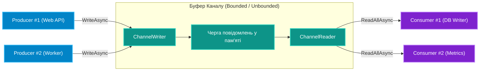

# 02. Високопродуктивні Черги з `System.Threading.Channels`

## 1. Патерн Виробник-Споживач (Producer-Consumer) та еволюція черг

У системах високого навантаження потоки генерації повідомлень (веб-запити, телеметрія, черги подій) та потоки їх обробки (запис у БД, відправка поштових сповіщень) працюють із різною швидкістю.

* У ранніх версіях .NET використовувався клас `BlockingCollection<T>`. Він блокував потоки ОС через `Monitor.Wait` / `Thread.Sleep`, що призводило до деградації пропускної здатності в сучасному асинхронному середовищі.
* Бібліотека **`System.Threading.Channels`** спеціально розроблена під `async/await` та `ValueTask`, забезпечуючи надзвичайно низьке навантаження на Garbage Collector (**Zero-Allocation** у багатьох сценаріях).

---

## 2. Архітектура та поділ відповідальностей каналу



---

## 3. Bounded проти Unbounded каналів та проблема Backpressure

1. **Unbounded Channel (`Channel.CreateUnbounded<T>()`)**:
   * Розмір черги не обмежений.
   * **Небезпека:** Якщо продюсери генерують події швидше, ніж споживачі встигають їх записувати на диск, черга розростеться до гігабайтів і викличе `OutOfMemoryException`.
2. **Bounded Channel (`Channel.CreateBounded<T>(capacity)`)**:
   * Буфер має суворо фіксовану максимальну кількість елементів.
   * Якщо буфер заповнений, вмикається механізм **зворотного тиску (Backpressure)**: метод продюсера `await channel.Writer.WriteAsync(item)` асинхронно призупиняється і чекає, поки споживач звільнить місце!

### Режими переповнення Bounded-каналу (`BoundedChannelFullMode`)

```csharp
var options = new BoundedChannelOptions(capacity: 500)
{
    // Wait: Продюсер асинхронно чекає звільнення слота (рекомендовано для надійності)
    FullMode = BoundedChannelFullMode.Wait,
    
    // Оптимізація внутрішніх замків, якщо у нас строго 1 продюсер і 1 споживач:
    SingleWriter = true,
    SingleReader = true
};

Channel<OrderEvent> channel = Channel.CreateBounded<OrderEvent>(options);
```

---

## 4. Читання через `IAsyncEnumerable<T>` та завершення `Complete()`

Споживач підписується на потік повідомлень за допомогою лаконічного синтаксису `await foreach`:

```csharp
// 1. Код Споживача (Consumer):
public static async Task ConsumeAsync(ChannelReader<OrderEvent> reader, CancellationToken ct)
{
    // Цикл автоматично завершиться, коли продюсер викличе Complete()
    await foreach (OrderEvent order in reader.ReadAllAsync(ct))
    {
        await ProcessOrderAsync(order);
    }
}

// 2. Код Продюсера (Producer):
public static async Task ProduceAsync(ChannelWriter<OrderEvent> writer)
{
    for (int i = 0; i < 100; i++)
    {
        await writer.WriteAsync(new OrderEvent(i));
    }

    // Сигналізуємо споживачам, що передачу даних успішно завершено:
    writer.Complete();
}
```

---

## 5. Порівняльна таблиця черг у .NET

| Черга | Асинхронний API | Підтримка Backpressure | Zero-Allocation | Сценарій |
|:---|:---:|:---:|:---:|:---|
| **`ConcurrentQueue<T>`** | Ні (тільки синхронний) | Ні (необмежена) | Ні | Прості безблокувальні структури даних у пам'яті |
| **`BlockingCollection<T>`** | Ні (блокує потік ОС) | Так (Bounded) | Ні | Старий синхронний код .NET Framework |
| **`System.Threading.Channels`** | **Так (`ValueTask`)** | **Так (Bounded options)** | **Так** | Сучасні мікросервіси, фонові воркери, брокери подій |

---

## 6. Матриця проєкту цієї секції

| Проєкт | Посилання на вихідний код | Що демонструє під капотом |
|:---|:---|:---|
| [`Concurrency.Channels.ProducerConsumer`](../Concurrency.Channels.ProducerConsumer/Program.cs) | [Program.cs](../Concurrency.Channels.ProducerConsumer/Program.cs) | Реалізація схеми Bounded Channel з кількома продюсерами і споживачами, демонстрація Backpressure та виклику `Complete()`. |
