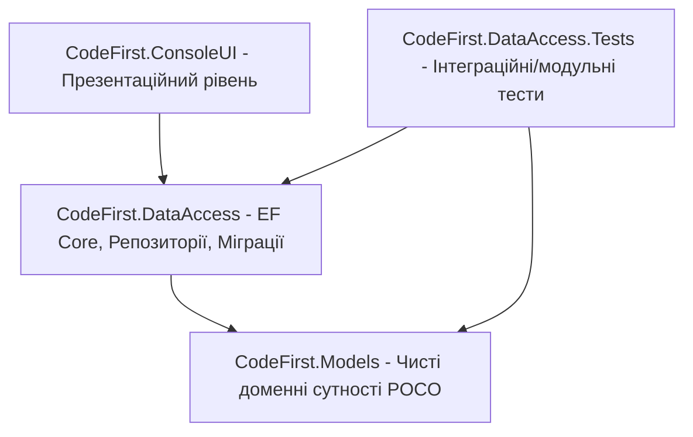
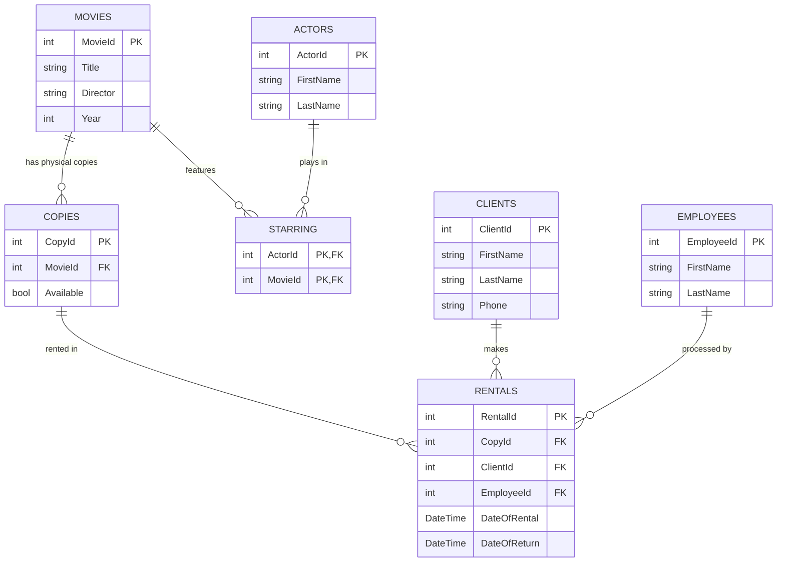

# Архітектура Entity Framework Core: Підхід Code-First та Моделі Даних

**Code-First** — це підхід до проектування баз даних, за якого розробник створює доменну модель за допомогою C# класів (POCO — Plain Old CLR Objects), а Entity Framework Core автоматично генерує схему бази даних (таблиці, колонки, зв'язки, обмеження) на основі цих класів та конфігурацій.

---

## 1. Архітектурні шари проекту

У рішенні реалізовано чітке розділення відповідальностей за принципами чистої архітектури:

- **`CodeFirst.Models`**: Доменні класи (`Actors`, `Clients`, `Copies`, `Employees`, `Movies`, `Rentals`, `Starring`). Не мають залежностей від EF Core чи зовнішніх бібліотек.
- **`CodeFirst.DataAccess`**: Контексти бази даних (`DbContext`), конфігурації Fluent API, міграції та патерн Repository.
- **`CodeFirst.ConsoleUI`**: Консольний клієнт для запуску операцій з даними.
- **`CodeFirst.DataAccess.Tests`**: NUnit-тести на операції CRUD.

---

## 2. Доменна модель: Відеопрокат (Video Rental Domain)

---

## 3. Зв'язки між сутностями

1. **Один-до-багатьох (One-to-Many):**
   - Один фільм (`Movies`) має багато фізичних копій (`Copies`).
   - Один клієнт (`Clients`) має багато оренд (`Rentals`).
2. **Багато-до-багатьох (Many-to-Many):**
   - Зв'язок між `Movies` та `Actors` реалізований через проміжну таблицю зв'язку `Starring` зі складеним первинним ключем `(ActorId, MovieId)`.
3. **Складені ключі (Composite Primary Keys):**
   - У таблиці `Rentals` або `Starring` використовуються комбінації ідентифікаторів як первинні ключі.
