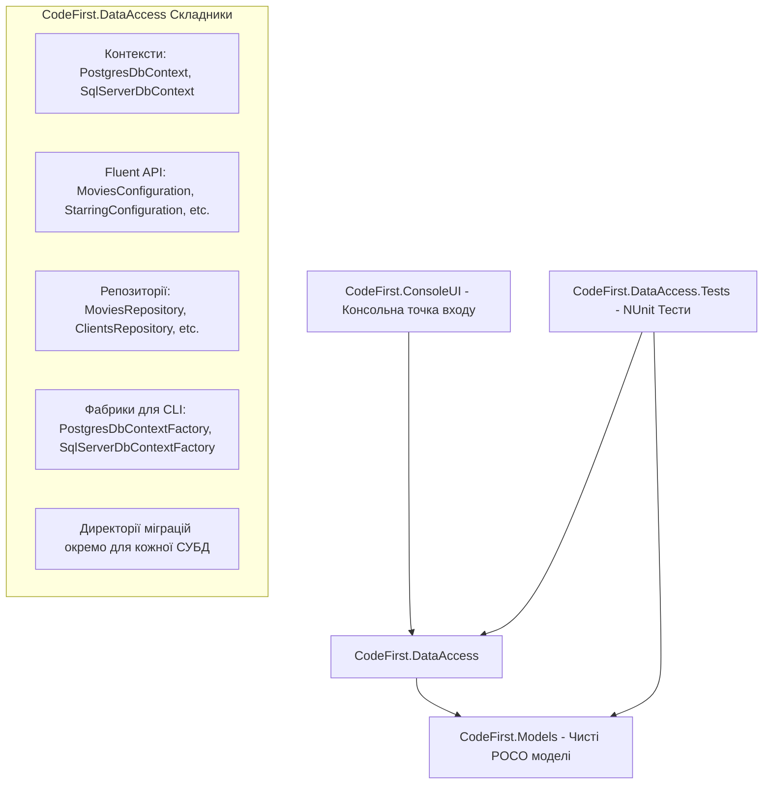

# Модуль 18: Entity Framework Core Code-First (Основи та Multi-Provider Архітектура)

Цей модуль демонструє проектування реляційних баз даних за підходом **Code-First** за допомогою Entity Framework Core, організацію чистої багатошарової архітектури, Fluent API конфігурацію та роботу з двома провайдерами СУБД: **PostgreSQL** та **Microsoft SQL Server**.

---

## 🧭 Навігація по навчальних матеріалах

1. [Архітектура EF Core: Підхід Code-First та Моделі Даних](Docs/01_EFCore_CodeFirst_Architecture_And_Models.md)
2. [Конфігурація схем за допомогою Fluent API](Docs/02_FluentAPI_And_Configurations.md)
3. [Підтримка декількох СУБД, фабрики контекстів та міграції CLI](Docs/03_Migrations_CLI_And_MultiDatabase.md)

---

## 🏛️ Архітектура рішення `CodeFirst.sln`



### Структура проектів:

| Проект | Призначення |
| :--- | :--- |
| `CodeFirst.Models` | Сутності бази даних: `Actors`, `Clients`, `Copies`, `Employees`, `Movies`, `Rentals`, `Starring`. |
| `CodeFirst.DataAccess` | `DbContext` для Postgres та MS SQL, Fluent API конфігурації, Generic Repository, міграції. |
| `CodeFirst.ConsoleUI` | Запуск демонстрації роботи контекстів і запитів. |
| `CodeFirst.DataAccess.Tests` | Модульні та інтеграційні тести операцій CRUD на базі NUnit і FluentAssertions. |

---

## 🛠️ Як зібрати та запустити

```powershell
# Збірка всього рішення
dotnet build "07-DataAccess-EFCore/01-CodeFirst-Basics/CodeFirst.sln" -c Release

# Запуск консольного додатку
dotnet run --project "07-DataAccess-EFCore/01-CodeFirst-Basics/CodeFirst.ConsoleUI/CodeFirst.ConsoleUI.csproj"

# Запуск модульних тестів
dotnet test "07-DataAccess-EFCore/01-CodeFirst-Basics/CodeFirst.DataAccess.Tests/CodeFirst.DataAccess.Tests.csproj"
```
