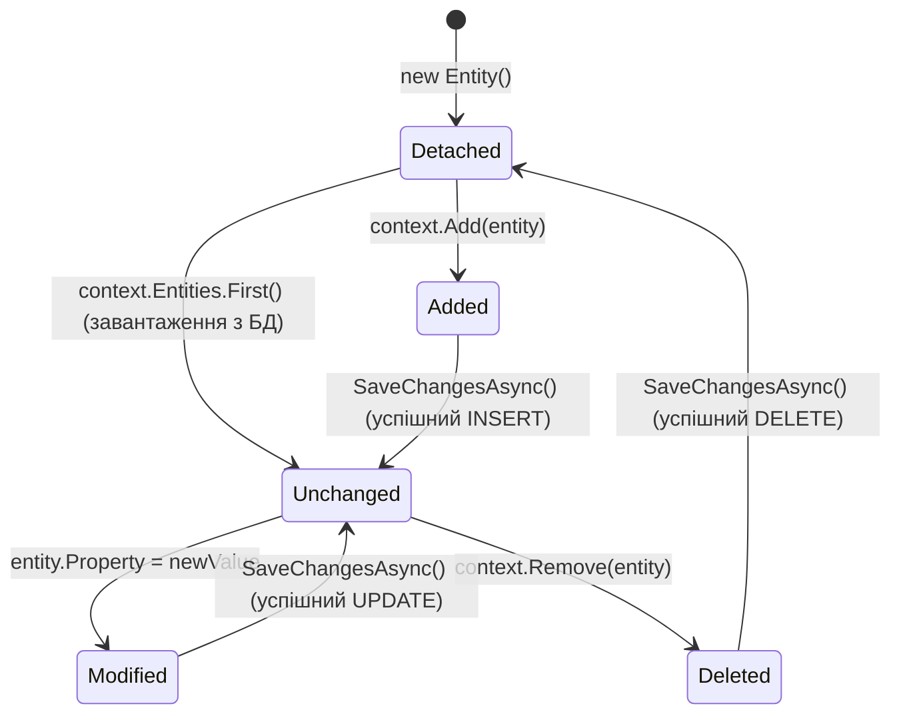

# 01. Життєвий цикл DbContext, операції CRUD та ChangeTracker

## 1. Патерни Unit of Work та Repository в архітектурі EF Core

Клас **`DbContext`** у Entity Framework Core є вбудованою комбінацією двох класичних патернів проєктування:
1. **Repository (Репозиторій)** — кожна властивість `DbSet<TEntity>` виступає як типізована колекція в пам'яті, що приховує деталі SQL-запитів.
2. **Unit of Work (Одиниця роботи)** — сам екземпляр `DbContext` відстежує всі модифікації, додавання та видалення сутностей, і зберігає їх в єдиній атомарній транзакції при виклику `SaveChanges()` / `SaveChangesAsync()`.

---

## 2. Діаграма переходів станів сутності в `ChangeTracker`

Внутрішній компонент **`ChangeTracker`** підтримує метадані для кожної відстежуваної сутності у вигляді структури **`EntityEntry`**, що має один із 5 канонічних станів:



---

## 3. Детальний розбір станів сутності (`EntityState`)

| Стан (`EntityState`) | Опис у пам'яті | SQL дія при `SaveChangesAsync()` |
|:---|:---|:---|
| **`Detached`** | Сутність існує в CLR, але контекст про неї не знає | Ніякої дії |
| **`Added`** | Зареєстрована для створення, первинний ключ може бути тимчасовим | Генерує команду `INSERT INTO ...` |
| **`Unchanged`** | Завантажена з БД, жодне поле не змінювалося з моменту зчитування | Ніякої дії (пропускається для економії I/O) |
| **`Modified`** | Змінено значення хоча б однієї скалярної властивості | Генерує команду `UPDATE ... WHERE Id = @id` лише для змінених стовпців |
| **`Deleted`** | Позначена для видалення | Генерує команду `DELETE FROM ... WHERE Id = @id` |

---

## 4. Порівняння: Пакетні операції (Batching) проти одиничних запитів

У наївних ORM кожен виклик збереження провокував окреме мережеве звернення. EF Core автоматично об'єднує декілька команд в один пакет (**SQL Batch**):

```csharp
// ДОБРЕ: Атомарна транзакція та єдиний пакетний запит (Batching)
using var context = new StoreDbContext();

for (int i = 0; i < 50; i++)
{
    context.Products.Add(new Product { Title = $"Товар #{i}", Price = 100 + i });
}

// Усі 50 записів надсилаються в БД ОДНИМ мережевим пакетом:
await context.SaveChangesAsync();
```

### Ручне керування станом без попереднього запиту (Disconnect Scenario)

Коли об'єкт приходить іззовні (наприклад, з JSON у веб-запиті), немає потреби завантажувати його з бази для оновлення одного поля:

```csharp
var product = new Product { Id = 42, Price = 199.99m };

// Прив'язуємо сутність до контексту без запиту SELECT:
context.Attach(product);

// Позначаємо конкретне поле як модифіковане:
context.Entry(product).Property(p => p.Price).IsModified = true;

// Згенерований SQL: UPDATE Products SET Price = 199.99 WHERE Id = 42;
await context.SaveChangesAsync();
```

---

## 5. Порівняльна таблиця операцій оновлення даних

| Підхід | Кількість SQL-запитів | Навантаження на пам'ять | Безпека бізнес-правил |
|:---|:---:|:---|:---|
| **Класичний Read-then-Update** | 2 (`SELECT` + `UPDATE`) | Вимагає створення знімка сутності | Найвища: перевіряються всі інваріанти |
| **Attach + IsModified** | 1 (`UPDATE`) | Мінімальне: зчитування з БД відсутнє | Висока: оновлюються лише обрані поля |
| **ExecuteUpdateAsync (.NET 7+)** | 1 (`UPDATE` безпосередньо в БД) | Нульове: об'єкти не завантажуються в пам'ять | Потребує обережності: оминає ChangeTracker |

---

## 6. Матриця проєкту цієї секції

| Проєкт | Посилання на вихідний код | Що демонструє під капотом |
|:---|:---|:---|
| [`01-DbContextCrudAndChangeTracker`](../01-DbContextCrudAndChangeTracker/Program.cs) | [Program.cs](../01-DbContextCrudAndChangeTracker/Program.cs) | Практика CRUD-операцій, інспекція станів `EntityEntry.State`, порівняння знімків пам'яті до та після виклику `SaveChangesAsync()`. |
