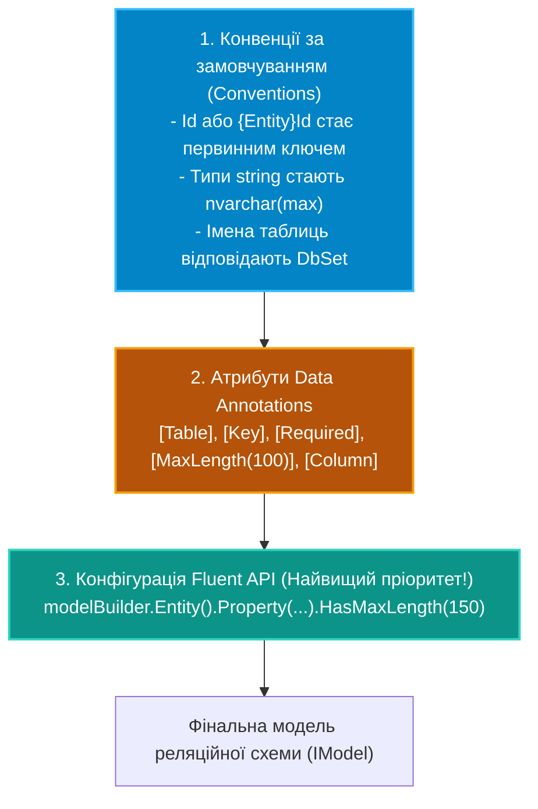

# 02. Моделювання сутностей: DataAnnotations та Fluent API

## 1. Конфігураційні рівні метаданих у EF Core

Entity Framework Core будує внутрішню реляційну модель бази даних (**`IModel`**), використовуючи суворий трирівневий пріоритет:



---

## 2. Fluent API: Розділення конфігурацій через `IEntityTypeConfiguration<T>`

Розміщення сотень рядків конфігурацій прямо всередині `OnModelCreating` роздуває контекст до непідтримуваних розмірів. Найкраща архітектурна практика полягає у винесенні конфігурації кожної сутності в окремий клас:

```csharp
public class OrderConfiguration : IEntityTypeConfiguration<Order>
{
    public void Configure(EntityTypeBuilder<Order> builder)
    {
        builder.ToTable("tbl_orders", schema: "sales");

        builder.HasKey(o => o.Id);

        builder.Property(o => o.OrderNumber)
            .IsRequired()
            .HasMaxLength(32)
            .IsUnicode(false); // VARCHAR замість NVARCHAR для оптимізації розміру індексу

        builder.Property(o => o.TotalAmount)
            .HasPrecision(18, 2); // Запобігає обрізанню фінансових даних

        // Створення унікального композитного індексу:
        builder.HasIndex(o => new { o.CustomerId, o.OrderNumber }).IsUnique();
    }
}

// Автоматична реєстрація всіх конфігурацій із поточної збірки в DbContext:
protected override void OnModelCreating(ModelBuilder modelBuilder)
{
    base.OnModelCreating(modelBuilder);
    modelBuilder.ApplyConfigurationsFromAssembly(typeof(StoreDbContext).Assembly);
}
```

---

## 3. Розширені можливості: Тіньові властивості та Конвертери значень

### Тіньові властивості (Shadow Properties)
Тіньові властивості — це стовпці в базі даних, яких фізично немає у C# класі сутності. Вони ідеально підходять для службових полів аудиту:

```csharp
// Реєстрація тіньових властивостей у Fluent API:
builder.Property<DateTime>("CreatedAt").HasDefaultValueSql("GETUTCDATE()");
builder.Property<string>("LastModifiedBy").HasMaxLength(50);

// Читання або запис тіньової властивості через Entry:
context.Entry(order).Property("LastModifiedBy").CurrentValue = "admin";
```

### Конвертери значень (Value Converters)
Дозволяють прозоро трансформувати типи між C# та базою даних (наприклад, зберігати `Enum` як зрозумілий рядок або серіалізувати об'єкт у JSON-колонку):

```csharp
builder.Property(o => o.Status)
    .HasConversion<string>() // У базі буде 'Delivered', 'Pending', а не 0, 1
    .HasMaxLength(20);
```

---

## 4. Порівняння: Data Annotations проти Fluent API

| Критерій | Data Annotations | Fluent API |
|:---|:---|:---|
| **Чистота доменної моделі (POCO)** | Порушується: сутність залежить від атрибутів БД | 100% чистий C# клас без жодних інфраструктурних залежностей |
| **Потужність налаштувань** | Базова (лише прості обмеження) | Повна (індекси, фільтри, тіньові поля, конвертери) |
| **Композитні ключі та індекси** | Обмежено | Повна підтримка будь-яких складених структур |
| **Зручність читання** | Атрибути прямо над полями | Відокремлено у файлах `EntityTypeConfiguration` |

---

## 5. Матриця проєкту цієї секції

| Проєкт | Посилання на вихідний код | Що демонструє під капотом |
|:---|:---|:---|
| [`02-EntityModelingAnnotationsAndFluentApi`](../02-EntityModelingAnnotationsAndFluentApi/Program.cs) | [Program.cs](../02-EntityModelingAnnotationsAndFluentApi/Program.cs) | Застосування Fluent API, створення таблиць із кастомними типами, конфігурація `HasPrecision`, індекси та тіньові поля. |
