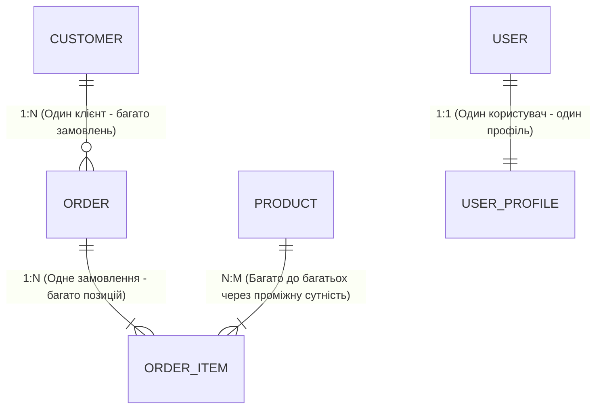

# 03. Зв'язки між сутностями (1:1, 1:N, N:M) та стратегії завантаження даних

## 1. Реляційні зв'язки в Entity Framework Core

У сучасних застосунках сутності пов'язані між собою через навігаційні властивості. EF Core підтримує всі типи реляційних взаємодій:



### Конфігурація зв'язків у Fluent API

* **Один до багатьох (1:N)**:
```csharp
builder.HasOne(o => o.Customer)
    .WithMany(c => c.Orders)
    .HasForeignKey(o => o.CustomerId)
    .OnDelete(DeleteBehavior.Restrict); // Забороняє видалення клієнта з активними замовленнями
```

* **Багато до багатьох (N:M)**:
Починаючи з EF Core 5+, якщо проміжній таблиці не потрібні додаткові колонки, зв'язок налаштовується автоматично:
```csharp
builder.HasMany(p => p.Tags).WithMany(t => t.Posts);
```
Якщо ж у проміжній таблиці потрібні додаткові атрибути (наприклад, `Quantity`, `UnitPrice`), створюється явна проміжна сутність `OrderItem`.

---

## 2. Стратегії завантаження пов'язаних даних

| Стратегія | Метод виклику | Кількість SQL-запитів | Переваги та ризики |
|:---|:---|:---:|:---|
| **Eager Loading (Жадібне)** | `.Include(o => o.Items).ThenInclude(i => i.Product)` | 1 (JOIN) або декілька (зі Split Query) | Дані готові відразу. Ризик декартового вибуху при багатьох колекціях. |
| **Explicit Loading (Явне)** | `context.Entry(order).Collection(o => o.Items).LoadAsync()` | Окремий SELECT за вимогою | Повний контроль: запит робиться лише тоді, коли дані дійсно потрібні. |
| **Lazy Loading (Ліниве)** | Автоматично при зверненні до `virtual` властивості | $1 + N$ запитів | Зручно, але є головною причиною катастрофічного падіння продуктивності. |

---

## 3. Декартовий добуток (Cartesian Explosion) та `AsSplitQuery()`

При жадібному завантаженні декількох колекцій через `Include` реляційна база даних виконує `LEFT JOIN`. Якщо у замовлення є 10 товарів і 5 платежів, СУБД поверне $10 \times 5 = 50$ рядків, у кожному з яких дані батьківського замовлення багаторазово дублюються, навантажуючи пам'ять і мережу.

Для вирішення цієї проблеми в EF Core введено метод **`AsSplitQuery()`**:

```csharp
// Замість одного велетенського JOIN, що генерує декартовий добуток:
var detailedOrders = await context.Orders
    .Include(o => o.Customer)
    .Include(o => o.Items)
    .ThenInclude(i => i.Product)
    .AsSplitQuery() // Генерує окремі оптимізовані SELECT для кожної колекції
    .ToListAsync();
```

---

## 4. Поведінка каскадного видалення (`DeleteBehavior`)

| Режим (`DeleteBehavior`) | Поведінка при видаленні головного запису (Principal) |
|:---|:---|
| **`Cascade`** | Автоматично видаляє всі пов'язані дочірні рядки (наприклад, видалення замовлення видаляє всі його позиції `OrderItems`). |
| **`Restrict`** | Забороняє видалення батьківського запису, якщо на нього посилаються дочірні (викидає `DbUpdateException`). |
| **`SetNull`** | Встановлює зовнішній ключ `Foreign Key` у значення `NULL` (вимагає nullable-поля). |
| **`ClientCascade`** | Каскад виконується лише для тих сутностей, які вже завантажені в пам'ять `ChangeTracker`. |

---

## 5. Матриця проєкту цієї секції

| Проєкт | Посилання на вихідний код | Що демонструє під капотом |
|:---|:---|:---|
| [`03-RelationshipsAndLoadingStrategies`](../03-RelationshipsAndLoadingStrategies/Program.cs) | [Program.cs](../03-RelationshipsAndLoadingStrategies/Program.cs) | Конфігурація 1:1, 1:N та N:M зв'язків, тестування `DeleteBehavior.Cascade` проти `Restrict`, порівняння профілів виконання `Include` та `AsSplitQuery`. |
