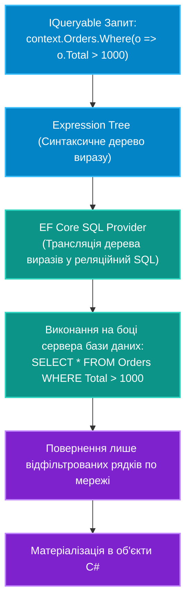

# 04. LINQ to Entities: Трансляція запитів, Проєкції та Оптимізація Відстеження

## 1. Архітектура виконання `IQueryable` проти `IEnumerable`

Фундаментальна різниця між `IEnumerable<T>` та `IQueryable<T>` полягає у місці та часі виконання коду:



Якщо помилково викликати `.AsEnumerable()` або `.ToList()` перед фільтрацією, вся таблиця з мільйонами рядків буде завантажена в оперативну пам'ять процесу, викликавши витік пам'яті (OutOfMemory).

---

## 2. Відстеження змін проти `AsNoTracking()`

За замовчуванням усі сутності, завантажені через `IQueryable`, реєструються у `ChangeTracker`. Для цього EF Core:
1. Зберігає оригінальний знімок усіх полів сутності.
2. Під час `SaveChanges` перевіряє кожен об'єкт методом `DetectChanges()`.

Якщо дані потрібні **лише для відображення** (read-only запити в API, генерація звітів, експорт у таблиці), відстеження слід вимикати:

```csharp
// Прискорення запиту в 2-3 рази та нульові витрати пам'яті на ChangeTracker:
var reportData = await context.Products
    .AsNoTracking()
    .Where(p => p.IsActive)
    .ToListAsync();
```

---

## 3. Проєкції (Projections) через `Select`: Завантаження лише потрібних стовпців

Замість вибору всіх стовпців сутності (`SELECT *`), оператор `Select` формує SQL-запит, який вибирає лише зазначені стовпці:

```csharp
// Генерує: SELECT Id, Title, Price FROM Products WHERE Price > 500
var productCards = await context.Products
    .Where(p => p.Price > 500)
    .Select(p => new ProductCardDto(p.Id, p.Title, p.Price))
    .ToListAsync();
```

При використанні проєкцій `Select` у DTO метод `AsNoTracking()` застосовується автоматично, оскільки DTO не є сутностями контексту.

---

## 4. Пагінація: Ефективний `Skip` та `Take`

Для безпечної роботи з великими таблицями обов'язково застосовується постранична вибірка (Pagination):

```csharp
int pageNumber = 2;
int pageSize = 20;

var pagedOrders = await context.Orders
    .OrderByDescending(o => o.CreatedAt) // Сортування є обов'язковим для пагінації!
    .Skip((pageNumber - 1) * pageSize)
    .Take(pageSize)
    .AsNoTracking()
    .ToListAsync();
```

---

## 5. Порівняльна таблиця стратегій читання даних

| Стратегія | Швидкість | Використання пам'яті | Чи можна викликати `SaveChanges()`? | Сценарій |
|:---|:---:|:---:|:---:|:---|
| **Tracking Query (Default)** | Стандартна | Висока (знімки в ChangeTracker) | Так, повна підтримка | Редагування даних у формах |
| **`AsNoTracking()`** | У 2-3 рази швидше | Низька (без знімків) | Ні | Read-only API ендпоінти, каталоги |
| **`AsNoTrackingWithIdentityResolution()`** | Висока | Середня (дедуплікація екземплярів) | Ні | Read-only запити з повторюваними зв'язками |
| **DTO Projection (`.Select`)** | Максимальна | Мінімальна (лише вибрані поля) | Ні | Списки, дашборди, зведені звіти |

---

## 6. Матриця проєкту цієї секції

| Проєкт | Посилання на вихідний код | Що демонструє під капотом |
|:---|:---|:---|
| [`04-LinqToEntitiesQueriesAndTracking`](../04-LinqToEntitiesQueriesAndTracking/Program.cs) | [Program.cs](../04-LinqToEntitiesQueriesAndTracking/Program.cs) | Порівняння продуктивності Tracking проти `AsNoTracking()`, генерація компактного SQL через проєкції та організація безпечної пагінації. |
